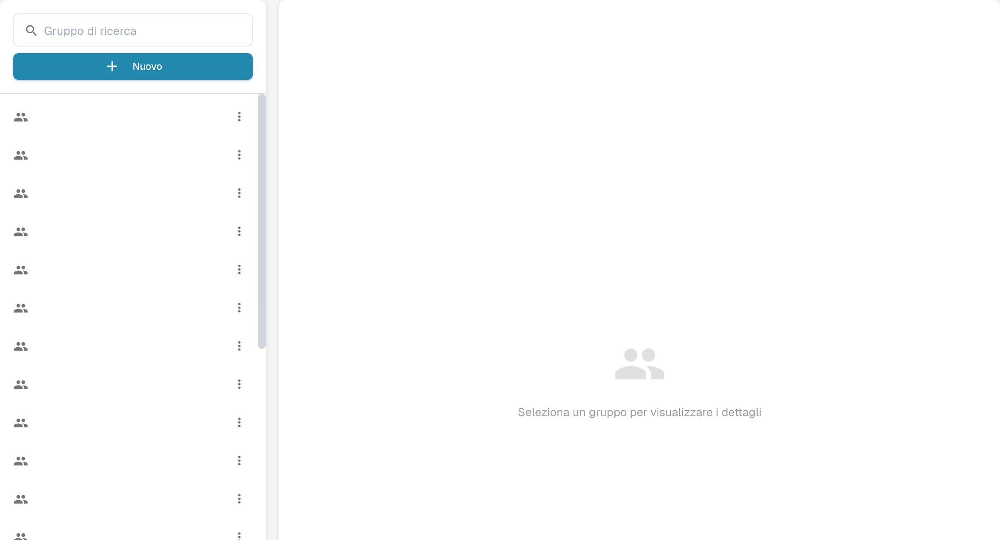

# Gruppi, Utenti e Autorizzazioni

Queste impostazioni rispondono a tre domande diverse: chi può accedere, in quale sotto-organizzazione lavora e che cosa può fare il suo gruppo.

| Se devi… | Apri… |
| --- | --- |
| Aggiungere o modificare l'account di una persona | **Impostazioni** → **Utenti**; poi leggi [Utenti](users/README.md). |
| Organizzare l'accesso tra le unità dell'azienda | **Impostazioni** → **Sotto-organizzazioni**; poi leggi [Sotto-organizzazioni](sub-organizations/README.md). |
| Controllare l'accesso per gruppo | **Impostazioni** → **Gruppi e autorizzazioni**; poi leggi [Gruppi e Autorizzazioni](groups-and-permissions/README.md). |

<figure><figcaption>
Pannello di selezione dei gruppi.
</figcaption></figure>

Se un utente non riesce a vedere un documento o un'azione, controlla prima il suo account e la sua organizzazione. Poi controlla le autorizzazioni del gruppo pertinente. Usa un account di test non amministratore per verificare l'accesso che avrà realmente un utente normale prima di modificare un'organizzazione in produzione.
