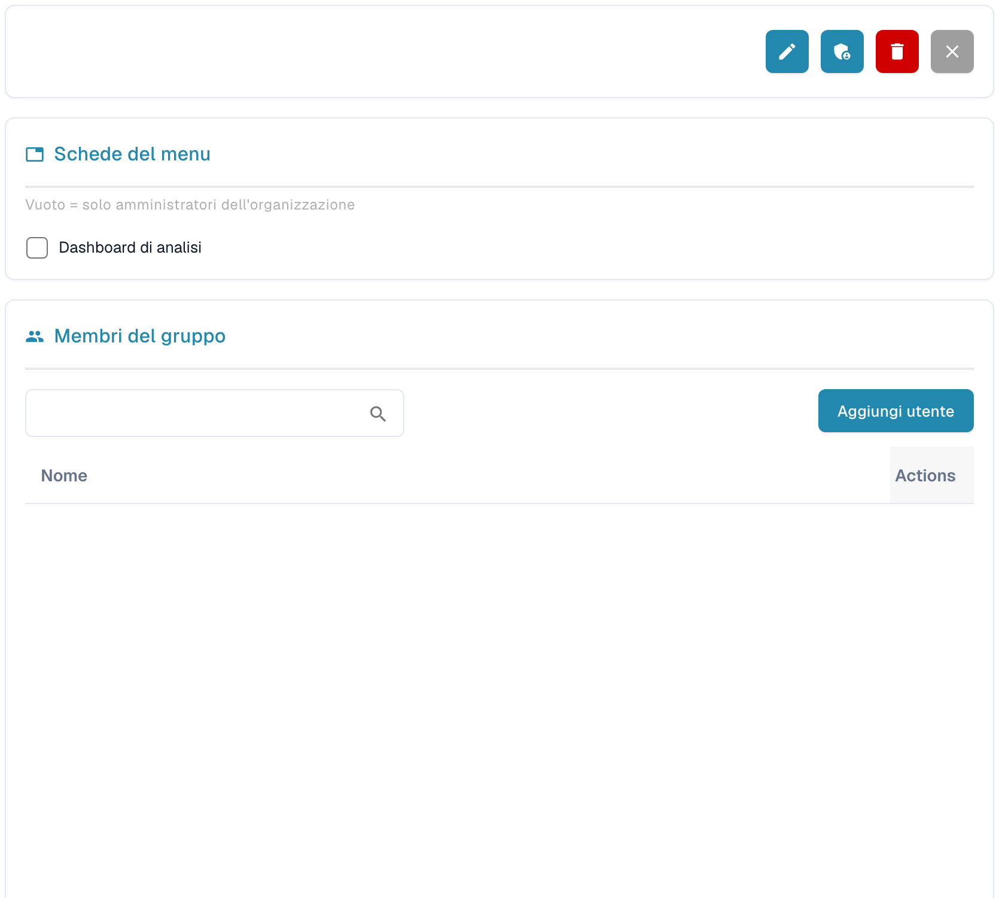

# Gruppi e Autorizzazioni


DocBits Tutorial su gruppi e autorizzazioni: imposta ruoli utente, diritti di accesso e proteggi il tuo spazio di lavoro


<figure><figcaption>
Dettagli del gruppo selezionato; i dati personali sono nascosti.
</figcaption></figure>

Gruppi e Autorizzazioni ti permettono di controllare quali utenti possono accedere a specifici tipi di documento e quali azioni possono eseguire.

## Attivare/Disattivare Gruppi e Autorizzazioni

Usa l'interruttore in alto nella pagina per abilitare o disabilitare il sistema di gruppi e autorizzazioni. Quando è disabilitato, il sistema usa un modello di accesso più semplice, senza restrizioni basate sui gruppi.

## Elenco dei Gruppi

La tabella mostra tutti i gruppi configurati con:

| Colonna | Descrizione |
|--------|-------------|
| **Nome del gruppo** | Il nome del gruppo. |
| **Descrizione del gruppo** | Una breve descrizione dello scopo del gruppo. |
| **Azioni** | Menu con le opzioni per modificare o eliminare il gruppo. |

Usa la barra **Ricerca** per cercare i gruppi per nome. Clicca su **+ New** per creare un nuovo gruppo.

## Configurazione delle Autorizzazioni del Gruppo

Quando selezioni un gruppo (tramite il menu Actions → Edit), compare una tabella delle autorizzazioni in cui puoi configurare l'accesso per tipo di documento:

| Autorizzazione | Descrizione |
|------------|-------------|
| **Vista** | Autorizzazione a vedere i documenti di questo tipo. |
| **Aggiornamento** | Autorizzazione a modificare i documenti di questo tipo. |
| **Cancellare** | Autorizzazione a rimuovere i documenti di questo tipo. |
| **Prima approvazione** | Autorizzazione a eseguire l'approvazione iniziale. |
| **Seconda approvazione** | Autorizzazione a eseguire un livello di approvazione secondario (se applicabile). |

Ogni riga della tabella delle autorizzazioni rappresenta un tipo di documento (ad es. Fattura, Nota di credito, Bolla di consegna). Seleziona o deseleziona le caselle per concedere o revocare le autorizzazioni a quel gruppo.

## Creazione di un Nuovo Gruppo

1. Clicca su **+ New** in alto a destra.
2. Inserisci un **Nome del gruppo** e, facoltativamente, una **Descrizione**.
3. Configura le autorizzazioni per ogni tipo di documento.
4. Assegna gli utenti al gruppo.
5. Clicca su **Salva** per applicare.
