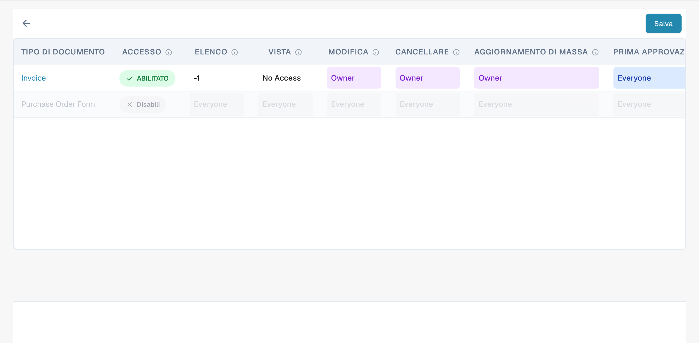
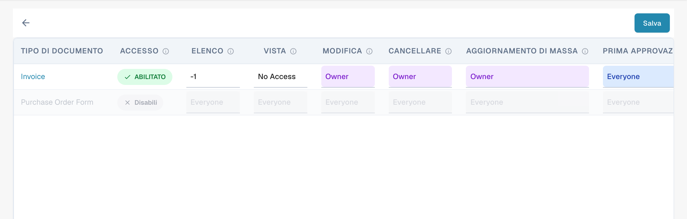

# Attivazione dei Permessi


DocBits Groups & Permissions Tutorial: Set User Roles, Access Rights & Secure Your Workspace


Abilitare o disabilitare il sistema di permessi utilizzando l'interruttore ha vari effetti sulla funzionalità in DocBits.

## **Abilitazione del sistema di permessi:**

<figure><figcaption>
Selezione di un gruppo per consultarne le autorizzazioni.
</figcaption></figure>

* Quando il sistema di permessi è abilitato, vengono applicati i permessi di accesso per utenti e gruppi.
* Gli utenti hanno accesso solo alle risorse a cui sono esplicitamente autorizzati ad accedere in base ai permessi assegnati.
* Gli amministratori possono gestire i permessi per singoli utenti e gruppi e garantire che solo le persone autorizzate possano visualizzare o modificare i dati.

<figure><figcaption>
Matrice delle autorizzazioni per tipo di documento e azione. I livelli Owner, Everyone e No Access restano in inglese.
</figcaption></figure>

## Only Assigned Documents

<figure><figcaption>
Livelli di accesso per azione nella matrice delle autorizzazioni. I livelli Owner, Everyone e No Access restano in inglese.
</figcaption></figure>

L'interruttore **Solo i documenti assegnati** controlla la visibilità dei documenti per gli utenti in base alle loro assegnazioni ai gruppi. Quando è attivo, gli utenti possono vedere solo i documenti assegnati specificamente a loro o a un gruppo di cui fanno parte. Quando è disattivo, gli utenti con il permesso di visualizzazione appropriato possono vedere tutti i documenti, indipendentemente dall'assegnazione.

#### Funzionamento

* **Stato disattivato (predefinito)**:
  * Quando l'interruttore è disattivato, gli utenti che fanno parte di un gruppo possono vedere tutti i documenti se hanno il permesso di visualizzazione appropriato. L'assegnazione dei documenti non influisce sulla visibilità.
* **Stato attivato**:
  * Quando l'interruttore è attivato, gli utenti possono vedere solo i documenti assegnati esplicitamente a loro o a un gruppo di cui fanno parte. Questo impone una visibilità dei documenti più restrittiva, basata sulle assegnazioni ai gruppi.

#### Scenario di esempio

1. **Predefinito (stato disattivato)**:
   * Un utente che fa parte del gruppo "Sales" può vedere tutti i documenti del sistema che ha il permesso di visualizzare, anche se non sono assegnati a lui.
2. **Attivato (stato attivato)**:
   * Un utente del gruppo "Sales" può vedere solo i documenti assegnati a lui o al gruppo "Sales", il che limita l'accesso ai documenti al di fuori delle sue assegnazioni.

## Disabilitazione del sistema di permessi:

<figure><figcaption>
Comando per attivare la gestione delle autorizzazioni.
</figcaption></figure>

* Quando il sistema di permessi è disabilitato, tutti i permessi di accesso vengono rimossi e gli utenti hanno tipicamente accesso illimitato a tutte le risorse.
* Questo può essere utile quando è necessaria una collaborazione aperta temporanea senza le restrizioni del controllo degli accessi.
* Tuttavia, potrebbe esserci un rischio maggiore di fuga di dati o accesso non autorizzato poiché gli utenti potrebbero essere in grado di accedere a informazioni sensibili a cui non sono autorizzati ad accedere.

Abilitare o disabilitare il sistema di permessi è una decisione importante basata sui requisiti di sicurezza e sul modo in cui l'organizzazione opera. In ambienti in cui la privacy e il controllo degli accessi sono critici, è comune lasciare abilitato il sistema di permessi per garantire l'integrità e la riservatezza dei dati. In altri casi, disabilitare il sistema di permessi può essere temporaneamente necessario per facilitare la collaborazione, ma dovrebbe essere utilizzato con cautela per ridurre al minimo i potenziali rischi per la sicurezza.

L’interfaccia attuale usa una matrice delle autorizzazioni per tipo di documento e azione. Alcuni livelli di accesso possono restare in inglese. Le istruzioni sul vecchio interruttore Only Assigned Documents valgono solo per le versioni che lo offrono.
