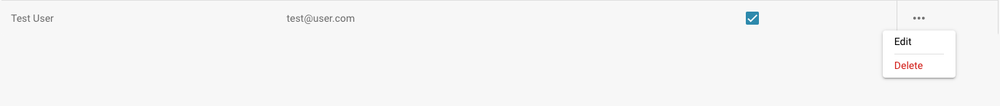

# Modifica dei Dettagli Utente

<figure><figcaption>
Impostazioni utente
</figcaption></figure>

* **Accesso come amministratore:** Accedi con i tuoi privilegi di amministratore.
* **Accesso alla gestione utenti:** Naviga nelle impostazioni utente dove puoi modificare gli utenti esistenti.
* **Selezione degli utenti:** Trova e seleziona l'utente i cui dettagli desideri modificare. Questo può essere fatto cliccando sul nome utente o su un pulsante di modifica accanto all'utente.

<figure><figcaption></figcaption></figure>

*   **Modifica dei dettagli utente:** Apparirà un modulo contenente i dettagli attuali dell'utente. Modifica i campi richiesti secondo le modifiche che desideri apportare. I dettagli tipici da modificare includono:

    * Nome e cognome
    * Indirizzo email
    * Ruolo utente o livello di autorizzazione

    <figure><figcaption></figcaption></figure>
* **Salvataggio delle Modifiche:** Rivedi eventuali modifiche apportate e clicca su Save per salvare i nuovi dettagli dell'utente.

<figure><figcaption></figcaption></figure>

* **Rivedi l'impatto delle modifiche di ruolo:** Se hai cambiato il ruolo utente, rivedi l'impatto di quella modifica sui livelli di accesso alla sicurezza. Assicurati che dopo il cambiamento di ruolo, l'utente abbia le autorizzazioni necessarie per continuare a svolgere i propri compiti.
* **Invia notifica (opzionale):** Puoi inviare una notifica all'utente per informarlo delle modifiche apportate.

Dopo aver completato questi passaggi, i dettagli dell'utente sono stati aggiornati con successo e l'utente ha le nuove informazioni e autorizzazioni secondo le modifiche apportate.

## Rimozione degli Utenti:

* **Selezione degli Utenti:** Trova e seleziona l'utente di cui desideri rimuovere l'accesso. Questo può essere fatto cliccando sul nome utente o su un pulsante di modifica accanto all'utente.

<figure><figcaption></figcaption></figure>

* **Rimozione dell'Accesso:** Clicca su "delete" per rimuovere l'utente.

<figure><figcaption></figcaption></figure>

* **Conferma:** Ti verrà chiesto di confermare la rimozione dell'utente.

<figure><figcaption></figcaption></figure>

* **Notifica Opzionale:** Puoi inviare opzionalmente una notifica all'utente per informarlo della rimozione del suo accesso.
* **Rivedi Compiti e Documenti:** Prima di rimuovere l'utente, rivedi quali compiti o documenti sono assegnati all'utente. Sposta o trasferisci la responsabilità per quei compiti o documenti a un altro utente per assicurarti che nulla venga perso o lasciato incompleto.
* **Salva Modifiche:** Conferma la rimozione dell'utente e salva le modifiche.

Seguendo questi passaggi, puoi assicurarti che l'accesso dell'utente venga rimosso in modo sicuro mentre gestisci correttamente tutti i compiti e documenti pertinenti.
