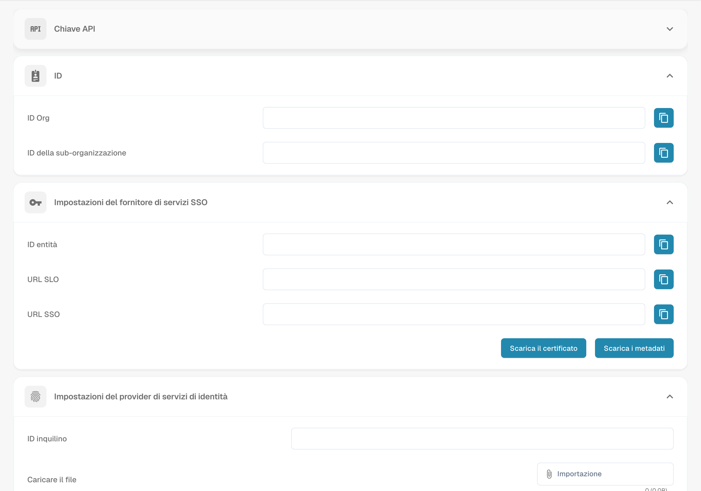

# Integrazione e SSO

<figure><figcaption>
Configurazione dell’integrazione e dei provider SSO.
</figcaption></figure>

La pagina Integration & SSO gestisce le chiavi API per l'accesso programmatico, gli ID dell'organizzazione e la configurazione del Single Sign-On (SSO).

## Chiave API

Gestisci le chiavi API utilizzate per l'accesso programmatico a DocBits.

| Colonna | Descrizione |
|--------|-------------|
| **Chiave** | Il valore mascherato della chiave API. Clicca sull'icona di copia per copiare la chiave completa. |
| **Nome** | Un nome descrittivo per la chiave. |
| **Scade** | Data di scadenza (oppure "Never"). |
| **Ultimo utilizzo** | Quando la chiave è stata usata l'ultima volta. |
| **Stato** | Active o Inactive. |
| **Azioni** | Menu a tre punti per revocare o eliminare. |

Clicca su **+ Create API Key** per generare una nuova chiave.

## ID

Mostra gli identificatori della tua organizzazione:

| Campo | Descrizione |
|-------|-------------|
| **ID Org** | L'identificatore univoco della tua organizzazione. |
| **ID della sub-organizzazione** | L'ID della sotto-organizzazione attualmente selezionata. |

## Impostazioni del fornitore di servizi SSO

I valori di configurazione SSO di DocBits necessari per configurare il tuo Identity Provider:

| Campo | Descrizione |
|-------|-------------|
| **ID entità** | L'URL dei metadati SAML di DocBits. |
| **SLO URL** | L'URL di Single Logout. |
| **SSO URL** | L'URL dell'Assertion Consumer Service. |

Puoi anche usare **Scarica il certificato** e **Scarica i metadati** per la configurazione del tuo IdP.

## Impostazioni del fornitore di servizi di identità

Configura il tuo Identity Provider (IdP) esterno:

| Campo | Descrizione |
|-------|-------------|
| **ID tenant** | L'identificatore del tenant del tuo IdP. |
| **Caricare il file** | Carica il file XML dei metadati del tuo IdP. |

Clicca su **Configurare** per salvare le impostazioni del tuo IdP.

* **Maggiore efficienza:** L'integrazione con altri strumenti e servizi può semplificare i flussi di lavoro e aumentare l'efficienza. Ad esempio, i documenti possono essere scambiati automaticamente tra Docbits e un sistema CRM, riducendo l'inserimento manuale e aumentando la produttività
* **Coerenza dei dati:** L'integrazione permette ai dati di essere scambiati senza interruzioni tra sistemi diversi, migliorando la coerenza e l'accuratezza dei dati. Questo evita incoerenze o doppi inserimenti di dati che potrebbero causare errori.
* **Aggiornamenti in tempo reale**: L'integrazione consente aggiornamenti in tempo reale tra piattaforme diverse, in modo che gli utenti abbiano sempre le informazioni più recenti. Questo è particolarmente importante per i processi aziendali critici che richiedono informazioni in tempo reale.
* **Automazione delle attività:** L'integrazione permette di automatizzare le attività di routine, risparmiando tempo e risorse. Ad esempio, le notifiche possono essere attivate automaticamente quando si verifica un determinato evento in un altro sistema, senza bisogno di intervento manuale.
* **Migliore esperienza utente:** Un'integrazione configurata correttamente garantisce un'esperienza utente fluida, perché gli utenti non devono passare da un sistema all'altro per accedere alle informazioni rilevanti. Questo migliora la soddisfazione degli utenti e contribuisce all'efficienza.

Per configurare correttamente le impostazioni di integrazione, è importante comprendere i requisiti dell'organizzazione e assicurarsi che l'integrazione si inserisca senza problemi nei flussi di lavoro e nei processi esistenti. Questo richiede una pianificazione, una configurazione e un monitoraggio accurati dell'integrazione per garantire che funzioni senza intoppi e offra il valore desiderato.
