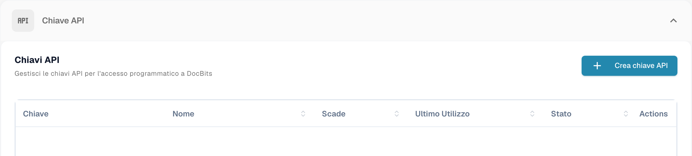
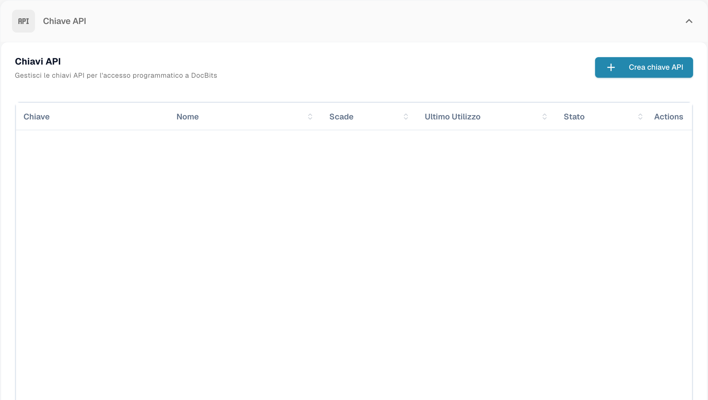
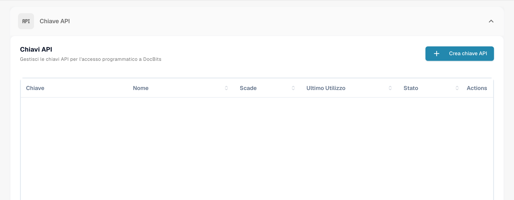
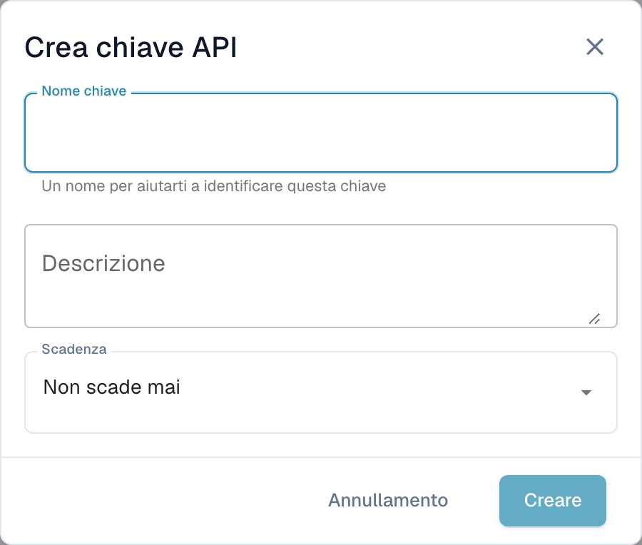

# API Key Management

Una API key consente a un altro sistema — il proprio ERP, uno script o un'applicazione partner — di dialogare con DocBits senza che un utente effettui l'accesso. La propria organizzazione può avere tutte le chiavi che servono, e ognuna si gestisce separatamente: le si dà un nome proprio, si decide se scade e la si revoca singolarmente se dovesse mai essere esposta.

Poiché ogni integrazione può avere la propria chiave, se ne può disattivare una senza disturbare le altre.

## Aprire la gestione delle chiavi API

Andare in **Impostazioni** e selezionare **Integrazione e SSO** sotto **Sistema e Amministrazione**.

<figure><figcaption>
Accesso all’amministrazione delle chiavi API.
</figcaption></figure>

La sezione **Chiave API** in cima alla pagina elenca tutte le chiavi che la propria organizzazione possiede.

<figure><figcaption>
Elenco delle chiavi API senza mostrare le chiavi o i relativi nomi.
</figcaption></figure>

## Capire l'elenco

<figure><figcaption>
Elenco delle chiavi API; chiavi e informazioni dell’account sono nascoste.
</figcaption></figure>

| Colonna | Che cosa indica |
| --- | --- |
| **Chiave** | I primi caratteri della chiave, seguiti da `****`. Il resto non viene più mostrato dopo la creazione — vedere [Creare una chiave API](#creare-una-chiave-api). |
| **Nome** | Il nome dato alla chiave, con la sua descrizione sotto. |
| **Scade** | La data in cui la chiave smette di funzionare, o **Mai** se non se ne è impostata una. |
| **Ultimo utilizzo** | Quando è arrivata l'ultima richiesta con questa chiave. **Mai usato** significa che nessun sistema l'ha ancora usata — utile per individuare chiavi che si possono rimuovere senza rischi. |
| **Stato** | **Attivo** significa che la chiave funziona. Una chiave revocata è disattivata in modo permanente. |
| **Azioni** | Il menu a tre puntini, da cui si può revocare la chiave. |

Se si hanno più chiavi di quante ne stiano in una pagina, usare i controlli di paginazione in fondo all'elenco.


**Ultimo utilizzo** è il modo più rapido per trovare chiavi di cui nessuno ha più bisogno. Una chiave mai usata, o non usata da mesi, è una buona candidata alla revoca.


## Creare una chiave API

1. Fare clic su **+ Create API Key** in alto a destra nella sezione API Keys.
2. Compilare la finestra di dialogo:

<figure><figcaption>
Finestra di creazione di una chiave API, senza salvataggio.
</figcaption></figure>

| Campo | Cosa inserire |
| --- | --- |
| **Nome chiave** | Obbligatorio. Darle il nome del sistema che la userà — `M3 Production`, `Invoice Import Script` — così da poter capire in seguito a quale integrazione appartiene una chiave. |
| **Descrizione** | Facoltativo. Spazio per una nota su a cosa serve la chiave o su chi l'ha configurata. |
| **Scadenza** | Scegliere una data di scadenza, oppure lasciare **Non scade mai**. Una data di scadenza è la scelta più sicura: la chiave si ritira da sé se l'integrazione dovesse essere dimenticata. |

3. Fare clic su **Creare**. DocBits mostra la nuova chiave:

4. Copiare la chiave con l'icona di copia e incollarla direttamente nel sistema che la userà, oppure nel proprio gestore di password.
5. Spuntare **Ho copiato e salvato questa chiave** e fare clic su **Done**.


**La chiave completa viene mostrata una sola volta.** DocBits memorizza un hash unidirezionale della chiave e un breve prefisso identificativo. Né i propri amministratori né il supporto DocBits possono recuperare la chiave originale completa da questo hash. Se la si perde, revocarla e crearne una nuova.


Trattare la chiave come una password. Chiunque la possieda può operare sui documenti e sui dati della propria organizzazione.

Vedere [Archiviazione sicura delle credenziali](../../../../security/secure-storage-of-credentials.md).

La chiave API completa viene mostrata una sola volta dopo la creazione. Copiarla nell’archivio sicuro approvato e verificarne la conservazione prima di chiudere la finestra. L’elenco non rivela nuovamente il segreto completo.
