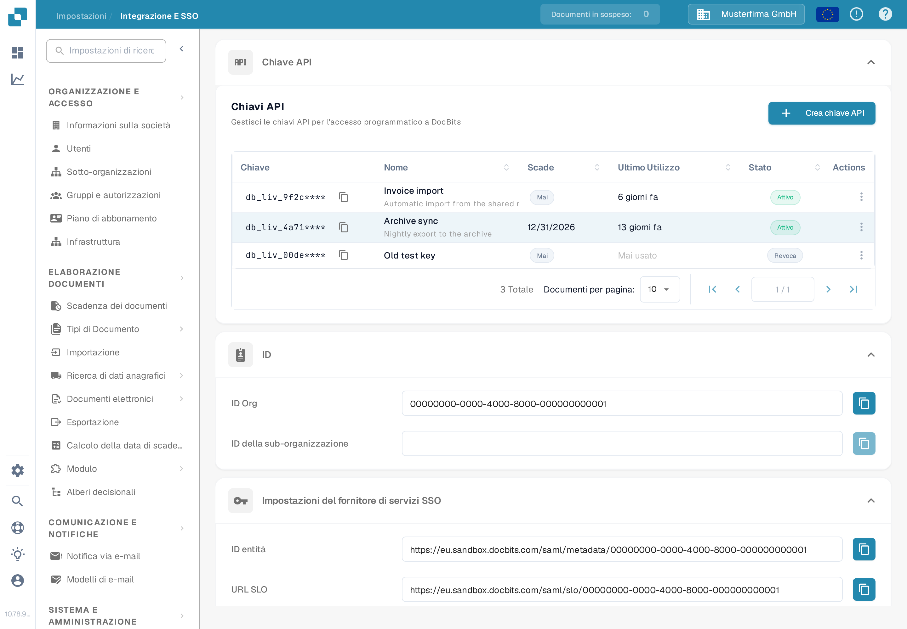

# API Key

<figure><figcaption>
Impostazioni → Integrazione e SSO → Chiave API. Il prefisso della chiave è nascosto in questo screenshot.
</figcaption></figure>

La sezione **Chiave API** in cima alla pagina Integrazione e SSO elenca tutte le chiavi API create dalla propria organizzazione. Una chiave API consente a un altro sistema — il proprio ERP, uno script o un'applicazione partner — di accedere a DocBits senza che un utente effettui l'accesso. Per le istruzioni passo passo, vedere [Gestione delle Chiavi API](api-key-management.md).

### Elenco delle chiavi API

* **Chiave:** I primi caratteri della chiave, seguiti da `****`. La chiave completa viene mostrata una sola volta, al momento della creazione, quindi non è possibile visualizzarla di nuovo in seguito. L'icona di copia accanto alla chiave copia il prefisso visibile negli appunti.
* **Nome / Scade / Ultimo Utilizzo / Stato:** Ogni riga mostra il nome della chiave, quando smette di funzionare, quando una richiesta l'ha usata l'ultima volta e se è ancora attiva.
* **Crea chiave API:** Apre una finestra di dialogo per creare una nuova chiave per un'integrazione. Vedere [Gestione delle Chiavi API](api-key-management.md) per i campi e la visualizzazione una tantum della chiave.
* **Azioni (menu a tre puntini):** Apre le azioni per una chiave, dove è possibile modificarne il nome, revocarla o eliminare una chiave già revocata. La revoca disattiva la chiave in modo permanente.

### Impostazioni del fornitore di servizi SSO (Single Sign-On)

Questi sono i valori di cui il proprio provider di identità ha bisogno per consentire agli utenti di accedere a DocBits con le credenziali aziendali. Per la guida completa alla configurazione, vedere [Configurazione Single Sign-On (SSO)](configuring-single-sign-on-sso/).

* **ID entità:** L'identificatore di DocBits come fornitore di servizi nella configurazione SSO. L'icona di copia copia il valore negli appunti.
* **URL SLO (Single Logout):** L'URL utilizzato per disconnettere un utente da tutte le applicazioni collegate tramite SSO allo stesso tempo. L'icona di copia copia il valore.
* **URL SSO:** L'URL utilizzato per avviare il processo di single sign-on. L'icona di copia copia il valore.
* **Scarica il certificato:** Scarica il certificato di sicurezza di cui il proprio provider di identità ha bisogno per considerare attendibile DocBits.
* **Scarica i metadati:** Scarica il file di metadati SAML che può essere importato direttamente nella maggior parte dei provider di identità.

### Impostazioni del provider di servizi di identità

Configurare DocBits per l'uso del proprio provider di identità (IdP) esterno per l'accesso. Per la guida completa, vedere la [Configurazione Single Sign-On (SSO)](configuring-single-sign-on-sso/).

* **ID inquilino:** L'identificatore del tenant del proprio provider di identità, utilizzato quando DocBits si integra con servizi cloud che gestiscono l'accesso per tenant.
* **Caricare il file:** Carica il file di metadati o di configurazione ricevuto dal proprio provider di identità.
* **Configurare:** Salva le impostazioni e applica la configurazione caricata. Immettere prima l'ID inquilino o caricare il file, quindi fare clic su **Configurare**.
