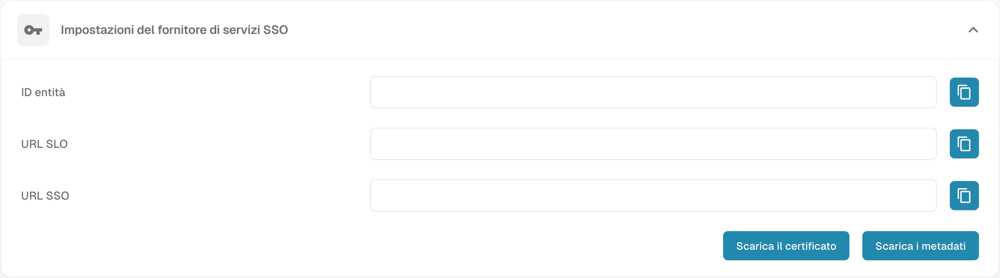

# Configurare il Single Sign-On (SSO)

Configurare DocBits come fornitore di servizi SAML (SP) e collegare il proprio provider di identità (IdP). È necessario l’accesso amministratore alle impostazioni pertinenti di entrambi i sistemi.

## Aprire le impostazioni SSO

Accedere a DocBits come amministratore e aprire Single Sign-On nelle impostazioni di integrazione.

<figure><figcaption>
Impostazioni del fornitore di servizi SSO: valori dell’organizzazione nascosti; nessuna configurazione è stata salvata.
</figcaption></figure>

## Consultare i valori del fornitore di servizi DocBits

DocBits mostra Entity ID, SSO URL e SLO URL come valori di sola lettura. Copiarli o utilizzare i metadati SP per configurare l’applicazione DocBits presso l’IdP; non inserire valori sostitutivi in questi campi di DocBits. Entity ID identifica il fornitore di servizi. Utilizzare gli endpoint visualizzati secondo i requisiti SAML dell’IdP.

## Scaricare il certificato e i metadati SP

Utilizzare Download Certificate e il download dei metadati nelle impostazioni del fornitore di servizi DocBits. Questi file descrivono DocBits come SP. Fornire all’IdP i metadati SP e, se richiesto, il certificato SP scaricato. Questo certificato è distinto dai metadati IdP da caricare in DocBits.

## Configurare il provider di identità

1. Configurare DocBits presso l’IdP con i valori SP visualizzati in DocBits o con i metadati SP scaricati.
2. Utilizzare la Tenant ID di DocBits se richiesta dal provider. Verificare il contesto del tenant e del provider nelle impostazioni del provider di identità di DocBits.
3. Ottenere dall’IdP i metadati SAML XML dell’applicazione configurata e caricare questi metadati XML dell’IdP in DocBits. Non sostituirli con i metadati SP di DocBits scaricati in precedenza.
4. Salvare la configurazione tramite l’azione Configure/Save nelle impostazioni del provider di identità di DocBits.

## Verificare accesso e disconnessione supportata

Verificare che un utente possa accedere a DocBits tramite l’IdP configurato. Provare Single Log-Out solo se DocBits e l’IdP lo supportano ed è configurato su entrambi i sistemi. La disconnessione da DocBits da sola non garantisce la disconnessione da tutte le altre applicazioni collegate.
