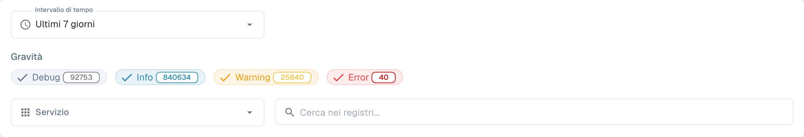

# Activity Logging

<figure><figcaption>
Filtri del registro delle attività; le voci sono nascoste.
</figcaption></figure>

Activity Logging offre una vista in tempo reale degli eventi di sistema di tutti i servizi DocBits. Usalo per monitorare l'attività di elaborazione, risolvere gli errori e verificare il comportamento del sistema.

## Analytics Banner

In cima alla pagina, un banner rimanda alla **Dashboard di analisi** per grafici, metriche e monitoraggio in tempo reale.

## Filtri

| Filtro | Descrizione |
|--------|-------------|
| **Intervallo di tempo** | Seleziona un intervallo di tempo (ad es. Today, Last 7 Days, Last 30 Days). |
| **Gravità** | Attiva o disattiva i livelli di gravità da includere o escludere: **Debug**, **Informazioni**, **Avvertimento**, **Errore**. Ogni chip mostra il conteggio attuale. |
| **Servizio** | Filtra i log per servizio (ad es. api, auth, api-service). |
| **Search logs** | Ricerca a testo libero nei messaggi di log. |

## Tabella dei Log

| Colonna | Descrizione |
|--------|-------------|
| **Marca temporale** | Data e ora in cui si è verificato l'evento. Ordinabile. |
| **Gravità** | Badge colorato: Info (blu), Warning (giallo), Error (rosso), Debug (grigio). |
| **Componente** | Il servizio o il modulo che ha generato il log (ad es. api, auth, api-service). |
| **Messaggio** | Il messaggio di log completo con i dettagli dell'evento. |

I risultati sono paginati — usa i controlli in basso per scorrere le pagine.

## Azioni a piè di pagina

| Azione | Descrizione |
|--------|-------------|
| **Auto-refresh** | Attiva per aggiornare automaticamente la vista dei log a intervalli regolari. |
| **Refresh Now** | Aggiorna manualmente i dati dei log. |
| **Export JSON** | Esporta i log filtrati correnti come file JSON. |
| **Download Logs** | Scarica i dati completi dei log. |
