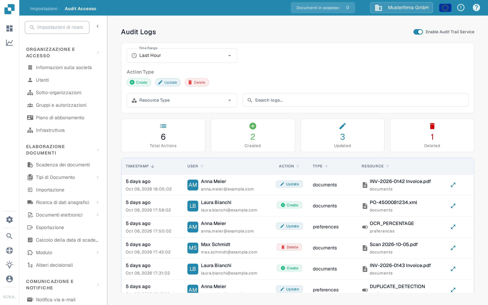
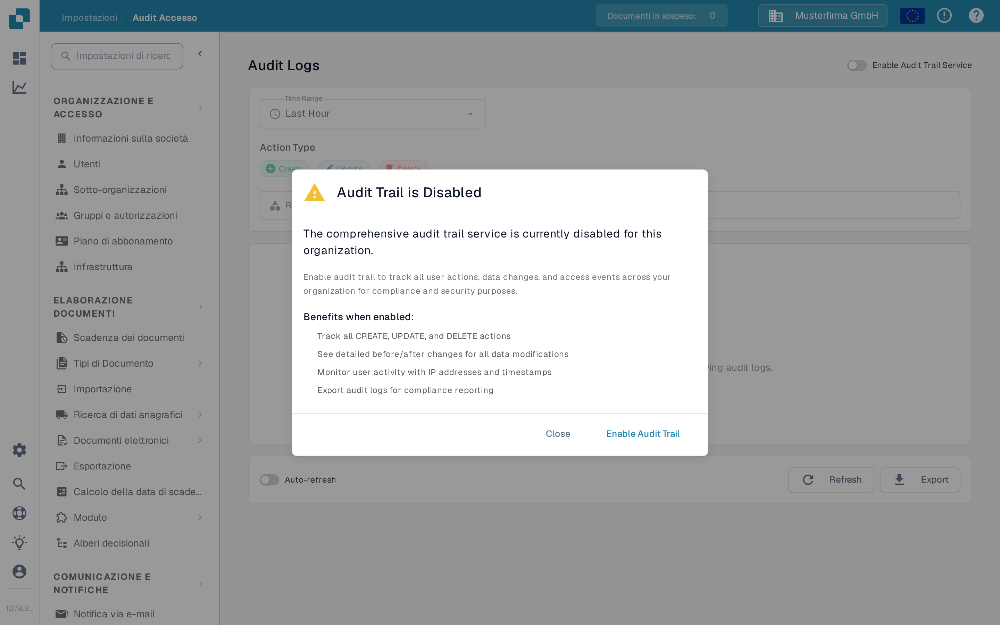

# Audit Accesso

<figure><figcaption>
La pagina Sandbox in italiano prima che la registrazione audit sia attivata.
</figcaption></figure>

Audit Accesso registra chi ha creato, modificato o eliminato una risorsa e quando. Apri **Impostazioni → Registro Attività → Audit Accesso** per consultare il registro. Attiva il servizio per un'organizzazione solo quando intendi raccogliere eventi di audit.

## Quando la registrazione audit è disattivata

<figure><figcaption>
La finestra di dialogo spiega cosa verrà registrato prima di attivare il servizio.
</figcaption></figure>

La prima visita in una sessione del browser può mostrare **Audit Trail is Disabled**. **Close** chiude la finestra di dialogo e lascia la registrazione audit disattivata. **Enable Audit Trail** la attiva per l'organizzazione corrente. Nella pagina dietro la finestra di dialogo, anche **Enable Now** e l'interruttore **Enable Audit Trail Service** lo attivano. Questi controlli modificano l'impostazione dell'organizzazione; non si limitano a mostrare un'anteprima della funzione.

Finché il servizio è disattivato, i filtri e la tabella dei log non possono mostrare eventi. Lo stato vuoto spiega come attivare la registrazione. Dopo l'attivazione, usa l'interruttore per disattivarla di nuovo se necessario. Gli eventi sono disponibili solo quando il servizio è attivo e ha raccolto dati.

## Trovare un evento

| Controllo                          | Cosa fa                                                                       |
| ---------------------------------- | ----------------------------------------------------------------------------- |
| **Time Range**                     | Limita l'elenco a un periodo, ad esempio Last Hour, Today o Last 7 Days.      |
| **Create**, **Update**, **Delete** | Include o esclude questi tipi di azione.                                      |
| **Resource Type**                  | Limita i risultati a un tipo di risorsa, ad esempio documenti o impostazioni. |
| **Search logs...**                 | Cerca nel testo delle voci di audit visibili.                                 |
| **Refresh**                        | Carica una volta le voci più recenti corrispondenti.                          |
| **Auto-refresh**                   | Mantiene l'elenco aggiornato automaticamente finché la pagina è aperta.       |
| **Export**                         | Scarica i dati attuali del log di audit in un file JSON.                      |

Le schede di riepilogo mostrano le azioni totali, create, aggiornate ed eliminate per i filtri selezionati. Nella tabella **TIMESTAMP** indica quando un evento ha avuto luogo, **USER** identifica l'autore, **ACTION** nomina la modifica e **RESOURCE** identifica l'elemento interessato. Apri il controllo dei dettagli di una riga per esaminare la modifica registrata. Se non compaiono eventi, verifica che il servizio sia attivo e amplia l'intervallo di tempo prima di modificare gli altri filtri.
