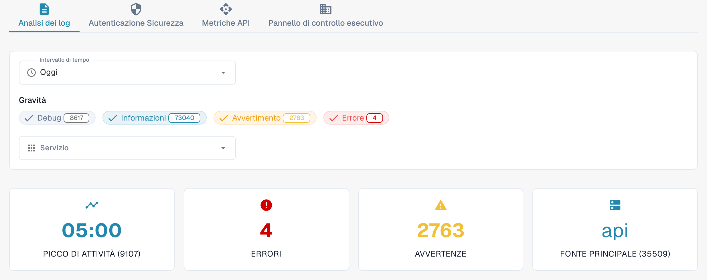

# Analisi

Aprite **Impostazioni → Registro Attività → Analisi** con un account amministratore dell’organizzazione. La pagina riunisce attività dei log, eventi di autenticazione, utilizzo delle API e una panoramica direzionale. Iniziate da **Analisi dei log**. Selezionate **Visualizza i registri degli eventi** per aprire l’elenco degli eventi e analizzare una voce specifica.

<figure><figcaption>
Vista attuale di Dev in italiano. I conteggi appartengono all’ambiente di test e saranno diversi nella vostra organizzazione.
</figcaption></figure>

## Schede

| Scheda | Descrizione |
|--------|-------------|
| **Analisi dei log** | Distribuzione della gravità dei log, andamento temporale e suddivisione per servizio. |
| **Autenticazione Sicurezza** | Eventi di autenticazione, tentativi di accesso e indicatori di sicurezza. |
| **Metriche API** | Volume delle richieste API, tempi di risposta e tassi di errore. |
| **Pannello di controllo esecutivo** | Panoramica per gli amministratori dell’organizzazione; la disponibilità dipende dal ruolo. |

Ogni scheda ha i propri controlli del periodo. Ricontrollate il periodo selezionato quando cambiate scheda.

## Filtri dei log

| Filtro | Descrizione |
|--------|-------------|
| **Intervallo di tempo** | Scegliete **Ultima ora**, **Oggi**, **Ultimi 7 giorni**, **Ultimi 30 giorni** o **Personalizzato**. L’opzione personalizzata mostra i campi di data e ora iniziali e finali. |
| **Gravità** | Fate clic su **Debug**, **Informazioni**, **Avvertimento** o **Errore** per includere o escludere quel livello. Il numero su ogni filtro indica il conteggio corrente. |
| **Servizio** | Selezionate uno o più servizi di cui volete esaminare gli eventi. |

## Riepiloghi

Sotto i filtri compaiono quattro riepiloghi:

| Riepilogo | Descrizione |
|-----------|-------------|
| **Picco di attività** | Momento con il maggior volume di log e relativo conteggio. |
| **Errori** | Numero di errori nel periodo selezionato. |
| **Avvertenze** | Numero di avvisi nel periodo selezionato. |
| **Fonte principale** | Servizio che genera più log, con il relativo conteggio. |

## Monitoraggio degli utenti reali (RUM)

Quando è disponibile la telemetria del browser, la sezione RUM mostra gli indicatori di prestazione del frontend. I dati disponibili dipendono dall’ambiente e dal periodo. Un grafico vuoto, un messaggio di dati non disponibili o un indicatore di caricamento non costituisce un risultato misurato.

## Grafici dei log e download

In **Analisi dei log**, scegliete una delle seguenti viste:

| Vista | Descrizione |
|-------|-------------|
| **Gravità** | Grafico a torta con la distribuzione dei livelli dei log. |
| **Linea temporale** | Grafico a linee con il volume dei log nel tempo. |
| **Servizio** | Grafico a barre con la suddivisione per servizio. |

Nel grafico **Linea temporale**, aprite il menu in alto a destra e scegliete **Download SVG**, **Download PNG** o **Download CSV**. Queste opzioni riguardano il grafico visualizzato; altri grafici potrebbero non offrire la stessa barra degli strumenti.

Se non sono disponibili dati, provate un **Intervallo di tempo** più ampio o meno filtri di **Gravità**.

## Errori JavaScript con stack trace

Quando questo riquadro è disponibile, l’etichetta dell’ambiente indica l’ambito degli errori, ad esempio **dev solo**. Il riquadro elenca le eccezioni recenti del browser, limitate a 24 ore. **Copia tutto JSON** copia le voci attualmente caricate in questo riquadro, non l’intero registro degli eventi. Il pulsante è disattivato quando non ci sono voci.

Per una voce disponibile, fate clic sul messaggio per espandere la traccia dello stack. Le azioni della riga copiano quella voce come JSON o ne copiano la traccia dello stack. Il collegamento a una traccia compare solo se la voce ha un ID di traccia.
