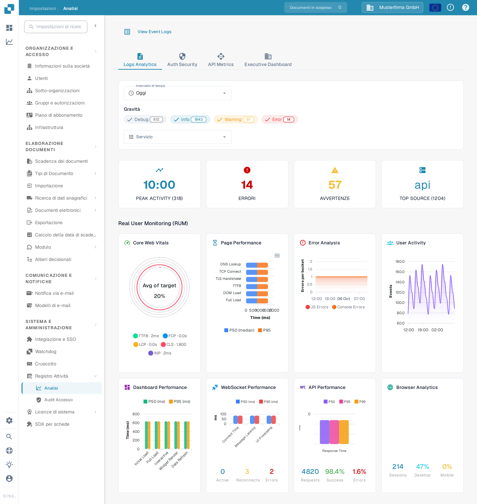

# Analisi

<figure><figcaption>
Usate le schede e i filtri per restringere gli indicatori da analizzare.
</figcaption></figure>

La pagina Analisi consente di esaminare i modelli dei log, gli eventi di autenticazione, l'utilizzo delle API e una panoramica direzionale. Iniziate dalla scheda **Logs Analytics**. Scegliete **View Event Logs** per aprire l'elenco sottostante degli eventi quando dovete investigare una singola voce.

## Schede

| Scheda | Descrizione |
|--------|-------------|
| **Logs Analytics** | Distribuzione dei livelli di gravità dei log, grafici temporali e suddivisione per servizio. |
| **Auth Security** | Eventi di autenticazione, tentativi di accesso e indicatori legati alla sicurezza. |
| **API Metrics** | Volume delle richieste API, tempi di risposta e tassi di errore. |
| **Executive Dashboard** | Panoramica di livello superiore per gli amministratori dell'organizzazione; le altre ruoli potrebbero non vedere questa scheda. |

## Filtri

| Filtro | Descrizione |
|--------|-------------|
| **Intervallo di tempo** | Selezionate una finestra temporale (ad esempio Oggi, Ultimi 7 giorni) per gli indicatori visualizzati. |
| **Gravità** | Fate clic su Debug, Info, Warning o Error per includere o escludere quel livello. Il numero su un chip mostra il conteggio attuale. |
| **Servizio** | Scegliete il servizio i cui eventi volete esaminare. |

## Riepiloghi

Quattro riepiloghi compaiono sotto i filtri:

| Riepilogo | Descrizione |
|-----------|-------------|
| **PEAK ACTIVITY** | Ora del giorno con il volume di log più alto e relativo conteggio totale. |
| **ERRORI** | Numero totale di errori nel periodo selezionato. |
| **AVVERTENZE** | Numero totale di avvertenze nel periodo selezionato. |
| **TOP SOURCE** | Il servizio che produce più log, con il relativo conteggio. |

## Real User Monitoring (RUM)

Sotto i riepiloghi, gli indicatori RUM mostrano i dati di prestazione del frontend raccolti dalle sessioni reali dei browser degli utenti.

## Grafici di Analisi

In **Logs Analytics** scegliete uno dei tre pulsanti dei grafici per cambiare il modo in cui vengono mostrati i log già filtrati:

| Vista | Descrizione |
|-------|-------------|
| **Severity** | Grafico a torta con la distribuzione dei livelli di log (Debug, Info, Warning, Error). |
| **Timeline** | Grafico a linee con il volume dei log nel tempo. |
| **Service** | Grafico a barre con la suddivisione dei log per servizio. |

Se un grafico indica che non sono disponibili dati, provate un **Intervallo di tempo** più ampio o meno filtri **Gravità**. I valori nello screenshot appartengono all'organizzazione sintetica di Sandbox e nella vostra organizzazione saranno diversi.
