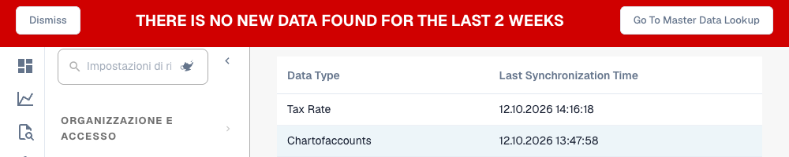

# Verificare la sincronizzazione dei dati

Usare questa vista quando mancano un fornitore, un ordine o altri dati anagrafici. Mostra l'ora di sincronizzazione registrata per tipo nell'organizzazione corrente, non il contenuto di ogni record importato.

<figure><figcaption>
Orari di sincronizzazione registrati per due tipi di dati e avviso relativo a dati più vecchi di due settimane. Questo estratto non dimostra la completezza dei dati importati. Le intestazioni delle colonne sono ancora visualizzate in inglese. Anche l’avviso e i relativi pulsanti sono attualmente visualizzati in inglese.
</figcaption></figure>

## Procedura

1. Confermare organizzazione, eventuale sotto-organizzazione e società ERP di origine.
2. Aprire **Impostazioni → Registro attività → Sincronizzazione dati**. Le versioni precedenti la collocano nelle impostazioni dei registri.
3. Cercare il tipo in **Data Type** e leggere **Last Synchronization Time** con il formato data configurato. Gli aggiornamenti recenti appaiono per primi.
4. Confrontare l'orario con la modifica attesa all'origine. Un aggiornamento fornitori recente non dimostra ordini aggiornati.
5. Cercare l'identificativo mancante nelle anagrafiche o negli ordini. Confrontare società, numero fornitore/ordine e identificativi delle righe con l'origine.
6. Controllare canale di importazione e registri: messaggio, organizzazione destinataria, mappatura e risposta. Correggere la causa nell'integrazione; questa vista non ha pulsanti di avvio o ripetizione.
7. Dopo l'aggiornamento corretto, ricaricare vista e ricerca/documento interessato. Verificare orario e valori effettivi.

## Interpretazione

| Osservazione | Verifica successiva |
| --- | --- |
| Nessuna riga | Organizzazione, configurazione import e sincronizzazioni registrate. Vuoto non significa riuscito. |
| Un tipo obsoleto | Seguire quel flusso indipendentemente dalle altre righe. |
| Avviso di dati vecchi | L'avviso attuale può apparire senza righe o con tutti gli aggiornamenti oltre due settimane. Il processo può richiedere dati molto più recenti. |
| Orario recente, record assente | Ambito dell'origine, identificativi, contenuto, mappatura e risposta. L'orario non prova completezza. |

Per il supporto conservare ambiente, organizzazione, tipo, identificativo, orario atteso ed errore o ID di traccia esatto con prove pertinenti anonimizzate.

Vedere [Importazione anagrafiche](../../../infor-integration-and-configuration/importing-customer-master-data/README.md), [Registro attività](README.md) e [Ricerca anagrafiche](../document-processing/master-data-lookup.md).
