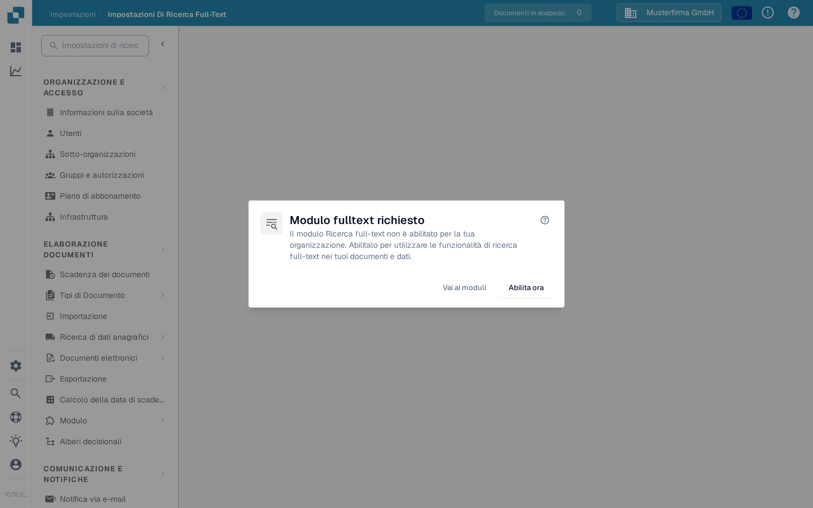

# Impostazioni della Ricerca a Testo Completo

<figure><figcaption>
Se la Ricerca a testo completo è disattivata, questa finestra spiega i passaggi successivi.
</figcaption></figure>

Le Impostazioni della Ricerca a Testo Completo stabiliscono cosa DocBits indicizza e come questi contenuti diventano ricercabili nei documenti, nei dati anagrafici ERP e nei modelli. La pagina delle impostazioni mostra una finestra di requisito finché il **modulo Ricerca a testo completo** non è attivato — il linguaggio di interrogazione per l'utente finale è descritto in [Ricerca a testo completo](../document-processing/module/fulltext-search.md).

## Prerequisiti

Il modulo Ricerca a testo completo deve essere attivato in **Impostazioni → Modulo → Dashboard e analisi → Ricerca testo completo**. Se il modulo non è attivato, la finestra offre tre azioni:

* **Aiuto (?)** — Apre la documentazione della Ricerca a testo completo in una nuova scheda, prima di modificare qualsiasi impostazione.
* **Vai ai moduli** — Apre le impostazioni del modulo Dashboard e analisi per verificare la configurazione.
* **Abilita ora** — Apre la finestra dell'abbonamento. Esamina e conferma questa finestra prima che il modulo venga attivato; un clic su questo pulsante da solo non lo attiva.

La pagina delle impostazioni stessa diventa disponibile quando il modulo è attivo.

## Struttura della pagina

La pagina delle impostazioni è organizzata in tre schede, ognuna relativa a un diverso tipo di contenuto che la Ricerca a testo completo può indicizzare.

### Scheda «Documenti»

La scheda Documenti copre tutto ciò che riguarda l'indicizzazione dei documenti elaborati:

* **Statistiche di indicizzazione** — totali dei documenti indicizzati e in attesa, aggiornabili su richiesta.
* **Preferenze vettoriali** — tre interruttori a livello di organizzazione che stabiliscono se l'indicizzazione vettoriale viene eseguita parallelamente all'indice testuale per i documenti. L'indicizzazione vettoriale alimenta la modalità di interrogazione `vector:` e la funzione «Trova simili».
* **Azioni di reindicizzazione** — avvia una reindicizzazione completa o incrementale. Mentre la reindicizzazione è in corso, vedi il progresso in tempo reale (documenti al minuto, tempo rimanente stimato), lo stato del flusso e l'ultimo errore (se presente).
* **Diagnostica di sincronizzazione** — diagnostica su richiesta per i casi in cui l'indice sembra non coincidere con l'archivio dei documenti sottostante.

La reindicizzazione non è distruttiva — la ricerca esistente continua a funzionare mentre il nuovo indice viene ricostruito.

### Scheda «ERP»

La scheda ERP controlla l'indicizzazione dei dati anagrafici ERP — fornitori, clienti, articoli ed entità simili. Ogni entità ha il proprio interruttore:

* **Indicizzazione** — indicizza testualmente l'entità, in modo che sia ricercabile dalla dashboard.
* **Vettore** — indicizza vettorialmente l'entità, in modo che possa essere trovata tramite query semantiche.

Usa l'azione **Attiva/disattiva tutto** in cima all'elenco per applicare lo stesso stato a tutte le entità contemporaneamente. L'indicizzazione parte in background; un indicatore su ogni riga mostra quando è in corso.

### Scheda «Modelli»

La scheda Modelli elenca le versioni dei modelli note all'indice della Ricerca a testo completo. Usa questa vista per confermare, dopo un nuovo rilascio, che le versioni dei modelli da cui dipendi siano presenti nell'indice.

## Cosa viene indicizzato

Una volta attivata e configurata, la Ricerca a testo completo consente agli utenti di:

* Cercare in tutto il contenuto dei documenti (non solo nei campi dei metadati).
* Trovare documenti tramite il testo contenuto nei file caricati.
* Usare operatori di ricerca avanzati per query precise.
* Accedere ai risultati di ricerca direttamente dalla dashboard.
* Usare la ricerca semantica (prefisso `vector:`) quando l'indicizzazione vettoriale è attiva per quel tipo di contenuto.

Consulta la pagina del modulo [Ricerca a testo completo](../document-processing/module/fulltext-search.md) per il riferimento completo del linguaggio di interrogazione, incluse query per intervalli, filtri intelligenti e la modalità di ricerca AI.
