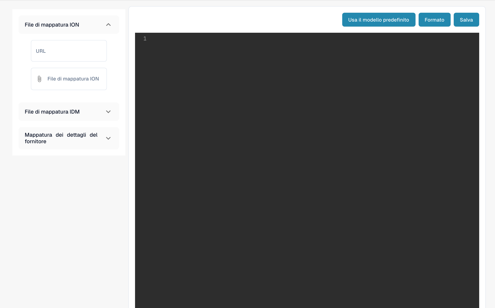

# Esportazione della Configurazione per il Portale Fornitori

<figure><figcaption><p>Configurazione dell’esportazione del portale fornitori.</p></figcaption></figure>

## Panoramica

Il file di configurazione per l'esportazione è un componente cruciale nel portale fornitori, che definisce come i dati vengono mappati tra il portale fornitori e il sistema ERP. Questa configurazione garantisce che i dati vengano trasferiti e sincronizzati accuratamente tra i sistemi, consentendo operazioni fluide ed efficienti.

## Struttura del File di Configurazione

Il file di configurazione per l'esportazione è strutturato come un oggetto JSON che contiene più mappature. Ogni mappatura è associata a un programma specifico nel sistema ERP e definisce le azioni da eseguire, i campi da mappare e eventuali condizioni da applicare.

## Componenti Chiave

### 1. Programma

* **Definizione**: Specifica il programma ERP a cui si applica la mappatura.
* **Esempio**: `"program": "CRS620MI"`

### 2. Azioni

* **Definizione**: Definisce le azioni che possono essere eseguite, come l'aggiunta o l'aggiornamento di record.
*   **Esempio**:

    ```json
    "actions": {
        "add": "AddSupplier",
        "update": "UpdSupplier"
    }
    ```

### 3. Mappatura

• Definizione: Specifica la mappatura tra i campi del sistema ERP e i campi del portale fornitori.

• Componenti:

• erp\_field\_name: Il nome del campo nel sistema ERP.

• value\_field\_name: Il nome del campo corrispondente nel portale fornitori.

• value: Un valore statico da utilizzare se nel portale fornitori non esiste un campo corrispondente.

• if\_conditions: Condizioni opzionali che determinano il valore in base a determinati criteri.

• Esempio:

```json
{
    "erp_field_name": "SUNO",
    "value_field_name": "supplier_number"
}
```

### 4. Logica Condizionale (if\_conditions)

• Definizione: Specifica le condizioni che devono essere soddisfatte per utilizzare un determinato valore.

• Componenti:

• field\_name: Il nome del campo nel portale fornitori che viene valutato.

• field\_value: Il valore che attiva la condizione.

• then\_value: Il valore da utilizzare se la condizione è soddisfatta.

• Esempio:

```json
{
    "erp_field_name": "SUTY",
    "value": "0",
    "if_conditions": [{
        "field_name": "supplier_group",
        "field_value": "FRT",
        "then_value": "5"
    }]
}
```

### 5. Cicli (loop\_on)

• Definizione: Definisce le sezioni in cui la configurazione deve iterare su un elenco di elementi, come i dettagli degli indirizzi o dei riferimenti.

• Esempio:

```json
"loop_on": "address_details"
```

### 6. Campi Calcolati (value\_field\_calculated)

• Definizione: Specifica i campi che devono essere calcolati in fase di esecuzione, ad esempio per generare la data corrente.

• Esempio:

```json
{
    "erp_field_name": "STDT",
    "value_field_calculated": "now()"
}
```

### 7. Mappature di Campo con Liste (mapping\_field\_name e mapping\_list)

• Definizione: Associa valori specifici del portale fornitori ai valori corrispondenti nel sistema ERP in base a un elenco predefinito.

• Componenti:

• mapping\_field\_name: Il campo che determina la mappatura.

• mapping\_list: Un dizionario che traduce i valori dal portale fornitori al sistema ERP.

• Esempio:

```json
{
    "erp_field_name": "RFID",
    "mapping_field_name": "reference_type",
    "mapping_list": {
        "10": "PURCHASING",
        "15": "DLVRY PHN#",
        "20": "COA",
        "25": "QA",
        "30": "FINANCE",
        "35": "SALES"
    }
}
```

## Esempio di Analisi della Configurazione

### Aggiunta e Aggiornamento Fornitori (CRS620MI)

• Programma: CRS620MI

• Azioni:

• Aggiungi fornitore: AddSupplier

• Aggiorna fornitore: UpdSupplier

• Campi di mappatura:

• SUNO → supplier\_number

• SUNM → name

• CSCD → supplier\_country

• TINO → tax\_id

• I campi aggiuntivi includono valori statici e mappature condizionali.

### Dettagli degli Indirizzi (CRS620MI)

• Loop On: _**address\_details**_

• Azioni:

• Aggiungi indirizzo: AddAddress

• Aggiorna indirizzo: AddAddress

• Campi di mappatura:

• SUNO → supplier\_number

• ADR1 → address

• TOWN → city

• I campi aggiuntivi includono campi calcolati come now() per la data corrente.

### Dettagli dei Riferimenti (CRS620MI)

• Loop On: _**reference\_details**_

• Azioni:

• Aggiungi riferimento fornitore: AddSupplierRef

• Aggiorna riferimento fornitore: AddSupplierRef

• Campi di mappatura:

• SUNO → supplier\_number

• RFTY → reference\_type

• RFID viene mappato tramite un elenco per tradurre tipi come “PURCHASING”, “QA” e “FINANCE”.

## Utilizzo della Configurazione di Esportazione

### 1. Caricamento del File di Configurazione

#### 1. Vai su Configurazione dell’esportazione:

• Vai alla sezione Export Configuration dal menu principale.

#### 2. Carica il File di Configurazione:

• Clicca sulle sezioni ION-Mapping File o IDM Mapping File per caricare il rispettivo file di configurazione.

#### 3. Salva la Configurazione:

• Dopo il caricamento, clicca sul pulsante Save per applicare la configurazione.

### 2. Utilizzo dei Template Predefiniti

• Clicca sul pulsante Use Default Template se desideri ripristinare il template di configurazione predefinito fornito dal sistema.

### 3. Formattazione del JSON

• Usa il pulsante Format per formattare automaticamente il codice JSON e renderlo più leggibile.

## Conclusione

Questo file di configurazione è essenziale per garantire che i dati tra il portale fornitori e il sistema ERP siano mappati e sincronizzati correttamente. Comprendendo la struttura e i componenti chiave, gli amministratori possono gestire e personalizzare in modo efficace il processo di esportazione per soddisfare le proprie specifiche esigenze aziendali.

## Esempio Completo&#x20;

```json
[{
    "program": "CRS620MI",
    "actions": {
        "add": "AddSupplier",
        "update": "UpdSupplier"
    },
    "mapping": [{
        "erp_field_name": "SUNO",
        "value_field_name": "supplier_number"
    }, {
        "erp_field_name": "SUNM",
        "value_field_name": "name"
    }, {
        "erp_field_name": "SUTY",
        "value": "0",
        "if_conditions": [{
            "field_name": "supplier_group",
            "field_value": "FRT",
            "then_value": "5"
        }]
    }, {
        "erp_field_name": "CSCD",
        "value_field_name": "supplier_country"
    }, {
        "erp_field_name": "DTFM",
        "value_field_name": "date_format"
    }, {
        "erp_field_name": "ORTY",
        "value": "F20"
    }, {
        "erp_field_name": "DT4T",
        "value": "1"
    }, {
        "erp_field_name": "DTCD",
        "value": "2"
    }, {
        "erp_field_name": "CUCD",
        "value_field_name": "currency"
    }, {
        "erp_field_name": "TINO",
        "value_field_name": "tax_id"
    }, {
        "erp_field_name": "PHNO",
        "value_field_name": "supplier_phone"
    }, {
        "erp_field_name": "CRTP",
        "value": "1"
    }, {
        "erp_field_name": "ATPR",
        "value": "1"
    }, {
        "erp_field_name": "SUCL",
        "value_field_name": "supplier_group"
    }, {
        "erp_field_name": "LNCD",
        "value_field_name": "language"
    }, {
        "erp_field_name": "CONO",
        "value": "781_DDD"
    }, {
        "erp_field_name": "TEDL",
        "value": "FOB"
    }, {
        "erp_field_name": "TEPY",
        "value_field_name": "payment_term"
    }, {
        "erp_field_name": "TEPA",
        "value": "001"
    }, {
        "erp_field_name": "PYME",
        "value": "CRP"
    }]
}, {
    "program": "CRS620MI",
    "loop_on": "address_details",
    "actions": {
        "add": "AddAddress",
        "update": "AddAddress"
    },
    "mapping": [{
        "erp_field_name": "SUNO",
        "main_value_field": "supplier_number"
    }, {
        "erp_field_name": "ADTE",
        "value_field_name": "address_type"
    }, {
        "erp_field_name": "ADID",
        "value_field_name": "address_type",
        "if_conditions": [{
            "field_name": "address_type",
            "field_value": "10",
            "then_value": ""
        }]
    }, {
        "erp_field_name": "STDT",
        "value_field_calculated": "now()"
    }, {
        "erp_field_name": "ADR1",
        "value_field_name": "address"
    }, {
        "erp_field_name": "TOWN",
        "value_field_name": "city"
    }, {
        "erp_field_name": "ECAR",
        "value_field_name": "state"
    }, {
        "erp_field_name": "PONO",
        "value_field_name": "postal_code"
    }, {
        "erp_field_name": "CSCD",
        "value_field_name": "supplier_country"
    }]
}, {
    "program": "CRS620MI",
    "loop_on": "reference_details",
    "actions": {
        "add": "AddSupplierRef",
        "update": "AddSupplierRef"
    },
    "mapping": [{
        "erp_field_name": "SUNO",
        "main_value_field": "supplier_number"
    }, {
        "erp_field_name": "RFTY",
        "value_field_name": "reference_type"
    }, {
        "erp_field_name": "RFID",
        "mapping_field_name": "reference_type",
        "mapping_list": {
            "10": "PURCHASING",
            "15": "DLVRY PHN#",
            "20": "COA",
            "25": "QA",
            "30": "FINANCE",
            "35": "SALES"
        }
    }, {
        "erp_field_name": "YRE1",
        "value_field_name": "reference_name"
    }, {
        "erp_field_name": "PHNO",
        "value_field_name": "telephone_no"
    }, {
        "erp_field_name": "EMAL",
        "value_field_name": "email_address"
    }]
}]
```
