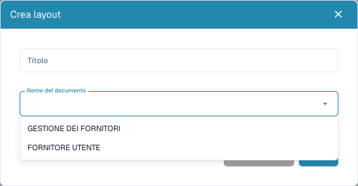

# Configurare i moduli dei fornitori

<figure><figcaption>
Scegliere il pubblico esterno o interno prima di salvare un layout.
</figcaption></figure>

I layout fornitori definiscono moduli esterni e per il personale interno. Non modificano la fattura stampata né addestrano l'estrazione. Servono diritti amministrativi e requisiti concordati per ciascun pubblico.

## Scegliere il pubblico

1. Aprire **Impostazioni → Impostazioni fornitori → Layout fornitori**.
2. Verificare i layout esistenti e aprire quello corretto prima di crearne un altro.
3. Per un nuovo layout scegliere **Nuovo**, un titolo chiaro e il tipo di documento: utente fornitore per l'esterno, gestione fornitori per l'interno.
4. Salvare la definizione, aprire il layout nell'elenco e verificare il pubblico.

## Configurare campi e struttura

1. Aprire i campi fornitori. Verificare titolo, nome campo ERP, elenco valori e proprietà obbligatorio, sola lettura e nascosto.
2. Creare un campo con nome, titolo e tipo. Selezione/ricerca/opzioni richiedono l'elenco appropriato. I file richiedono il tipo di documento; per gli altri campi verificare il nome ERP.
3. Salvare le impostazioni corrette. Definizione e disposizione sono passaggi distinti.
4. Organizzare gruppi e campi tramite **Elementi** e **Campi** nel layout corretto. Selezionare un elemento e controllarne le proprietà disponibili.
5. Assegnare nomi e titoli validi ai gruppi. Non nascondere/bloccare un campo obbligatorio senza valore esistente o processo adatto.
6. Salvare e riaprire il layout. **Annulla** esce dall'editor. Il modello predefinito può sostituire la disposizione: usarlo intenzionalmente.

## Provare entrambe le viste

Con fornitore fittizio e account di test, controllare separatamente registrazione e dettagli interni: messaggi obbligatori, opzioni, file e visibilità/sola lettura. Salvare nell'editor non prova registrazione, approvazione o export riusciti.

Per campi mancanti verificare definizione, visibilità, layout e pubblico. Per valori ERP assenti controllare anche la mappatura di esportazione.

Vedere [Portale fornitori](../../setup/supplier-portal/README.md), [Impostazioni generali](supplier-general-settings.md) e [Permessi](supplier-permissions.md).
