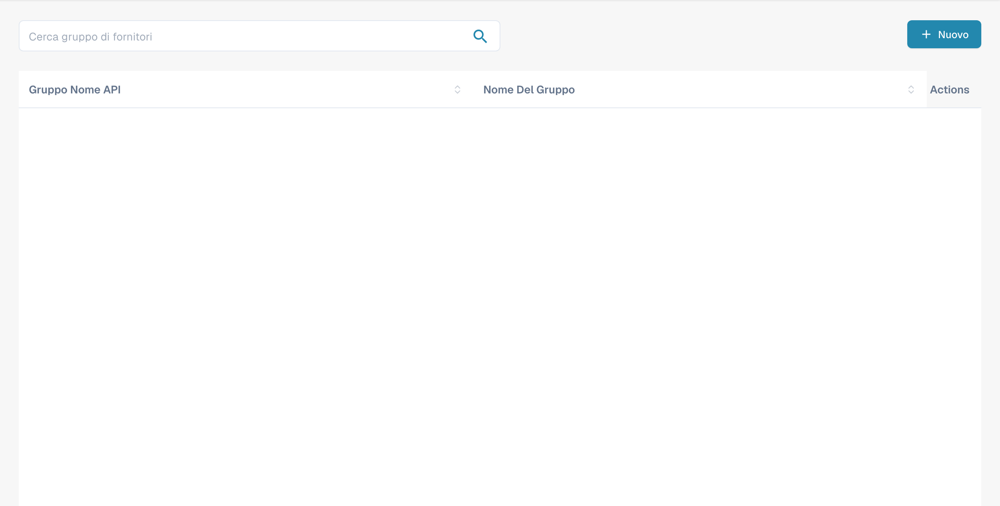
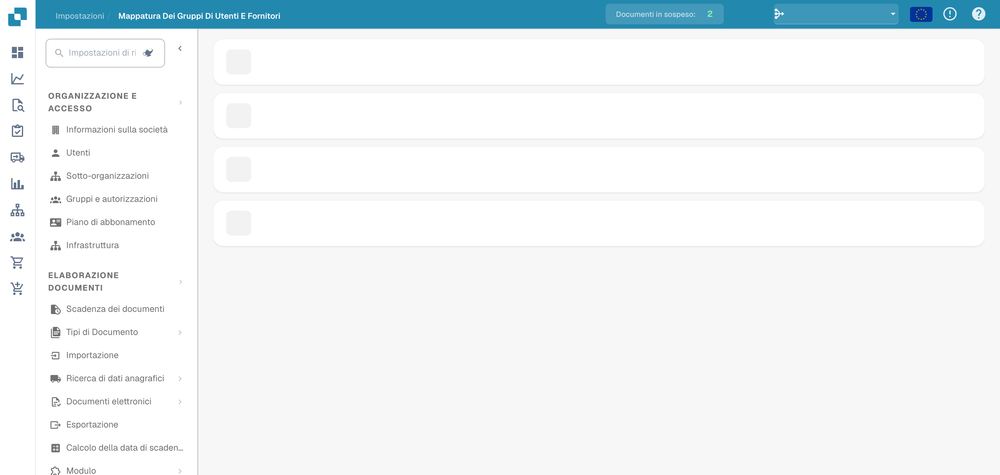

# Permessi fornitore

### Gruppo fornitori

<figure><figcaption>
Elenco dei gruppi di fornitori con i nomi nascosti.
</figcaption></figure>

Gestisci i gruppi di fornitori per categorizzarli per tipo, area geografica o ruolo. Ogni gruppo ha un **Gruppo Nome API** (utilizzato per le integrazioni) e un **Nome del gruppo** (nome visualizzato).

Fai clic su **+ Nuovo** per creare un gruppo. Usa il menu a tre puntini su ciascuna riga per modificarlo o eliminarlo.

### Mappatura tra utenti e gruppi di fornitori

<figure><figcaption>
Associazione degli utenti ai gruppi di fornitori.
</figcaption></figure>

Assegna gli utenti ai gruppi di fornitori per controllare quali dipendenti possono accedere e gestire specifici insiemi di fornitori. Ogni gruppo è mostrato come una sezione espandibile che elenca gli utenti assegnati con un conteggio dei membri.

Fai clic su **+ Nuovo** all'interno di un gruppo per aggiungere una mappatura utente. Usa il menu a tre puntini per rimuovere una mappatura.
