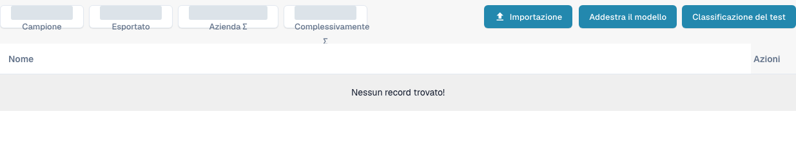

# Addestramento dei documenti

L’addestramento dei documenti insegna a DocBits dove trovare i valori nei documenti che non legge ancora correttamente. Addestrare separatamente i campi di intestazione e i campi di riga.

Per esaminare l’addestramento di classificazione di un tipo di documento, aprire **Impostazioni** → **Tipi di Documento** e scegliere **Modello di formazione** nella scheda di un tipo di documento esistente. La vista mostra gli esempi di addestramento e i controlli **Importazione**, **Addestra il modello** e **Classificazione del test**. Esaminare gli esempi esistenti prima di apportare modifiche e utilizzare file di prova autorizzati per eventuali addestramenti o test di classificazione successivi.

<figure><figcaption>
Vista italiana dell’addestramento dei modelli per un tipo di fattura esistente. Non sono elencati documenti di esempio; i contatori aggregati sono coperti. Non sono state eseguite importazioni né sessioni di addestramento o test di classificazione.
</figcaption></figure>

* [Addestrare i campi di intestazione](training-header-fields.md): indicare dove compare nel documento un valore di intestazione, come una data o un importo totale.
* [Addestrare i campi di riga e le tabelle](training-line-fields-table-training/README.md): definire la struttura della tabella delle righe per un fornitore specifico.

I risultati dell’addestramento dipendono dai documenti utilizzati. Verificare i valori estratti su un ulteriore documento di prova prima di farvi affidamento.
