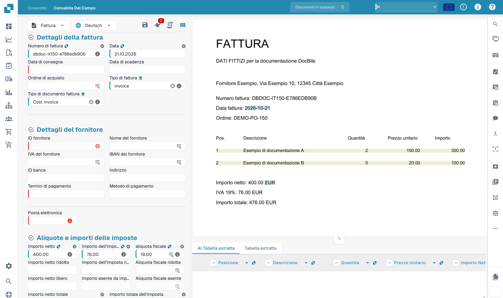
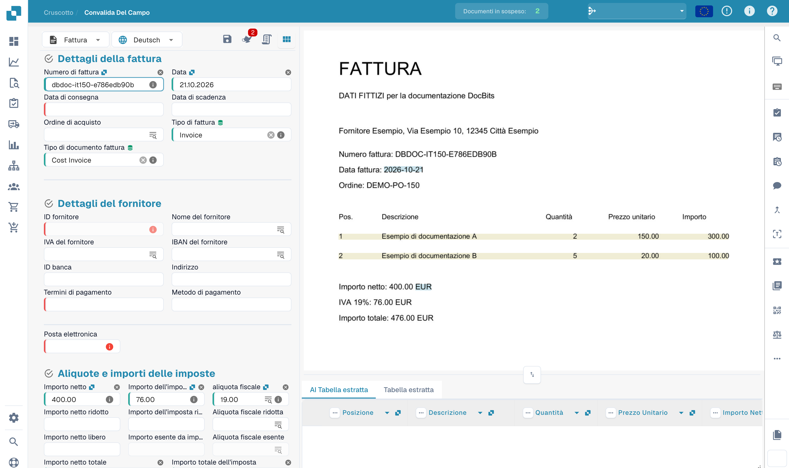

# Campi Intestazione dell'Addestramento

Dopo aver caricato il tuo documento, verrai portato alla schermata di convalida.\
Alcuni campi potrebbero essere già popolati — questo grazie all'intelligenza collettiva di DocBits. Tuttavia, altri campi potrebbero rimanere vuoti. Questo significa tipicamente che il tipo di documento non è stato ancora completamente addestrato, quindi DocBits non sa ancora da dove estrarre quelle informazioni.

Puoi aiutare ad addestrare DocBits a riconoscere questi campi identificando manualmente i dati corretti.\
**Si prega di notare:** se un campo rimane vuoto, potrebbe semplicemente significare che l'informazione non è presente nel documento caricato.

<figure><figcaption>
Convalida di una fattura fittizia prima dell’addestramento dei campi di intestazione.
</figcaption></figure>

### Per addestrare un campo:

1. Clicca sul campo che desideri addestrare.
2. Quindi o:
   * **Doppio clic** sui dati rilevanti all'interno del documento, o
   * **Disegna un riquadro di selezione** intorno ai dati usando il cursore.

<figure><figcaption>
Selezione del numero di fattura come punto iniziale dell’addestramento.
</figcaption></figure>

Ripeti questo processo per tutti i campi richiesti.\
Una volta che tutti i campi necessari sono stati popolati, **clicca su "Salva Regole"** per memorizzare l'addestramento. Questo assicura che DocBits impari dove trovare ciascuna informazione per documenti simili in futuro.

Dopo aver salvato, il tuo documento è pronto per essere esportato — e la prossima volta, DocBits estrarrà automaticamente i campi addestrati.

Dopo il salvataggio dell’addestramento previsto, provare altri documenti dello stesso fornitore. L’esportazione dipende anche dalla convalida e dal workflow configurato.
