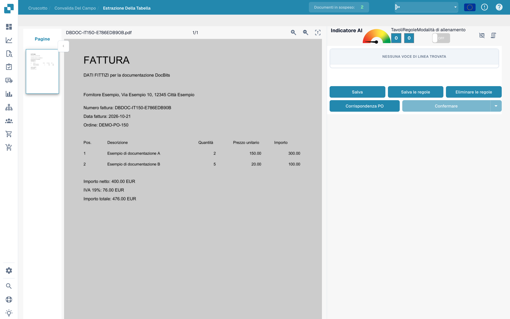
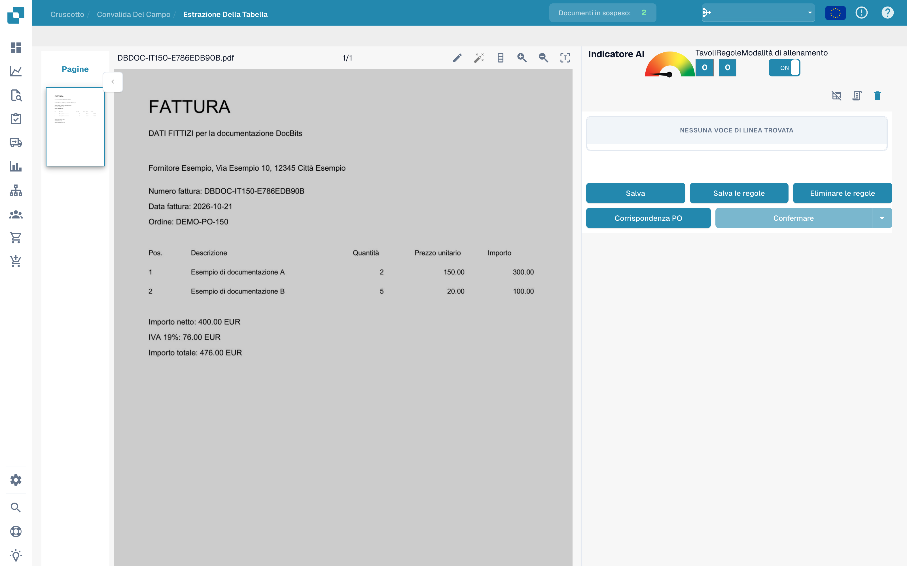
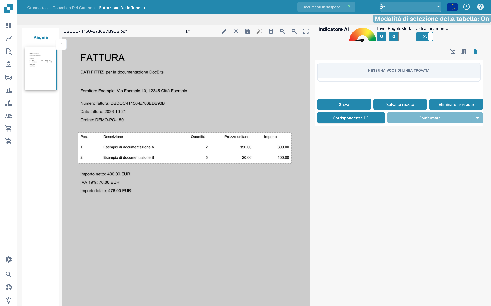
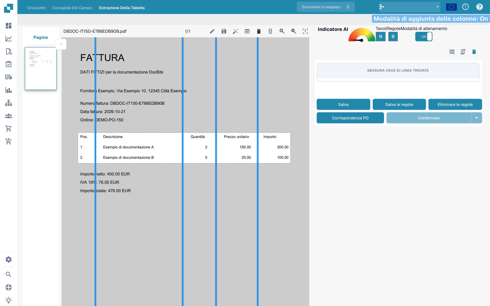
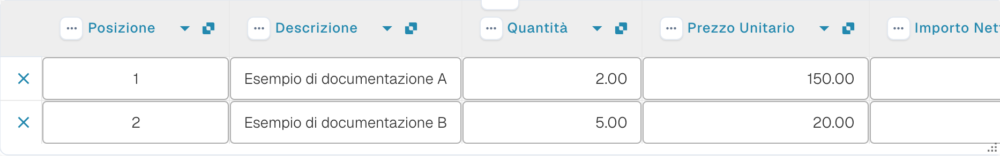

# Definire tabelle e colonne

Se una tabella non viene riconosciuta completamente, usare l’addestramento per definirne l’area e le colonne. Gli esempi utilizzano una fattura fittizia e una bozza non salvata.

## Aprire l’addestramento

Aprire il documento nella convalida dei campi, quindi l’estrazione delle tabelle.

<figure><figcaption>
Interfaccia per definire tabelle e colonne. Le etichette Tavolo/Tavoli si riferiscono a tabelle di dati.
</figcaption></figure>

Attivare la modalità di addestramento per visualizzare gli strumenti di selezione e delle colonne.

<figure><figcaption>
Addestramento delle tabelle con la modalità di addestramento attiva. Le etichette Tavolo/Tavoli si riferiscono a tabelle di dati.
</figcaption></figure>

La barra offre anche il rilevamento automatico. Confrontare il risultato con il documento: questa immagine mostra gli strumenti disponibili, non un rilevamento completato.

<figure><figcaption>
Strumenti di addestramento delle tabelle, incluso il rilevamento automatico. Le etichette Tavolo/Tavoli si riferiscono a tabelle di dati.
</figcaption></figure>

## Definire l’area e le colonne

Con la matita, tracciare un rettangolo intorno alle intestazioni e alle righe degli articoli. Escludere i totali sottostanti.

<figure><figcaption>
Area della tabella non salvata intorno alle righe della fattura fittizia. Le etichette Tavolo/Tavoli si riferiscono a tabelle di dati.
</figcaption></figure>

Scegliere lo strumento delle colonne e posizionare i separatori verticali tra le colonne effettive.

<figure><figcaption>
Area della tabella con separatori verticali delle colonne. Le etichette Tavolo/Tavoli si riferiscono a tabelle di dati.
</figcaption></figure>

Verificare posizione, descrizione, quantità, prezzo unitario e importo.

<figure><figcaption>
Separatori posizionati tra le colonne della fattura fittizia. Le etichette Tavolo/Tavoli si riferiscono a tabelle di dati.
</figcaption></figure>

Controllare l’intera area e i separatori prima di salvare il documento o le regole.

<figure><figcaption>
Area e separatori in una bozza di addestramento non salvata. Le etichette Tavolo/Tavoli si riferiscono a tabelle di dati.
</figcaption></figure>

## Controllare l’estrazione

Confrontare le righe estratte con la fattura. L’immagine seguente mostra le righe già estratte automaticamente nella convalida; non sono il risultato della bozza di addestramento illustrata sopra.

<figure><figcaption>
Righe estratte automaticamente dalla fattura fittizia nella convalida.
</figcaption></figure>

Dopo il salvataggio previsto, provare altri documenti dello stesso fornitore. Una sola fattura non dimostra un’estrazione affidabile per tutti i layout.
