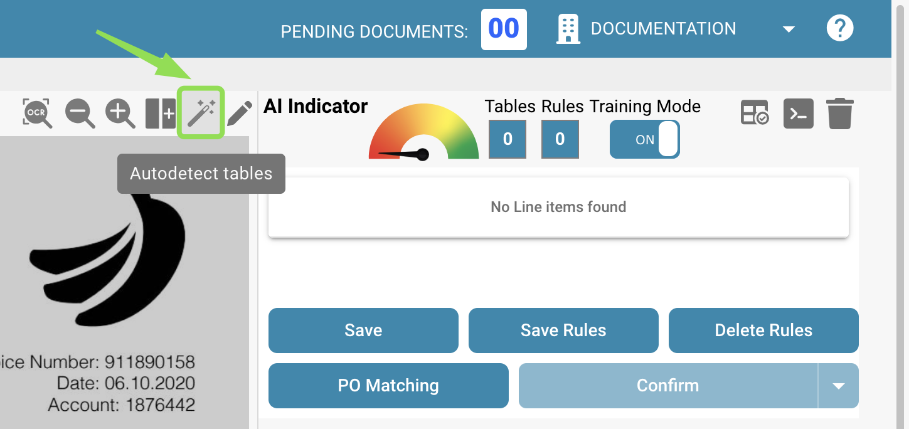
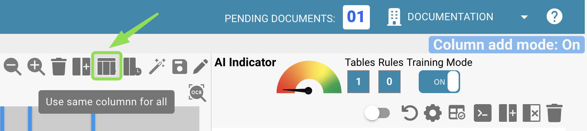

# Definizione di Tabelle e Colonne

Usa questa guida per definire manualmente tabelle e colonne per l'estrazione delle voci di linea in DocBits. È particolarmente utile quando il rilevamento automatico non cattura completamente la struttura della tabella, oppure quando devi aggiungere campi personalizzati.

### 1. Accedi alla Vista di Estrazione delle Tabelle

Apri il documento in DocBits e clicca sul pulsante **“Table Training”** per entrare nella vista di estrazione delle tabelle.

<figure><figcaption></figcaption></figure>

### 2. Attiva la Modalità di Allenamento

Per definire o modificare manualmente tabelle e colonne, clicca su **“TRAINING MODE.”**

<figure><figcaption></figcaption></figure>

### 3. Definisci l'Area della Tabella

Dopo essere entrato in Modalità di Allenamento, puoi definire dove si trova la tabella nel documento. Hai due opzioni:

#### Opzione 1: Usa il Rilevamento Automatico

Clicca sul pulsante **“Auto-Detect Tables”** per lasciare che DocBits provi a individuare da solo l'area della tabella.

<figure><figcaption></figcaption></figure>

Se il rilevamento ha successo, il contorno della tabella verrà visualizzato automaticamente. Puoi quindi procedere a definire le colonne.

#### Opzione 2: Definisci la Tabella Manualmente

Se il rilevamento automatico fallisce o non è accurato, puoi definire la tabella manualmente:

1. Clicca sul pulsante **“Edit”** per attivare la modalità di selezione della tabella.
2. Disegna un rettangolo attorno all'area della tabella nella vista del documento a sinistra.

<figure><figcaption></figcaption></figure>

### 4. Aggiungi e Definisci le Colonne

Una volta definite le tabelle, puoi definire manualmente le colonne tramite il seguente pulsante:\

<figure><figcaption></figcaption></figure>

Definisci e ordina le colonne tramite trascinamento sul documento. Ripeti l'operazione anche per le tabelle presenti nelle altre pagine. In alternativa, se le tabelle sono uguali su ogni pagina, puoi usare il seguente pulsante per applicare le stesse colonne a tutte le tabelle definite nel documento. Questa funzionalità copia le colonne che hai definito anche su tutte le altre pagine:

<figure><figcaption></figcaption></figure>

Usa la funzione di **zoom** per definire meglio le colonne in documenti confusi o complessi, ad esempio quando molte informazioni sono vicine tra loro e questo rende difficile definire le colonne:

<figure><figcaption></figcaption></figure>

Se hai definito una colonna per errore, puoi selezionarla cliccandoci sopra ed eliminarla tramite il seguente pulsante:

<figure><figcaption></figcaption></figure>

<mark style="color:red;">**Nota**</mark>: Il pulsante è visibile solo se la colonna è selezionata.

Quando hai finito di definire tutte le tabelle e tutte le colonne del documento, usa il pulsante “Save” per attivare le modifiche ed estrarre i dati dal documento:

<figure><figcaption></figcaption></figure>

I dati di tutte le aree definite verranno estratti e mostrati sul lato destro:

<figure><figcaption></figcaption></figure>

### 6. Salva ed Estrai

Clicca su **“Save Rules”** quando tutte le tabelle e le colonne sono state definite.

* Questo indica a DocBits dove trovare i dati della tabella per questo specifico fornitore.
* La prossima volta che viene caricato un documento dello stesso fornitore, DocBits estrarrà automaticamente la tabella usando le regole salvate.

<mark style="color:red;">**Nota**</mark>: Questo allenamento è specifico per il fornitore. Non verrà applicato ai documenti di altri fornitori.
