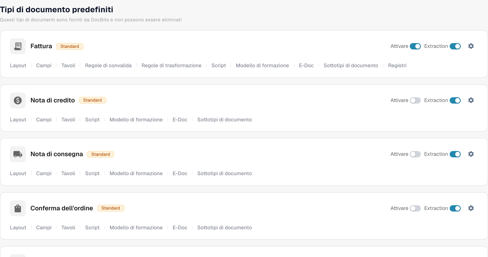
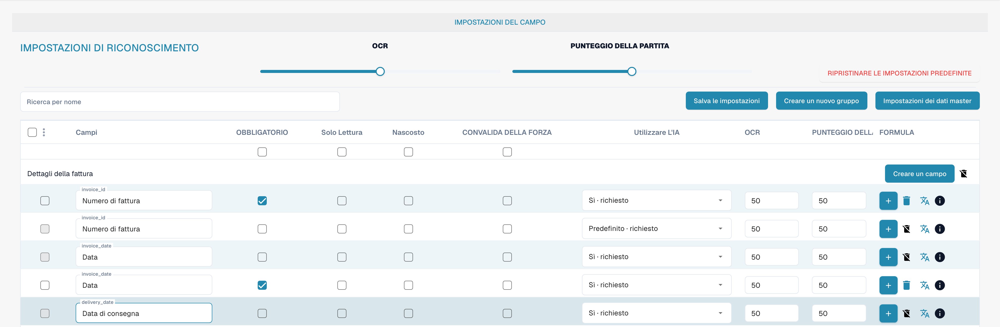
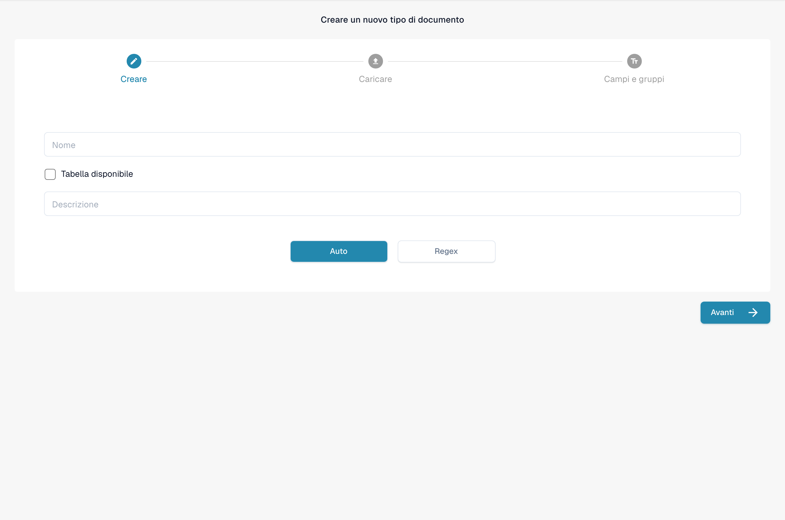

# Tipi di Documento

I tipi di documento indicano a DocBits con quali tipi di documenti lavora la tua organizzazione. Un amministratore li trova in **Impostazioni → Tipi di documento** nella sezione **Elaborazione Documenti** del menu delle impostazioni.

La pagina mostra i **Tipi di documento predefiniti**, che DocBits mette a disposizione e che non puoi eliminare, seguiti dai **Tipi di documenti personalizzati** creati per la tua organizzazione. Ogni tipo ha una propria scheda.

<figure><figcaption>
Tipi di documento predefiniti e accesso alle relative impostazioni. Le etichette Tavolo/Tavoli si riferiscono a tabelle di dati.
</figcaption></figure>

## Cosa puoi fare su una scheda

| Controllo | Cosa fa |
| --- | --- |
| **Attivare** | Rende questo tipo di documento disponibile o non disponibile nella tua organizzazione. Un interruttore blu è attivo; un interruttore grigio è disattivato. |
| **Estrazione** | Sceglie la modalità di estrazione: **Flex** se attivo o **Fix** se disattivo. Non attiva né disattiva semplicemente l'estrazione. Passa il mouse sull'interruttore per vedere la modalità corrente. |
| **Impostazioni** (ingranaggio) | Apre **Altre impostazioni** per questo tipo. Espandi una categoria per visualizzarne le opzioni. Le categorie dipendono dal tipo di documento. |
| **Disposizione** | Apre la configurazione dei layout. Consulta [Layout Builder](layout-builder.md) per i passaggi successivi. |
| **Campi** | Apre i campi e le impostazioni di riconoscimento per questo tipo. Consulta [Fields](../../settings/global-settings/document-types/fields/README.md) per sapere come configurarli. |
| **Tabelle** | Apre la configurazione delle colonne della tabella per questo tipo. |
| **Script** | Apre gli script di elaborazione quando questa funzione è disponibile. |
| **Addestramento del modello** | Apre l'allenamento del modello per questo tipo. |
| **E-Doc** | Apre le impostazioni dei documenti elettronici quando il tipo le supporta. |
| **Sottotipi di documento** | Apre i sottotipi di questo tipo di documento. |

A seconda delle funzionalità della tua organizzazione, potresti vedere altri link, ad esempio per le regole di validazione o di trasformazione. Scegli il link sulla scheda del tipo che vuoi modificare.

## Modificare campi e impostazioni di riconoscimento

Clicca su **Campi** su una scheda per visualizzarne i gruppi di campi. In alto nella pagina, **OCR** e **Punteggio di corrispondenza** impostano le soglie di riconoscimento, **Ripristinare i valori predefiniti** ripristina tali soglie e **Ricerca per nome** trova un campo. Usa **Creare un nuovo gruppo** per organizzare i campi e **Creare un campo** all'interno di un gruppo per aggiungerne uno. **Impostazioni dei dati master** apre la relativa configurazione dei dati anagrafici.

Ogni riga di campo ha controlli come **Obbligatorio**, **Solo lettura**, **Nascosto**, **Validazione forzata**, **Utilizzare l'IA**, OCR, Match Score e Formula. Consulta la [guida ai Fields](../../settings/global-settings/document-types/fields/README.md) prima di modificare i singoli valori. Clicca su **Salva le impostazioni** nella pagina Fields per conservare le modifiche.

<figure><figcaption>
Configurazione dei campi del tipo di documento Fattura. L’etichetta Punteggio della partita indica Match Score. L’etichetta CONVALIDA DELLA FORZA indica la convalida forzata.
</figcaption></figure>

## Creare un tipo di documento personalizzato

Scorri fino a **Tipi di documenti personalizzati** e clicca su **+ New**. Segui [Adding/Editing Document Types](../../settings/global-settings/document-types/adding-editing-document-types.md) per configurare il nuovo tipo.

<figure><figcaption>
Modulo di creazione di un tipo di documento non salvato.
</figcaption></figure>
