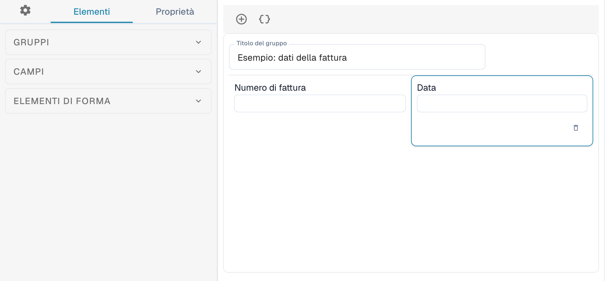
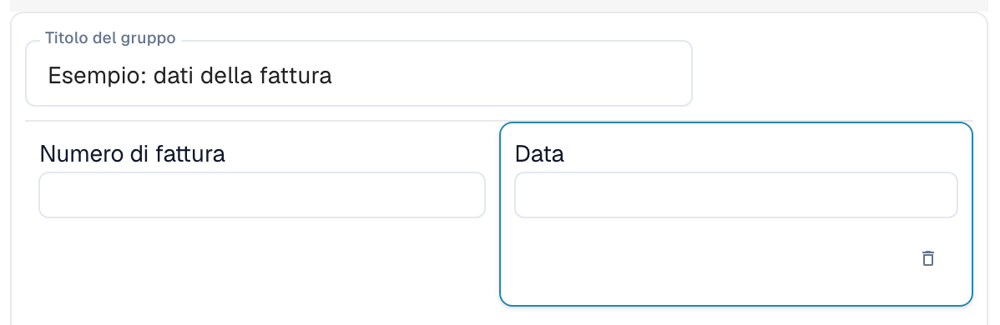
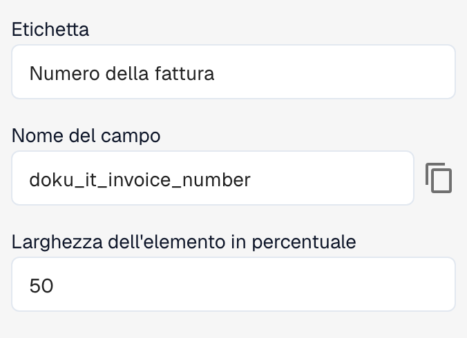

# Costruttore di Layout

Usa il Costruttore di Layout per organizzare i campi e i controlli visualizzati durante la convalida o l'approvazione di un documento. Ogni layout è associato a un tipo di documento, a un'origine e a un tipo di layout. Prima di salvare le modifiche, verifica quale layout è aperto.

## Aprire il layout

1. Apri **Impostazioni → Tipi di Documento**.
2. Apri il Costruttore di Layout del tipo o sottotipo di documento desiderato. Se non è disponibile, un amministratore potrebbe dover attivare il modulo per la tua organizzazione.
3. Verifica l'origine selezionata nella barra delle azioni e il tipo di editor indicato accanto.

<figure><figcaption>
Vista parziale dell&#x27;editor: le sezioni Gruppi, Campi ed Elementi di forma a sinistra e un esempio semplificato di layout di fattura al centro.
</figcaption></figure>

Quando cambi **Origine**, DocBits può creare un layout indipendente per quell'origine. Verifica l'origine prima di apportare modifiche.

## Conoscere le aree dell'editor

A sinistra puoi passare tra **Elementi**, **Proprietà** e la configurazione generale, rappresentata da un ingranaggio.

* La scheda **Elementi** contiene le sezioni **Gruppi**, **Campi** ed **Elementi di forma**. Apri ogni sezione per consultare i gruppi, i campi e i controlli disponibili.
* L'area centrale mostra i gruppi e i campi del layout. I gruppi permettono di organizzare campi correlati.
* A destra si trova la vista del documento di esempio, dove puoi consultare il documento e regolare lo zoom.

Trascina un elemento dalla sezione corrispondente a sinistra nell'area del layout per aggiungere un gruppo, un campo o un controllo del modulo.

<figure><figcaption>
I campi Numero di fattura e Data del gruppo di esempio. In questo layout, ogni campo occupa il 50 % della larghezza del gruppo.
</figcaption></figure>

Configura i campi riutilizzabili in [Tipi di Documento](README.md). I campi disponibili dipendono dal tipo di documento selezionato e dalla relativa configurazione.

## Modificare le proprietà di un elemento

Seleziona un gruppo o un campo nell'area del layout e apri **Proprietà** a sinistra. Le opzioni dipendono dall'elemento selezionato e comprendono, ad esempio, l'etichetta, il nome tecnico, la larghezza e il comportamento.

<figure><figcaption>
Proprietà del campo selezionato: Etichetta, Nome del campo e Larghezza dell&#x27;elemento in percentuale.
</figcaption></figure>

Nell'esempio, **Etichetta** contiene «Numero della fattura», mentre il campo nell'area centrale mostra **Numero di fattura**.

Per i campi predefiniti, l'etichetta e il nome tecnico potrebbero non essere modificabili. A seconda del tipo di elemento, puoi anche configurare la modalità di sola lettura, la visibilità, l'ordine di tabulazione, gli elenchi di valori e l'esecuzione di un workflow o di uno script quando il valore cambia. Le opzioni dei gruppi e dei campi sono diverse.

Dopo aver modificato le proprietà, verifica il risultato nell'area del layout. La larghezza viene inserita come percentuale tramite un controllo numerico; i gruppi e i relativi campi possono avere larghezze diverse. Vedi [Configurazione delle proprietà dei campi](../../settings/global-settings/document-types/layout-manager/configuring-field-properties.md).

## Modelli e JSON

Oltre al salvataggio del layout, la barra delle azioni offre funzioni per generare un modello, applicare il layout predefinito ai layout per origine, usare il modello predefinito e modificare JSON. La disponibilità dipende dall'editor aperto.

Generare o applicare un modello può sostituire il layout personalizzato. Verifica prima il tipo di documento, l'origine e il layout attuale. **Modifica JSON** è destinato alla configurazione avanzata e richiede la conoscenza del formato del modello. La funzione per copiare la configurazione è disponibile nella finestra di dialogo JSON.

## Rivedere e salvare

Organizza i gruppi e i campi e verifica il risultato nell'area del layout. Quando è corretto, usa **Salva** nella barra delle azioni. Per i layout specifici di un'origine, vedi [Layout per origine](origin-layouts.md).


Le illustrazioni utilizzano un esempio semplificato di layout di fattura. I nomi dei campi e le opzioni disponibili dipendono dalla configurazione.

