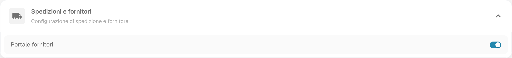
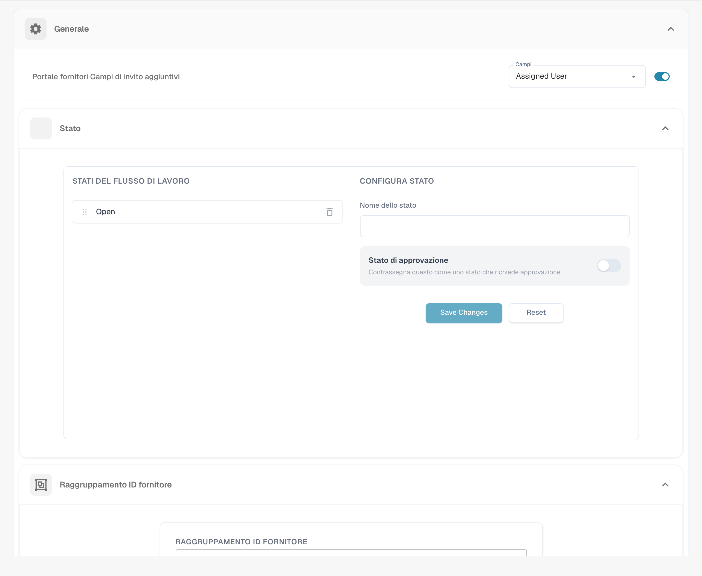
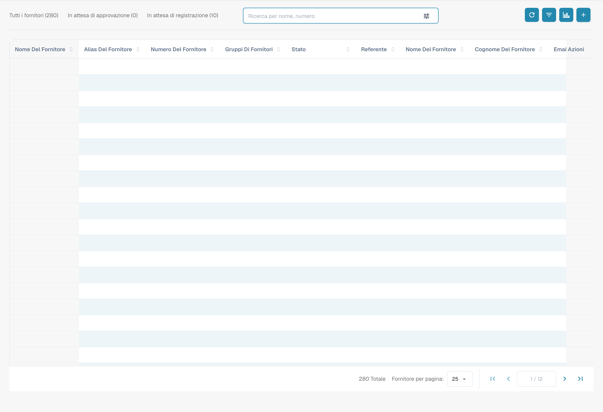
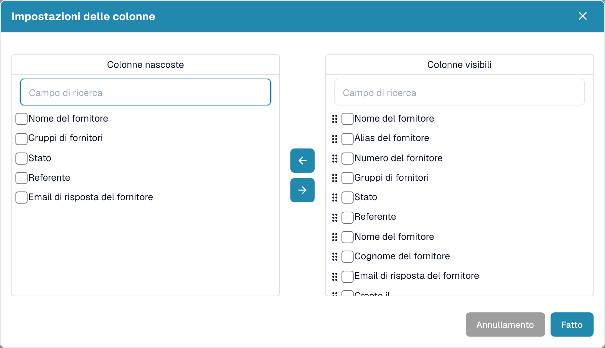
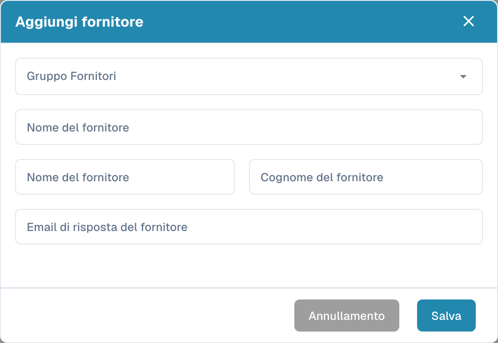

# Portale fornitori

## Disponibilità e autorizzazioni

Il portale consente ai fornitori autorizzati di partecipare al processo di registrazione e consultare i dati resi disponibili dall’organizzazione. La visibilità di ordini, fatture e funzioni dipende dalle autorizzazioni e dalla configurazione assegnate.

Apri **Impostazioni → Modulo → Spedizioni e fornitori** e verifica **Portale fornitori** con l’amministratore.

<figure><figcaption>
Spedizioni e fornitori con Portale fornitori già attivo nell’organizzazione di prova. L’immagine mostra lo stato esistente; nessun modulo o interruttore è stato modificato.
</figcaption></figure>

## Impostazioni del fornitore

Le impostazioni del fornitore comprendono [impostazioni generali](../../settings/supplier-setting/supplier-general-settings.md), [modelli di e-mail](../../settings/supplier-setting/editing-email-templates.md), layout di registrazione, autorizzazioni e [configurazione di esportazione per M3](../../settings/supplier-setting/export-configuration-for-supplier-portal-for-m3.md). Verifica campi richiesti, testi legali e destinatari prima di usare il processo con un fornitore.

<figure><figcaption>
Impostazioni generali del fornitore, con valori e contenuti configurati mascherati. Assigned User, Save Changes e Reset restano in inglese. Open è un valore di stato configurato, non la prova di un’ulteriore traduzione mancante. Nessuna impostazione è stata salvata.
</figcaption></figure>

## Cruscotto fornitori 

Apri il cruscotto dei fornitori dal menu. La tabella mostra i fornitori accessibili e i contatori dell’organizzazione corrente. Ricerca, filtri di stato e paginazione restringono l’elenco; i valori mostrati non sono valori predefiniti del prodotto.

<figure><figcaption>
Cruscotto fornitori italiano con contatori e tabella esistenti. I dati delle righe sono mascherati mantenendo la struttura: la tabella non è vuota. Le etichette Nome del fornitore e Cognome del fornitore non distinguono chiaramente tutti i campi del contatto.
</figcaption></figure>

### Aggiornare la tabella 

Usa il controllo di aggiornamento del cruscotto per ricaricare l’elenco. Rivedi filtri e intervallo selezionati prima di interpretare un risultato vuoto.

### Colonne dei fornitori 

Il selettore di colonne riguarda la **tabella dei fornitori**. Esamina i campi visibili e nascosti e l’eventuale ambito organizzativo prima di salvare una modifica.

<figure><figcaption>
Selettore delle colonne della tabella fornitori. Le etichette dei nomi non distinguono chiaramente azienda e contatto nella versione illustrata. Nessuna visibilità o posizione di colonna è stata salvata.
</figcaption></figure>

### Stato e analisi 

Controlla lo stato effettivo del singolo fornitore e i passaggi previsti dalla configurazione. Le categorie possono includere registrazione in attesa, richiesta di integrazioni, approvazione o rifiuto. Non dedurre dal solo contatore che un invito sia stato consegnato o che ogni organizzazione usi le stesse fasi.

## Creazione e invio della registrazione

Apri il comando di creazione e identifica separatamente ragione sociale, dati del contatto ed e-mail. Nella versione illustrata **Nome del fornitore** compare sia per l’azienda sia per il nome del contatto; verifica il significato del campo prima di inserire dati.

<figure><figcaption>
Modulo di creazione del fornitore senza dati inseriti. Nome del fornitore è ripetuto per azienda e nome del contatto; Cognome del fornitore indica il cognome del contatto. Nessun fornitore è stato creato e nessuna e-mail è stata richiesta.
</figcaption></figure>

Il salvataggio può richiedere l’invio di un’e-mail di registrazione: controlla destinatario e configurazione prima di procedere. Una richiesta di invio non dimostra la consegna del messaggio né la registrazione del fornitore.

Per un fornitore già esistente, usa il processo di invito autorizzato previsto dalla tua installazione. Le azioni della riga e il relativo invio non sono stati eseguiti durante questa verifica.

Consulta la [registrazione del fornitore](supplier-registration.md) per il percorso del destinatario. La verifica delle immagini non ha creato fornitori, salvato impostazioni o inviato inviti.

## Video: cercare un fornitore e aggiornare i dati anagrafici

Questo video in italiano mostra come un amministratore cerca un fornitore di esempio, apre i suoi dettagli, modifica città e codice postale, salva e verifica i valori dopo aver ricaricato la pagina.


Dimostrazione in italiano con un personaggio sintetico e la vera interfaccia DocBits di un’organizzazione di prova.


[Apri il video con sottotitoli e trascrizione in italiano](https://docbits-videos.fra1.cdn.digitaloceanspaces.com/settings-assistant/supplier-management-admin/v1/it.html).

La dimostrazione usa tre aziende fittizie e un modulo preparato con nome, città e codice postale. Il fornitore di imballaggi viene cercato per nome; la città viene impostata su **Köln** e il codice postale su **50667**. Dopo il salvataggio e il ricaricamento i valori sono ancora presenti. Lo stato del fornitore resta in attesa di registrazione: il salvataggio dei dati anagrafici non costituisce un’approvazione. Il video non invia inviti e non mostra il completamento della registrazione.
