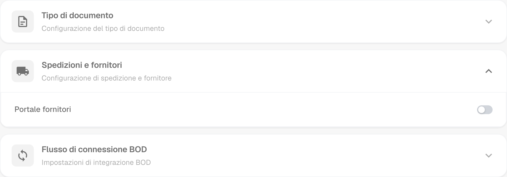
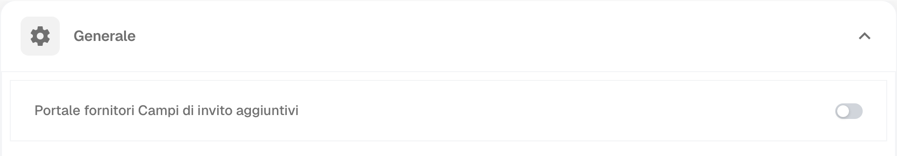
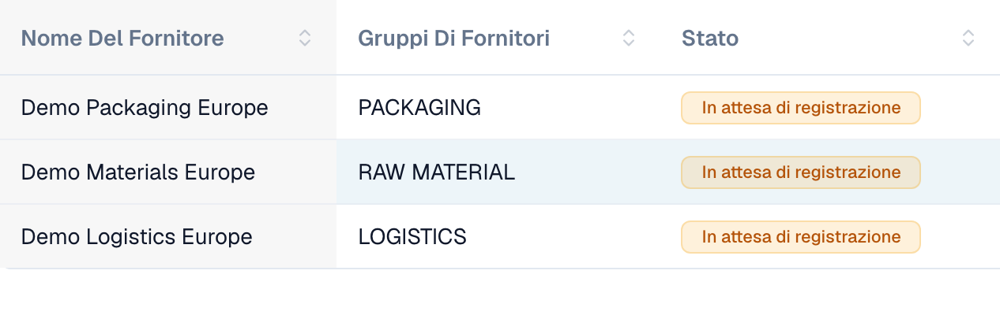
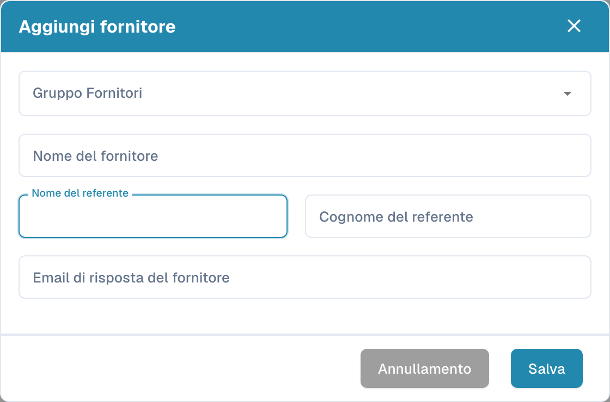

# Portale fornitori

Il **portale fornitori** permette a un amministratore di dare ai fornitori della propria azienda accesso a **DocBits**. L’amministratore attiva il portale e configura quali fornitori possono utilizzarlo e quali informazioni possono consultare.

Un fornitore invitato si registra e accede con il proprio account. Può quindi consultare le informazioni messe a sua disposizione, ad esempio lo stato dei propri ordini di acquisto e delle fatture. Le funzioni disponibili dipendono dalla configurazione dell’organizzazione.

## Admin: attivare il portale

1. Nelle impostazioni, aprire i moduli e selezionare **Integrazione dei documenti**.
2. Espandere **Spedizioni e fornitori** e attivare **Portale fornitori**.
3. Se compare una finestra di attivazione, verificare il piano visualizzato e confermare l’attivazione desiderata.

<figure><figcaption>
Opzione del portale nel modulo spedizioni e fornitori. Questo interruttore attiva la funzione per l’organizzazione.
</figcaption></figure>

## Admin: configurare il portale

Configurare il portale dell’organizzazione prima di inviare i primi inviti:

- [Impostazioni generali dei fornitori](../../settings/supplier-setting/supplier-general-settings.md): Campi aggiuntivi dell’invito, stati, logo e informazioni sulla privacy.
- [Modelli email](../../settings/supplier-setting/editing-email-templates.md): Contenuto e presentazione dei messaggi di invito.
- [Layout fornitore](../../settings/supplier-setting/supplier-layout.md): Campi per la registrazione dei fornitori e la gestione interna. Selezionare il tipo di layout appropriato.
- [Autorizzazioni dei fornitori](../../settings/supplier-setting/supplier-permissions.md): Assegnazione dei dipendenti interni ai gruppi di fornitori. Queste responsabilità interne sono separate dall’accesso personale del fornitore al portale.

<figure><figcaption>
Impostazioni generali dei fornitori con l’opzione per i campi aggiuntivi dell’invito.
</figcaption></figure>

## Admin: invitare i fornitori

Aprire la gestione dei fornitori. Prima di inviare un invito, controllare azienda, gruppo, referente e indirizzo email. Quando si crea un fornitore, il salvataggio richiede l’invio dell’invito alla registrazione; non salva soltanto una bozza. Per un fornitore esistente, utilizzare l’azione di invito appropriata. Una conferma di invio non dimostra la consegna dell’email né il completamento della registrazione.

<figure><figcaption>
Gestione interna di tre aziende fittizie. Tutti e tre gli stati indicano una registrazione in attesa.
</figcaption></figure>

<figure><figcaption>
Modulo per creare e invitare un fornitore. Controllare azienda, referente ed email prima di salvare.
</figcaption></figure>

## Fornitore: registrarsi e accedere a DocBits

Il fornitore apre l’invito, crea o utilizza l’account personale previsto e segue i passaggi di registrazione configurati. Può quindi consultare le informazioni rese disponibili in DocBits. La procedura esatta e le funzioni disponibili dipendono dall’organizzazione.

[Guida alla registrazione dei fornitori](supplier-registration.md).

## Comprendere accesso e stati

Portale attivato, invito inviato, registrazione completata e approvazione concessa sono stati distinti. Una scheda fornitore o dati anagrafici salvati non dimostrano che l’accesso al portale sia pronto. La vista del fornitore dipende dalle autorizzazioni assegnate ed è diversa dalla vista interna dell’amministratore.
