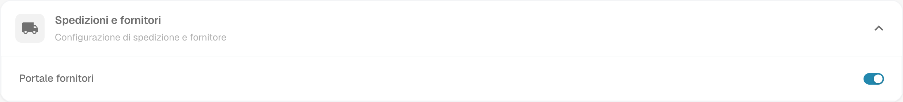
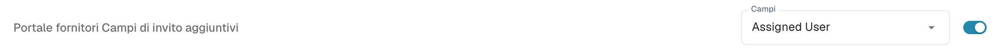
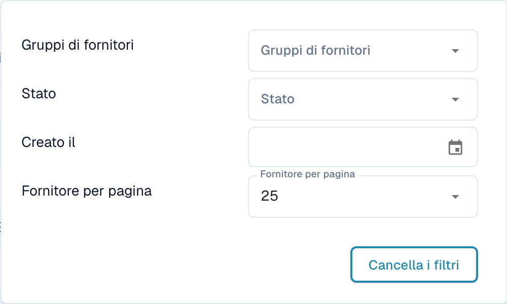
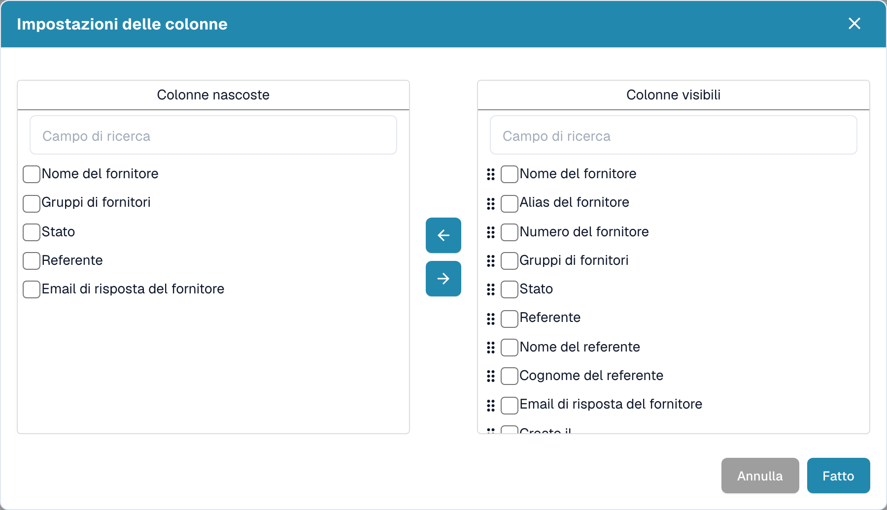
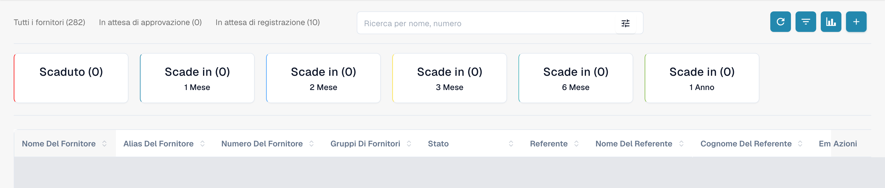
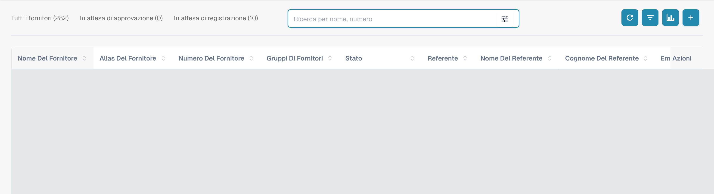
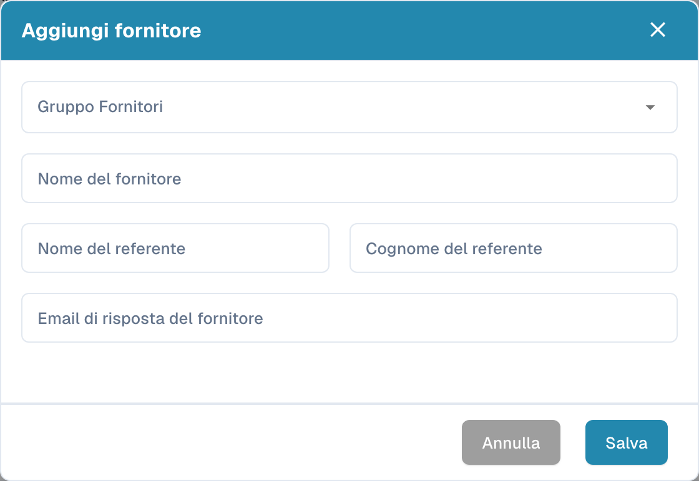

# Portale fornitori

Il **portale fornitori** permette a un amministratore di dare ai fornitori della propria azienda accesso a **DocBits**. L’amministratore attiva il portale e configura quali fornitori possono utilizzarlo e quali informazioni possono consultare.

Un fornitore invitato si registra e accede con il proprio account. Può quindi consultare le informazioni messe a sua disposizione, ad esempio lo stato dei propri ordini di acquisto e delle fatture. Le funzioni disponibili dipendono dalla configurazione dell’organizzazione.

## Video: preparare il portale fornitori e l’accesso

Un amministratore presenta l’opzione del portale, la scelta del piano, la preparazione di un invito e l’avvio della registrazione. Attivazione, invio, registrazione e approvazione sono spiegati come passaggi distinti.



[Apri il video con sottotitoli in italiano e selezione dei capitoli](https://docbits-videos.fra1.cdn.digitaloceanspaces.com/settings-assistant/supplier-portal-access-admin/v1/it.html)

## Admin: attivare il portale

1. Nelle impostazioni, aprire i moduli e selezionare **Integrazione dei documenti**.
2. Espandere **Spedizioni e fornitori** e attivare **Portale fornitori**.
3. Se compare una finestra di attivazione, verificare il piano visualizzato e confermare l’attivazione desiderata.

<figure><figcaption>
Vista reale di Dev in italiano, Spedizioni e fornitori: Portale fornitori è già attivato in questa organizzazione di prova. L’interruttore non è stato modificato per la cattura.
</figcaption></figure>

## Admin: configurare il portale

Configurare il portale dell’organizzazione prima di inviare i primi inviti:

- [Impostazioni generali dei fornitori](../../settings/supplier-setting/supplier-general-settings.md): Campi aggiuntivi dell’invito, stati, logo e informazioni sulla privacy.
- [Modelli email](../../settings/supplier-setting/editing-email-templates.md): Contenuto e presentazione dei messaggi di invito.
- [Layout fornitore](../../settings/supplier-setting/supplier-layout.md): Campi per la registrazione dei fornitori e la gestione interna. Selezionare il tipo di layout appropriato.
- [Autorizzazioni dei fornitori](../../settings/supplier-setting/supplier-permissions.md): Assegnazione dei dipendenti interni ai gruppi di fornitori. Queste responsabilità interne sono separate dall’accesso personale del fornitore al portale.

<figure><figcaption>
Vista reale dei campi di invito aggiuntivi: l’opzione è già attivata e Campi conserva il valore configurato Assigned User. Non è stata salvata alcuna modifica.
</figcaption></figure>

## Admin: cercare e filtrare i fornitori

Aprire la **dashboard fornitori** per la gestione interna. I totali **Tutti i fornitori**, **In attesa di approvazione** e **In attesa di registrazione** permettono di limitare l’elenco visualizzato. Il campo **Ricerca per nome, numero** serve a cercare un fornitore per nome o numero.

Aprire il controllo dei filtri nel campo di ricerca per utilizzare **Gruppi di fornitori**, **Stato** e **Creato il**. **Fornitore per pagina** controlla la dimensione della pagina; **Cancella i filtri** rimuove i filtri di ricerca attivi. Questi controlli riguardano l’elenco dei fornitori.

<figure><figcaption>
Menu dei filtri con Gruppi di fornitori, Stato, Creato il, Fornitore per pagina e Cancella i filtri. La cattura mostra i controlli disponibili senza attestare una prova del risultato del filtraggio.
</figcaption></figure>

## Admin: scegliere le colonne visibili

Accanto al pulsante di aggiornamento, aprire le impostazioni delle colonne. Il suggerimento indica **Impostare le colonne della tabella per l'organizzazione**. Selezionare i campi in **Colonne nascoste** o **Colonne visibili** e spostarli tra gli elenchi con le frecce. Usare le maniglie per cambiare l’ordine delle colonne visibili. **Fatto** applica la selezione all’organizzazione; **Annulla** chiude la finestra senza applicarla. Lo scorrimento orizzontale permette di raggiungere le colonne di una tabella più larga dello schermo.

<figure><figcaption>
Impostazioni delle colonne con Colonne nascoste, Colonne visibili, frecce, Annulla e Fatto. La finestra è stata chiusa con Annulla senza modificare la selezione.
</figcaption></figure>

## Admin: consultare l’analisi delle scadenze

Usare **Analisi**, l’icona del grafico accanto alle impostazioni delle colonne, per mostrare o nascondere il riepilogo delle scadenze. Le schede indicano **Scaduto** e **Scade in**, con i periodi **1 Mese**, **2 Mese**, **3 Mese**, **6 Mese** e **1 Anno**, così come compaiono nell’interfaccia. Selezionare una scheda limita l’elenco al periodo di scadenza corrispondente. I contatori si riferiscono alle date di scadenza dei fornitori.

<figure><figcaption>
Analisi mostra Scaduto e Scade in per uno, due, tre o sei mesi e un anno. Le righe sono coperte e non è stata selezionata alcuna scheda.
</figcaption></figure>

## Admin: invitare i fornitori

Aprire la gestione dei fornitori. Prima di inviare un invito, controllare azienda, gruppo, referente e indirizzo email. Quando si crea un fornitore, il salvataggio richiede l’invio dell’invito alla registrazione; non salva soltanto una bozza. Per un fornitore esistente, utilizzare l’azione di invito appropriata. Una conferma di invio non dimostra la consegna dell’email né il completamento della registrazione.

<figure><figcaption>
Dashboard interno con Tutti i fornitori, In attesa di approvazione, In attesa di registrazione, ricerca e barra degli strumenti. Le righe dei fornitori esistenti sono coperte.
</figcaption></figure>

<figure><figcaption>
Modulo vuoto Aggiungi fornitore con Gruppo Fornitori, Nome del fornitore, dati del referente, Annulla e Salva. Salva richiede l’invio dell’invito alla registrazione; per questa cattura è stato usato soltanto Annulla.
</figcaption></figure>

## Admin: aprire i dettagli dalla dashboard fornitori

Il personale interno può aprire la scheda dettagliata dalla riga di un fornitore nella dashboard. Questa vista contiene le stesse sei sezioni compilate dal fornitore e ne mostra lo stato. Permette di verificare e aggiornare le informazioni trasmesse e di effettuare l’approvazione corrispondente. Per queste catture non è stata aperta alcuna riga di un fornitore esistente.

## Fornitore: registrarsi e accedere a DocBits

Il fornitore apre l’invito, crea o utilizza l’account personale previsto e segue i passaggi di registrazione configurati. Può quindi consultare le informazioni rese disponibili in DocBits. La procedura esatta e le funzioni disponibili dipendono dall’organizzazione.

[Guida alla registrazione dei fornitori](supplier-registration.md).

## Comprendere accesso e stati

Portale attivato, invito inviato, registrazione completata e approvazione concessa sono stati distinti. Una scheda fornitore o dati anagrafici salvati non dimostrano che l’accesso al portale sia pronto. La vista del fornitore dipende dalle autorizzazioni assegnate ed è diversa dalla vista interna dell’amministratore.

Le catture sono state realizzate con l’account di prova Dev autorizzato e l’interfaccia in italiano. Sono state verificate le richieste di lettura dell’interfaccia e degli elenchi, i controlli visibili e i moduli annullati senza modifiche. Le impostazioni del portale e la selezione delle colonne non sono state salvate; non sono stati creati o modificati fornitori e non sono stati eseguiti inviti, registrazioni o approvazioni. I risultati della ricerca e dei filtri e la consegna delle email non sono attestati come testati funzionalmente. Il video esistente è conservato; non è stata svolta una nuova verifica di audio, lingua o sincronizzazione.
