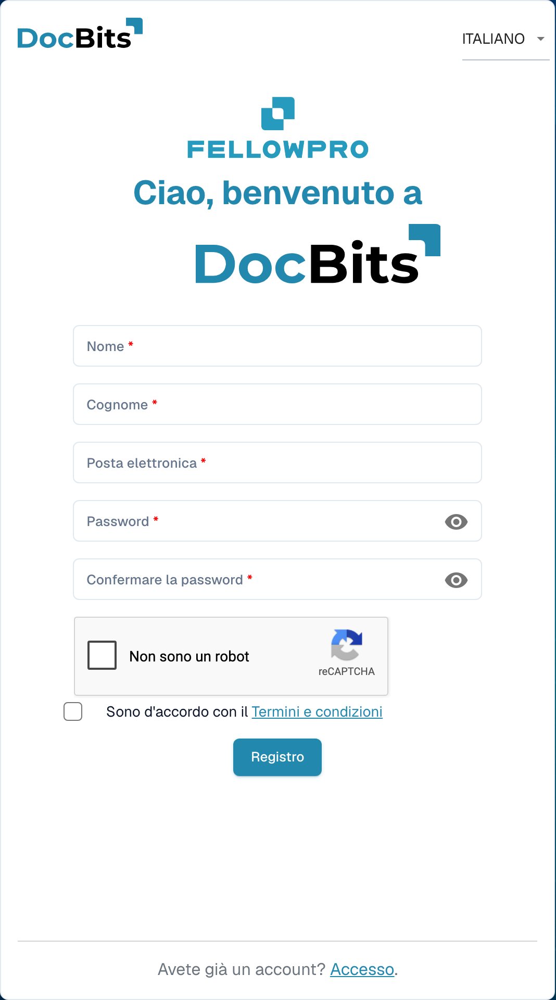

# Registrazione dei fornitori

Questa guida è destinata ai fornitori invitati al portale DocBits di un’organizzazione. Utilizzare il link dell’invito. Il fornitore dispone di un proprio account; l’organizzazione che lo invita stabilisce quali informazioni sono disponibili e quali passaggi di registrazione sono necessari.

## 1. Aprire l’invito

Verificare quale organizzazione ha inviato l’invito e a quale indirizzo email è destinato. Aprire il link di registrazione contenuto nell’invito. Se è scaduto o riguarda un’altra persona, richiedere un nuovo invito all’organizzazione.

## 2. Configurare il proprio account

Controllare nome ed email precompilati. Inserire i dati richiesti e rispettare le regole della password visualizzate. Leggere condizioni e informazioni sulla privacy. Completare la creazione dell’account con la funzione di registrazione. Un account esistente e una nuova registrazione sono casi diversi; seguire la procedura prevista per l’invito.

<figure><figcaption>
Modulo di registrazione dell’account fornitore. L’esempio è vuoto; un invito può precompilare alcuni dati.
</figcaption></figure>

## 3. Completare i dati del fornitore

Inserire i dati e gli eventuali documenti richiesti dall’organizzazione. Campi e sezioni dipendono dal layout fornitore configurato. Indicatori e messaggi di convalida segnalano i dati obbligatori. Salvare i progressi se la schermata offre questa possibilità; il salvataggio non equivale automaticamente all’invio definitivo.

## 4. Verificare registrazione e approvazione

Inviare i dati tramite l’apposita funzione di completamento. Se è prevista una verifica o approvazione, attenderne l’esito. Accedere quindi con il proprio account. L’organizzazione determina quali ordini, fatture e altre informazioni sono consultabili.

## In caso di problemi di accesso

Contattare l’organizzazione che ha inviato l’invito se il link non è valido, mancano autorizzazioni o i dati obbligatori non sono chiari. Una scheda fornitore interna non sostituisce la registrazione né la necessaria approvazione dell’accesso.

[Configurazione del portale fornitori](README.md).
