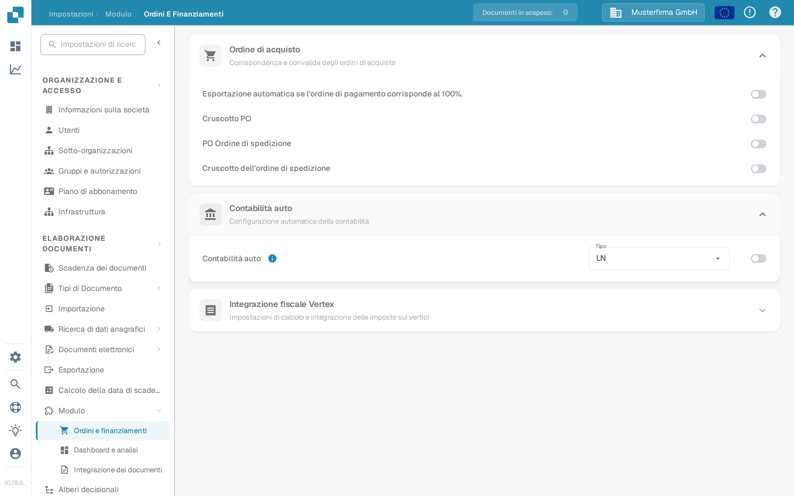
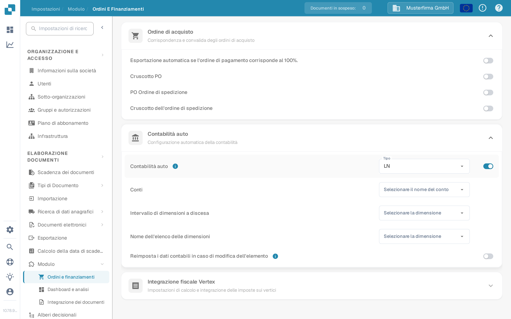

# Test Contabilità auto

La Contabilità auto richiede un modulo attivo, i dati anagrafici contabili e una fattura con importi o righe di posizione utilizzabili. Questa guida separa le impostazioni che è possibile controllare prima di aprire una fattura dai controlli che richiedono una connessione LN o M3 configurata.

## Controllare le impostazioni del modulo

1. Aprire **Impostazioni → Modulo → Ordini e finanziamenti** ed espandere **Contabilità auto**. Il percorso precedente **Elaborazione documenti → Modulo → Ordine di acquisto / Contabilità automatica** non è più il percorso mostrato nell'applicazione attuale.
2. Scegliere il **Tipo** per il sistema collegato (**LN** o **M3**). Attivare **Contabilità auto** solo quando i dati anagrafici richiesti e la connessione sono pronti.
3. Una volta attivata, selezionare l'elenco **Conti** e gli elenchi di dimensioni adatti al proprio sistema. Per LN, i campi visibili includono **Intervallo di dimensioni a discesa** e **Nome dell'elenco delle dimensioni**. M3 ha campi diversi. Usare **Reimposta i dati contabili in caso di modifica dell'elemento** solo se si intende un ricalcolo dopo la modifica di un elemento.

<figure><figcaption>
La Contabilità auto è disattivata nell'organizzazione di test della Sandbox in italiano.
</figcaption></figure>

<figure><figcaption>
I campi mostrati quando l'impostazione è attivata. È stata disattivata nuovamente dopo questa acquisizione; non sono stati configurati conti o dimensioni.
</figcaption></figure>

## Test con una fattura configurata

Utilizzare una fattura le cui righe di posizione e i cui dati anagrafici contabili siano disponibili. Aprirla nella schermata di convalida e selezionare **Contabilità auto**. Se l'azione non è presente, controllare l'impostazione del modulo e se questa fattura è idonea. Convalidare la fattura prima di spostarsi; l'applicazione salva ed esegue la convalida quando si seleziona l'azione.

Nella schermata contabile, verificare quanto segue con i propri dati LN o M3:

1. Eseguire **Validate Setup** dove disponibile e risolvere la configurazione mancante di conti o dimensioni prima di procedere. Un risultato verde descrive solo i controlli del proprio ambiente.
2. Controllare se la fattura deve essere assegnata in base al **totale** o in base alle **singole righe di posizione**. Confrontare gli importi contabili con la fattura originale.
3. Se si suddivide un importo, selezionare il conto previsto per ogni riga di suddivisione. Inserire importi o percentuali e controllare che i valori allocati sommino all'importo padre. Aggiungere o rimuovere una riga solo quando necessario.
4. Esaminare eventuali **Unsettled amount** o avvisi di convalida e correggerli prima di salvare o esportare. Confermare il risultato nel sistema collegato separatamente.

L'organizzazione di test della Sandbox usata per le schermate precedenti non ha elenchi di conti e dimensioni configurati né righe di fattura per questo flusso. La schermata contabile, la suddivisione e l'esportazione non sono quindi state **testate né illustrate qui**. Non usare le schermate delle impostazioni come prova del buon esito della contabilizzazione o dell'esportazione.

Per la configurazione specifica del sistema, proseguire con la [guida LN](ln.md) o la [guida M3](m3.md).
