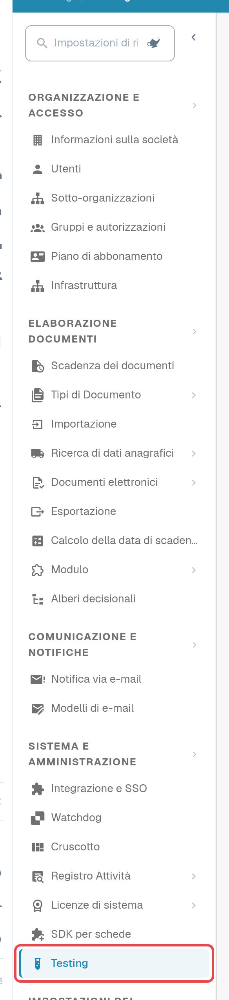
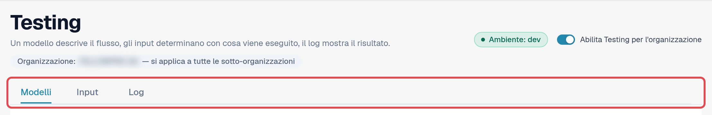
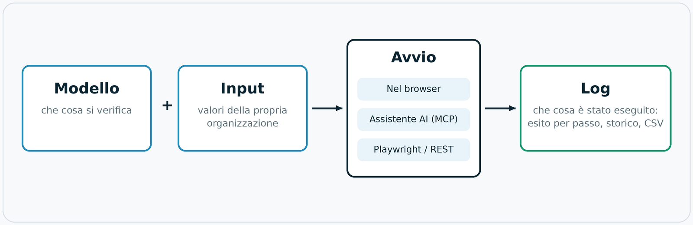
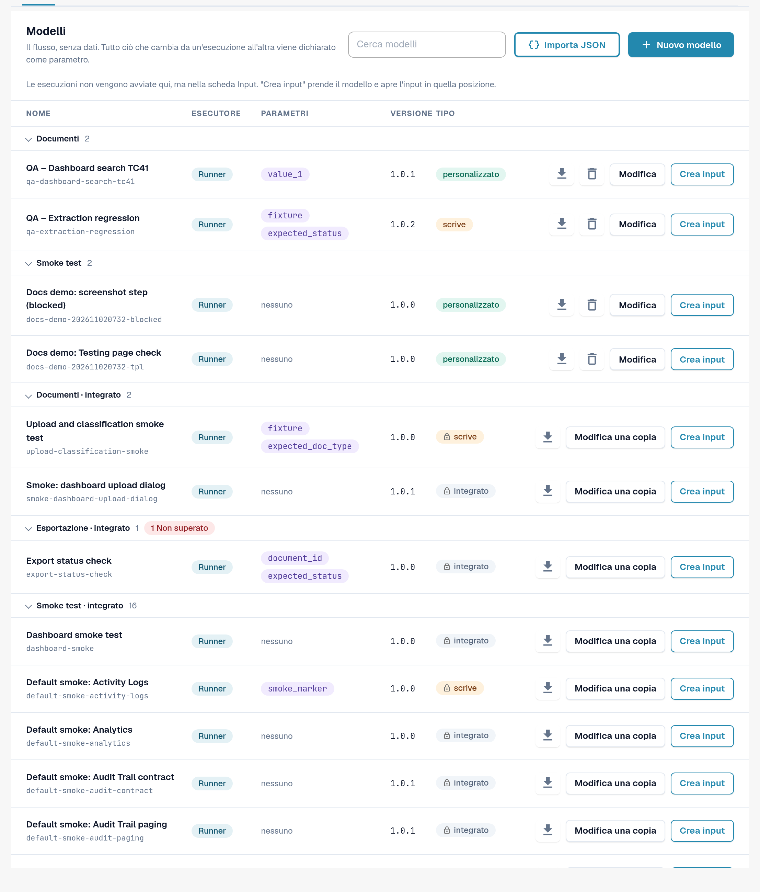

# Modulo Testing

## Video tutorial: eseguire il primo test nel browser



[Aprire il video in italiano con sottotitoli, capitoli e trascrizione](https://docbits-videos.fra1.cdn.digitaloceanspaces.com/settings-assistant/testing-module-overview-preview-admin/v1/it.html).

**Durata: 2:31.** Interfaccia, narrazione e sottotitoli in italiano.

La guida utilizza il **Live testing self-check** integrato nell’ambiente di sviluppo: esaminare i tre passaggi, creare e salvare un input con un nome, avviare il test nel browser e aprire il registro salvato della stessa esecuzione. Il modello non richiede parametri e non modifica dati aziendali. Il superamento conferma questi tre controlli; non dimostra l’estrazione delle fatture, l’approvazione o l’esportazione ERP.

**Versione di revisione:** l’ascolto umano completo e la verifica funzionale sono ancora da approvare.


**Controllare il risultato salvato.** Nelle registrazioni inglese e tedesca della versione 11.21.2, l’indicatore di un input mostrava un blocco, mentre l’esecuzione e il registro salvato risultavano superati. Riaprendo l’input, l’indicatore tornava coerente. In caso di differenze, consultare il registro della stessa esecuzione. La riapertura è una soluzione temporanea osservata, non una correzione confermata.


## A cosa serve il modulo Testing

Il modulo **Testing** esegue test del browser all'interno della propria sessione DocBits già autenticata. Un test utilizza
le schermate reali anziché una simulazione: apre la dashboard, carica una fattura di esempio, verifica che un nuovo documento
arrivi alla validazione oppure controlla che un'esportazione riporti lo stato previsto. Verifica che DocBits si comporti
correttamente **nella propria organizzazione** e registra il risultato di ogni passaggio.

Il modulo si trova in **Impostazioni → Testing**. È destinato agli amministratori che si occupano delle suite di test di
un'organizzazione.

Utilizzarlo quando si desidera:

* verificare che tutto funzioni ancora dopo un rilascio, una modifica della configurazione o un'importazione delle impostazioni;
* ripetere la stessa verifica di accettazione per più organizzazioni durante un'implementazione;
* mettere a disposizione del QA un elenco di verifiche che chiunque può avviare e di cui tutti possono leggere i risultati;
* consentire alla propria automazione dei test o a un assistente AI di avviare le stesse verifiche e di leggerne i risultati.

## Chi può utilizzarlo

Il modulo è disponibile per gli **amministratori dell'organizzazione** (vedere [Privilegi di amministratore](../../../settings/global-settings/groups-users-and-permissions/users/admin-privileges.md)).
Per ogni organizzazione è disattivato finché un amministratore dell'organizzazione non lo attiva.

1. Aprire **Impostazioni**. Nella barra laterale, sotto **Sistema e amministrazione**, selezionare **Testing**.
2. Attivare **Abilita Testing per l'organizzazione**.

<figure><figcaption>
Barra laterale delle impostazioni con la voce Testing evidenziata.
</figcaption></figure>

<figure><figcaption>
Intestazione della pagina Testing con il badge dell'ambiente, l'interruttore e le tre schede.
</figcaption></figure>

Sotto il titolo, **Organizzazione: … — si applica a tutte le sotto-organizzazioni** indica l'organizzazione a cui si riferisce questa pagina. Ciò che si configura qui vale per quell'organizzazione e per tutte le sue sotto-organizzazioni.

Finché l'interruttore è disattivato, la pagina mostra soltanto *Testing è disattivato. Non verrà eseguito nulla finché un amministratore dell'organizzazione non lo attiverà.* Disattivandolo di nuovo si chiude anche ogni scheda del browser che era stata registrata per gli avvii dall'esterno.

Il badge **Ambiente** indica dove ci si trova. In un ambiente cliente (sandbox o produzione) è rosso e DocBits applica una
protezione aggiuntiva: i test che modificano dati richiedono una conferma esplicita e i passaggi di esportazione, eliminazione o
approvazione vengono bloccati, a meno che il modello non dichiari di scrivere dati.

## Come funziona: modello, input, avvio, log

La pagina ha tre schede: **Modelli**, **Input** e **Log**. Un modello descrive il flusso, un input stabilisce con quali
valori viene eseguito e il log mostra il risultato.

<figure><figcaption>
Diagramma: modello più input dà un test; viene avviato nel browser, da un assistente AI o dall'esterno; ogni esecuzione termina nei Log.
</figcaption></figure>

| Elemento | Scheda | Che cos'è |
|---|---|---|
| **Modello** | **Modelli** | Una definizione di test riutilizzabile: *che cosa* viene verificato, passaggio per passaggio. Non contiene dati della propria organizzazione. Tutto ciò che cambia da un'organizzazione all'altra è un **parametro**. |
| **Input** | **Input** | I valori salvati dalla propria organizzazione per i parametri di un modello, ad esempio il documento da aprire. **Modello + input = un test che si può avviare.** |
| **Avvio** | **Input** | Il modulo esegue e gestisce il test. Esistono tre modi equivalenti per avviarlo: nel browser, da un assistente AI tramite MCP oppure dall'esterno con Playwright o una chiamata REST. |
| **Log** | **Log** | Che cosa è stato effettivamente eseguito, indipendentemente da come è stato avviato: il risultato, ogni passaggio, i parametri utilizzati. Un grafico della cronologia mostra i risultati nel tempo; i log si possono esportare in CSV. |

DocBits fornisce **modelli predefiniti** (i loro ID iniziano con `default-smoke-`) e alcuni modelli integrati. Sono
uguali per tutte le organizzazioni e non possono essere modificati né eliminati. Un modello predefinito può essere eseguito in qualsiasi
organizzazione; l'input fornisce ciò che è specifico della propria. È anche possibile creare modelli propri ed eliminarli di nuovo.

## Avvio rapido: eseguire un test predefinito

1. Aprire **Impostazioni → Testing**, scheda **Modelli**.
2. Nel gruppo **Smoke test**, trovare un modello predefinito senza parametri (nella colonna **Parametri** compare *nessuno*), ad esempio *Default smoke: log metrics*.
3. Selezionare **Crea input**. Si apre la scheda **Input** con un nuovo input per questo modello.
4. Inserire un **Nome di input** e selezionare **Salva input**.
5. Selezionare **Avvia**. Il test viene eseguito in questa scheda del browser; non ricaricare né chiudere la scheda mentre è in corso.
6. Aprire la scheda **Log**. La riga più recente mostra il risultato: **Superato**, **Non superato** o **Bloccato**.

<figure><figcaption>
Scheda Modelli con il gruppo Smoke test.
</figcaption></figure>

Per approfondire:

* [Modelli](templates.md): modelli predefiniti, modelli propri, importazione ed eliminazione
* [Passaggi e blocchi predefiniti](steps-and-blocks.md): gruppi di passaggi, impostazioni avanzate, pulizia, valori memorizzati
* [Selezionare un elemento nell'app](pick-in-app.md): scegliere un elemento indicandolo direttamente
* [Ricaricare e riprendere](reload-and-resume.md): ricaricare la pagina nel mezzo di un test
* [Input](inputs.md): salvare i valori della propria organizzazione
* [Avviare un test](start-a-test.md): nel browser, da un assistente AI o da Playwright
* [Log e cronologia](logs.md): risultati, grafico ed esportazione CSV
* [Risoluzione dei problemi](troubleshooting.md)
* [Per sviluppatori](for-developers.md)
