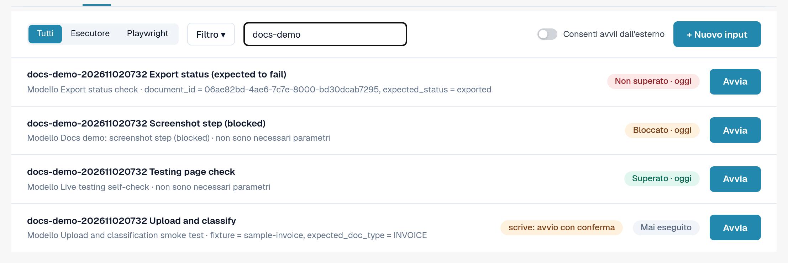
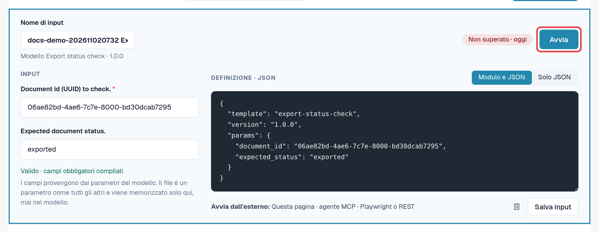
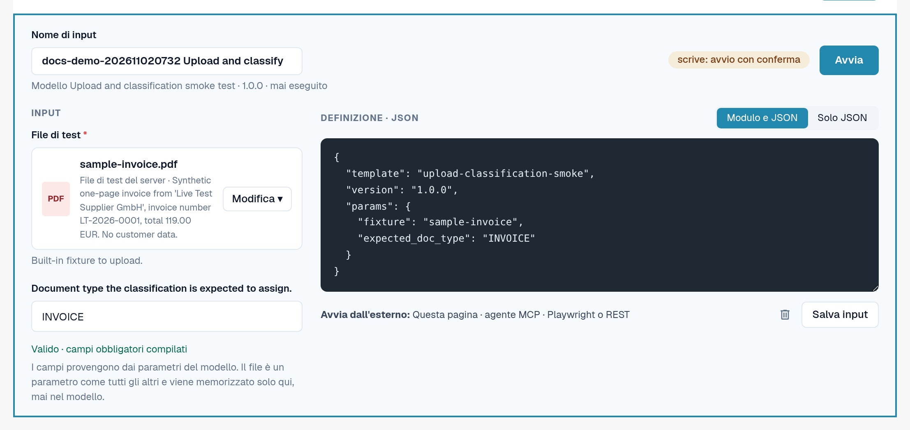

# Input

Un input memorizza **i valori della propria organizzazione** per i parametri di un modello, con un nome a scelta.
Un modello più un input è un test che si può avviare più volte, manualmente o in automatico.

Esempio: il modello predefinito *Default smoke: validation contract* apre un documento e ne verifica lo stato e il tipo di
documento. Richiede un ID documento. L'input *Fattura LT-2026-0001 pronta per la validazione* memorizza l'ID di un
documento della propria organizzazione e lo stato previsto.

Aprire **Impostazioni → Testing**, scheda **Input**.

<figure><figcaption>
Scheda Input con gli input salvati e i rispettivi ultimi risultati.
</figcaption></figure>

Ogni riga mostra il nome dell'input, il suo modello e la versione, l'ultimo risultato e **Avvia**. **Aggiornamento disponibile**
significa che il modello ha una versione più recente di quella per cui l'input è stato salvato. Un indicatore **scrive: avvio con conferma**
contrassegna gli input il cui modello modifica dati.

## Creare un input

1. Nella scheda **Modelli**, selezionare **Crea input** sul modello. (Oppure, nella scheda **Input**, selezionare
   **+ Nuovo input** e scegliere il modello.)
2. Inserire un **Nome di input**, ad esempio lo scopo e l'organizzazione.
3. Compilare i parametri. I campi obbligatori sono contrassegnati da un asterisco. È possibile passare da **Modulo e JSON**
   a **Solo JSON**; i due modi restano sincronizzati.
4. Controllare la riga sotto il modulo: *Valido · campi obbligatori compilati* significa che l'input può essere avviato.
5. Selezionare **Salva input**.

<figure><figcaption>
Editor degli input con nome, parametri e riga di validità.
</figcaption></figure>

### File come parametri

Alcuni modelli caricano un documento. Il loro parametro di tipo file offre **File dell'organizzazione** (PDF, PNG o JPEG fino a 10 MB
caricati dalla propria organizzazione per i test) e **File di test del server** (file di test sintetici forniti da DocBits).
Il file viene memorizzato nella propria organizzazione, mai nel modello.

<figure><figcaption>
Parametro file con file dell'organizzazione e file di test del server.
</figcaption></figure>

### Valori che non vengono mai salvati

I parametri contrassegnati come riservati (ad esempio la password di un sistema esterno) non vengono mai memorizzati. L'input
ricorda soltanto che il valore è necessario; lo si inserisce a ogni avvio (*Inviato solo all'avvio; mai salvato.*).
I log mostrano tali valori come *Fornito all'inizio*.

## Modificare o eliminare un input

Aprire l'input dall'elenco, modificarlo e selezionare **Salva input**. Per eliminarlo, selezionare l'icona del cestino
nell'editor e confermare. L'eliminazione di un input non elimina i relativi log.


Se la propria organizzazione gestisce **casi di test**, il collegamento **Casi di test** nel menu dei filtri della scheda Input elenca
i casi e mostra quali hanno un modello. Un caso senza modello può essere confermato manualmente da una persona autorizzata.

