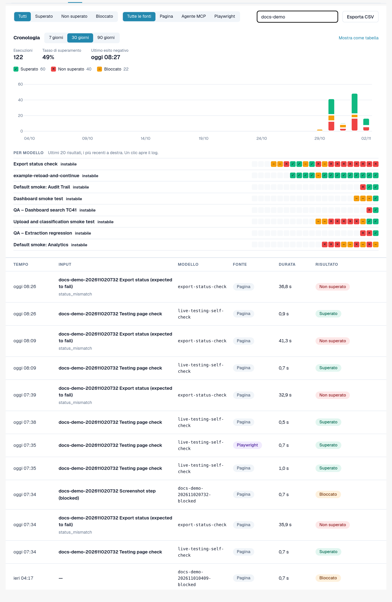
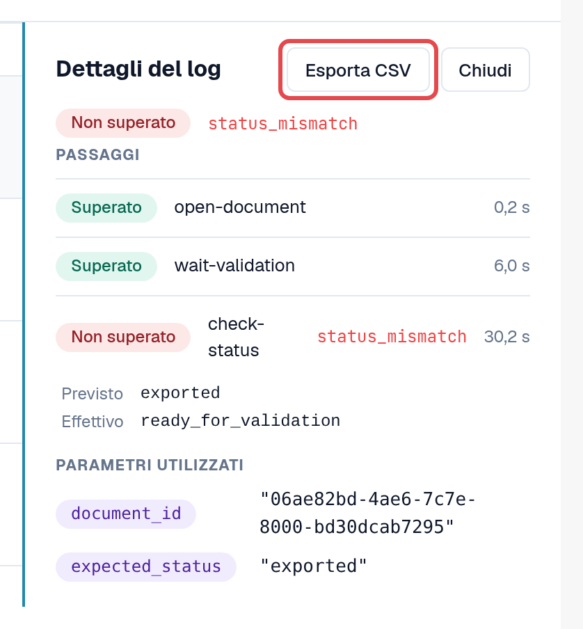
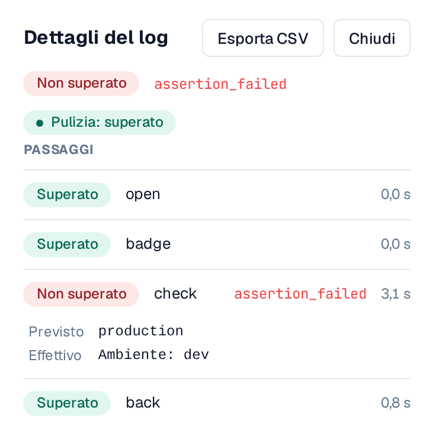
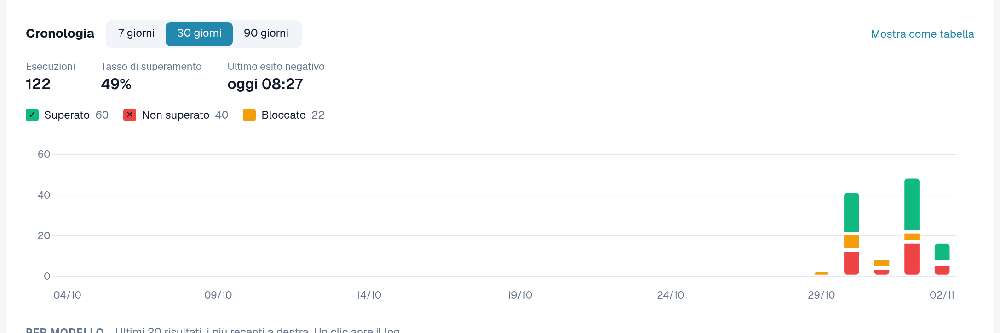
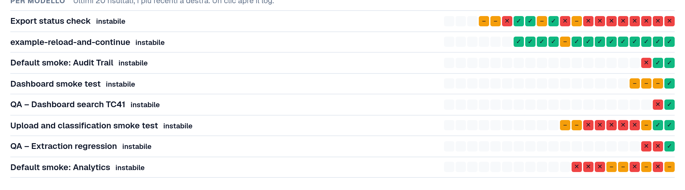
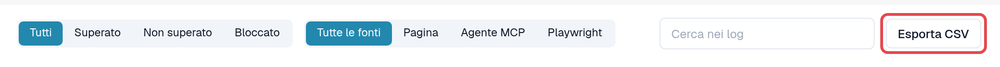

# Log e cronologia

Ogni esecuzione, indipendentemente da come è stata avviata, confluisce nella scheda **Log**: il risultato, i passaggi, il codice di errore di un passaggio
non riuscito e i parametri utilizzati. I log non memorizzano il contenuto delle pagine né gli screenshot.

Aprire **Impostazioni → Testing**, scheda **Log**.

<figure><figcaption>
Scheda Log con risultati e fonti diversi.
</figcaption></figure>

## Leggere l'elenco

| Colonna | Significato |
|---|---|
| **Tempo** | Quando è iniziata l'esecuzione. |
| **Input** | L'input che è stato avviato (oppure il caso del piano di test). |
| **Modello** | L'ID del modello. |
| **Fonte** | **Pagina** (avviato nel browser), **Agente MCP**, **Playwright**, **Manuale** (un caso confermato a mano). |
| **Durata** | Quanto è durata l'esecuzione. |
| **Risultato** | **Superato**: ogni passaggio è stato superato. **Non superato**: un passaggio non è riuscito. **Bloccato**: l'esecuzione non ha potuto essere valutata, ad esempio perché alcuni passaggi sono stati saltati; un'esecuzione composta solo da passaggi saltati non viene mai mostrata come superata. |

Filtrare con **Tutti / Superato / Non superato / Bloccato**, con **Tutte le fonti / Pagina / Agente MCP / Playwright** oppure con
**Cerca nei log**.

## Aprire un log

Selezionare una riga. **Dettagli del log** mostra ogni passaggio con il suo risultato, il codice di errore di un passaggio non riuscito e i
**Parametri utilizzati** (i valori riservati solo come *Fornito all'inizio*). **Apri caso** porta al caso del piano di test, se
ce n'è uno.

<figure><figcaption>
Dettagli del log di un'esecuzione non riuscita.
</figcaption></figure>

### Valore previsto ed effettivo

Sotto una verifica non riuscita, **Dettagli del log** mostra che cosa la verifica si aspettava e che cosa ha trovato:

* **Previsto**: il valore richiesto dal modello.
* **Effettivo**: il valore presente nella pagina.

Entrambi compaiono solo in **ambienti di sviluppo e di test**, vengono abbreviati a 120 caratteri e vengono omessi quando il
passaggio utilizza un valore riservato. In un ambiente cliente (sandbox, produzione) il log conserva solo il codice di errore.

### Pulizia

Se il modello ha [passaggi di pulizia](steps-and-blocks.md), l'indicatore accanto al risultato mostra come sono terminati:
**Pulizia: superato**, **Pulizia: non superato** o **Pulizia: saltato** (ad esempio perché l'esecuzione è stata fermata). I passaggi di pulizia
vengono eseguiti anche dopo una verifica non riuscita. Una pulizia non riuscita non modifica il risultato dell'esecuzione, ma i dati di test, ad esempio un
documento caricato, potrebbero restare. Aprire il log per vedere quale passaggio di pulizia non è riuscito.

<figure><figcaption>
Dettagli del log: la verifica non riuscita con Previsto ed Effettivo e l'indicatore Pulizia: superato.
</figcaption></figure>

## Grafico della cronologia

Sopra l'elenco, **Cronologia** mostra l'andamento dei test nel tempo. Passare da **Mostra come grafico** a **Mostra come tabella**.

* **Risultati giornalieri**: quante esecuzioni sono state superate, non superate o bloccate in ogni giorno, nel proprio fuso orario. Scegliere
  l'**Intervallo di tempo** (da 7 a 90 giorni, predefinito 30). Selezionare un giorno per filtrare l'elenco su quel giorno; **Mostra di nuovo tutti i giorni** rimuove il filtro.
* **Tasso di superamento** e **Ultimo esito negativo** riassumono l'intervallo. Le esecuzioni ancora in corso vengono conteggiate come *senza ancora un risultato*.
* **Per modello**: gli ultimi 20 risultati di ogni modello, il più recente a destra, con un'etichetta: **stabile** (solo
  superati), **instabile** (risultati misti) o **non superato** (solo non superati o bloccati). Selezionare un risultato per aprirne il log.
  I modelli instabili sono elencati per primi.

<figure><figcaption>
Cronologia: risultati giornalieri.
</figcaption></figure>

<figure><figcaption>
Per modello: ultimi 20 risultati e stabilità.
</figcaption></figure>

## Esportare come CSV

Selezionare **Esporta CSV** nella barra degli strumenti per scaricare i log corrispondenti al risultato e alla fonte selezionati (fino a 5.000;
il testo di ricerca non viene applicato). In **Dettagli del log**, **Esporta CSV** scarica un singolo log con tutti i suoi passaggi.

Il file si apre direttamente in Excel (UTF-8). Gli orari sono in UTC. Contiene le stesse informazioni della pagina: nessun valore
riservato, nessun contenuto delle pagine.

<figure><figcaption>
Esporta CSV nella barra degli strumenti dei Log.
</figcaption></figure>
