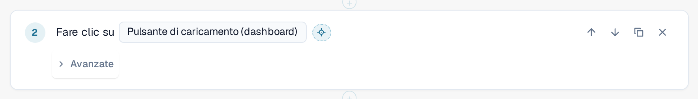
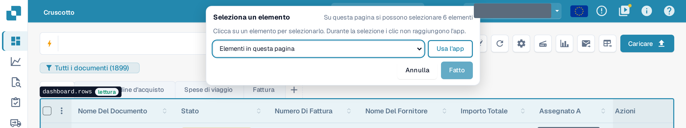
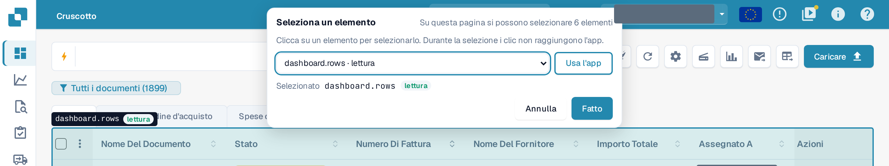
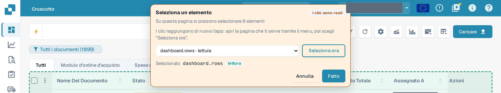

# Selezionare un elemento nell'app

Ogni passaggio deve sapere **su quale elemento** della pagina agisce: un pulsante, un campo, una tabella. Invece di cercarlo
in un lungo elenco, è possibile indicarlo direttamente nell'applicazione reale.

## Selezionare un elemento

1. Nell'editor dei modelli, selezionare il pulsante con il mirino **Seleziona nell'app** accanto all'elemento di un passaggio.

<figure><figcaption>
Il pulsante Seleziona nell'app accanto all'elemento di un passaggio Clic
</figcaption></figure>

2. DocBits apre la pagina su cui si trova il test in questo passaggio: la pagina del passaggio **Apri pagina** precedente più vicino.
   Se quel passaggio utilizza un valore di input, DocBits chiede quale pagina aprire. La bozza viene conservata, non salvata, e
   l'applicazione resta in questa scheda del browser.
3. In alto compare una barra **Seleziona un elemento**. Indica quanti elementi si possono selezionare in questa pagina. Spostare il
   mouse sulla pagina: DocBits evidenzia con un contorno l'elemento sotto il puntatore e ne indica il nome, insieme alla sua classe:
   **lettura** (solo lettura), **modifica i dati**, **irreversibile** o **sconosciuto**.

<figure><figcaption>
Passando sopra l'elenco dei documenti: il contorno indica l'elemento dashboard.rows e la sua classe lettura
</figcaption></figure>

4. Fare clic sull'elemento. La barra lo mostra sotto **Selezionato**. È anche possibile scegliere un elemento dall'elenco
   **Elementi in questa pagina** nella barra, che funziona con la tastiera e con uno screen reader.

<figure><figcaption>
La barra dopo un clic: dashboard.rows è selezionato, Fatto è attivo
</figcaption></figure>

5. Selezionare **Fatto**. L'editor si riapre con la bozza e l'elemento nel passaggio. Selezionare **Annulla** per tornare
   indietro senza modifiche. In entrambi i casi la bozza resta non salvata: selezionare **Salva** nell'editor quando si è soddisfatti.

Durante la selezione **l'applicazione non vede i clic.** Selezionare un pulsante **Elimina** non elimina nulla. Uscire
dal selettore con **Fatto** o **Annulla**; nessun tasto (nemmeno Esc) lo chiude. Il pulsante è disattivato mentre un test
è in esecuzione in questa scheda.

## Selezionare una tabella, una colonna o un'azione di riga

I passaggi del gruppo **Tabella** (**Verifica riga della tabella**, **Clicca sulla riga della tabella**, **Memorizza valore** da una cella di tabella) accettano
solo tabelle. Fare clic su una cella della tabella: DocBits prende la tabella e propone la colonna di quella cella e le altre
colonne della riga come suggerimenti per i campi colonna del passaggio. Per **Clicca sulla riga della tabella**, fare clic sul pulsante
all'interno della riga per scegliere quell'azione di riga. **Verifica numero** accetta qualsiasi elemento, tabelle comprese.

## Usare l'app durante la selezione

L'elemento necessario potrebbe trovarsi in un'altra pagina. Selezionare **Usa l'app**. La barra diventa arancione e mostra **I clic sono reali**:
da questo momento i clic raggiungono di nuovo l'applicazione, quindi è possibile aprire l'altra pagina tramite il normale menu.
La barra rimane e il suo elenco segue la pagina. Selezionare **Seleziona ora** per tornare a selezionare.

<figure><figcaption>
Modalità Usa l'app: i clic sono reali, Seleziona ora riporta alla selezione
</figcaption></figure>


Nella modalità **Usa l'app** un clic è un clic reale: può salvare, eliminare o inviare dati nella propria organizzazione.
Tornare a **Seleziona ora** prima di fare clic su qualcosa che non si desidera eseguire.

