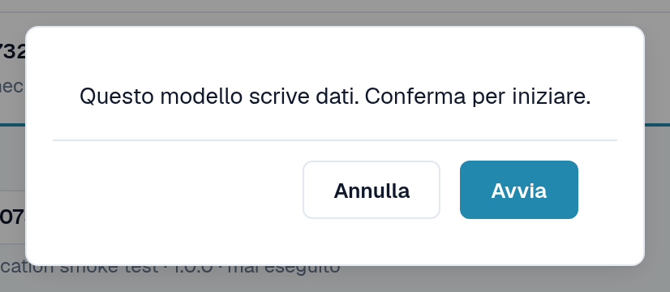
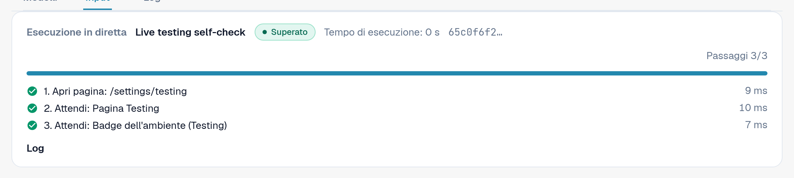
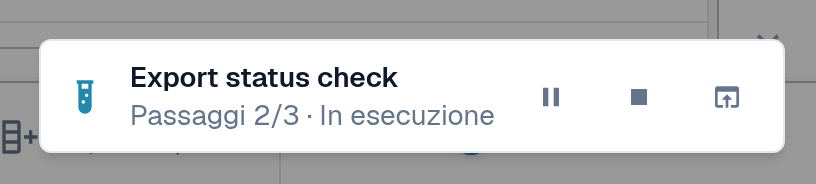
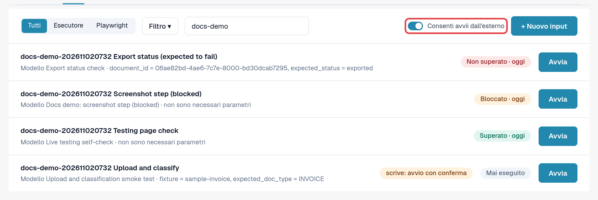
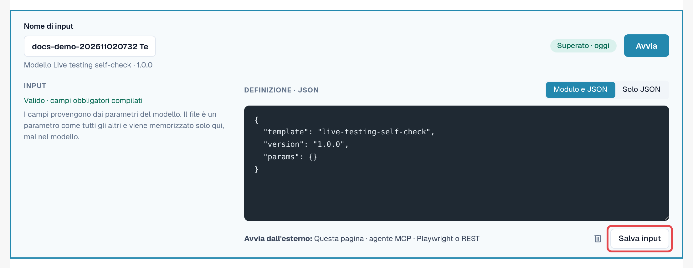

# Avviare un test

Un test è un modello più un input. Il modulo Testing lo esegue e lo gestisce; si sceglie come avviarlo. Tutti e tre i
modi sono equivalenti e ogni esecuzione confluisce nei [Log](logs.md).

| Modo | Quando utilizzarlo | Mostrato nei log come |
|---|---|---|
| **Nel browser** | Si desidera eseguire subito una verifica e seguirla. | **Pagina** |
| **Assistente AI (MCP)** | Si lavora con un assistente AI collegato a DocBits e si desidera che esegua e valuti le verifiche. | **Agente MCP** |
| **Dall'esterno (Playwright o REST)** | L'automazione dei test o la pipeline CI avvia le verifiche, ad esempio dopo un deployment. | **Playwright** |

In ogni caso i clic avvengono in una **scheda del browser DocBits di un amministratore dell'organizzazione**, con i permessi di
quella persona. La scheda deve restare aperta; ricaricarla o chiuderla termina l'esecuzione. L'unica eccezione è un passaggio **Ricarica pagina**
del test stesso (vedere [Ricaricare e riprendere](reload-and-resume.md)).

## Avviare nel browser

1. Aprire **Impostazioni → Testing**, scheda **Input**.
2. Selezionare **Avvia** sull'input (oppure aprire l'input e selezionare **Avvia**).
3. Se il modello modifica dati, DocBits chiede: *Questo modello scrive dati. Conferma per iniziare.* Selezionare **Avvia** per continuare.
4. Il test viene eseguito in questa scheda. Nella pagina Testing il pannello **Esecuzione in diretta** mostra lo stato, l'**Azione in corso**,
   l'avanzamento dei passaggi e **Pausa**, **Riprendi** e **Ferma**. Quando il test apre un'altra pagina, un piccolo indicatore
   nell'angolo in basso a destra ne mostra l'avanzamento. Quando il test termina, l'indicatore mostra il risultato
   con **Apri log** e **Chiudi**.
5. Al termine del test, aprire la scheda **Log** per leggere il risultato.

<figure><figcaption>
Conferma prima di un test che scrive dati.
</figcaption></figure>

<figure><figcaption>
Pannello Esecuzione in diretta dopo il superamento del test.
</figcaption></figure>

<figure><figcaption>
Indicatore di esecuzione nell'angolo in basso a destra in un'altra pagina.
</figcaption></figure>


**Caricamenti durante un test:** se la propria organizzazione ha sotto-organizzazioni e la dashboard le mostra tutte, la finestra
di caricamento chiede normalmente a quale sotto-organizzazione appartiene il documento. Mentre un test è in esecuzione, il caricamento viene indirizzato alla
**prima sotto-organizzazione proposta dalla finestra**, senza chiedere. Per caricare in una sotto-organizzazione specifica, avviare il
test dalla vista di quella sotto-organizzazione.


## Consentire gli avvii dall'esterno

Un assistente AI o uno script Playwright non può fare clic da solo; chiede a DocBits di eseguire un test **in una scheda del browser che
è stata registrata**:

1. Aprire **Impostazioni → Testing**, scheda **Input**, nella scheda del browser che deve eseguire i test.
2. Attivare **Consenti avvii dall'esterno**. La scheda ora accetta gli avvii e mostra il proprio ID di sessione.
3. Lasciare la scheda aperta. La registrazione termina quando la scheda viene ricaricata o chiusa.

<figure><figcaption>
Consenti avvii dall'esterno attivato, con l'ID di sessione.
</figcaption></figure>

L'editor degli input ricorda i tre modi sotto **Avvia dall'esterno:** **Questa pagina**, **agente MCP**,
**Playwright o REST**.

<figure><figcaption>
Riga Avvia dall'esterno nell'editor degli input.
</figcaption></figure>

## Avviare da un assistente AI (MCP)

Se il proprio assistente AI è collegato a DocBits (vedere [DocBits MCP](../../../../advanced-functions-and-tools/docbits-mcp/README.md)
e [Configurare DocBits con Claude o Codex](../../../../advanced-functions-and-tools/docbits-mcp/configuration-with-claude-or-codex.md)):

1. Consentire gli avvii dall'esterno in una scheda del browser (vedere sopra).
2. Rivolgersi all'assistente, ad esempio: *"Elenca i miei input di test DocBits e avvia 'Fattura LT-2026-0001 pronta per la validazione'
   nella mia scheda del browser registrata. Poi dimmi il risultato."*
3. L'assistente chiede quale scheda utilizzare se ne è registrata più di una e chiede conferma prima di avviare un test che
   modifica dati. Poi legge il log e riporta il risultato.

## Avviare da Playwright o da un altro strumento (REST)

L'automazione dei test avvia un input con una sola chiamata API e poi ne legge il log. Occorrono:

* un token di un amministratore dell'organizzazione (vedere [Chiave API](../../../settings/global-settings/integration/api-key.md));
* l'ID dell'input;
* l'ID di sessione di una scheda del browser con **Consenti avvii dall'esterno** attivato.

La chiamata e un esempio si trovano in [Per sviluppatori](for-developers.md).

## Ambienti cliente

In sandbox e in produzione il badge **Ambiente** è rosso. I test che modificano dati richiedono una conferma esplicita a ogni
avvio e i passaggi di esportazione, eliminazione o approvazione vengono bloccati, a meno che il modello non dichiari di scrivere dati. Se possibile, eseguire
i test che scrivono in un ambiente di test.
