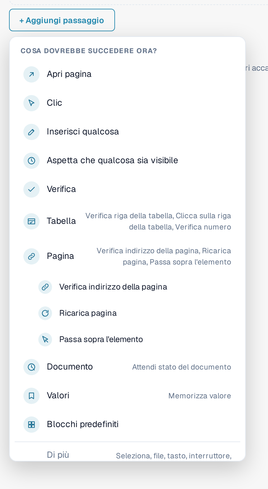
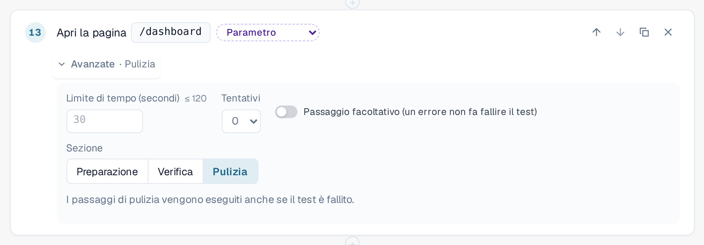
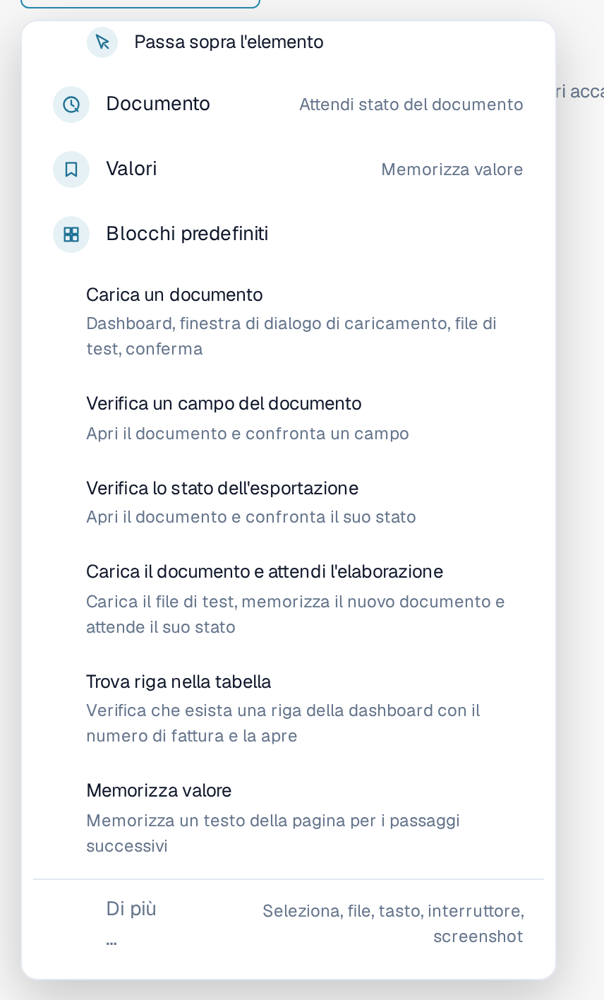
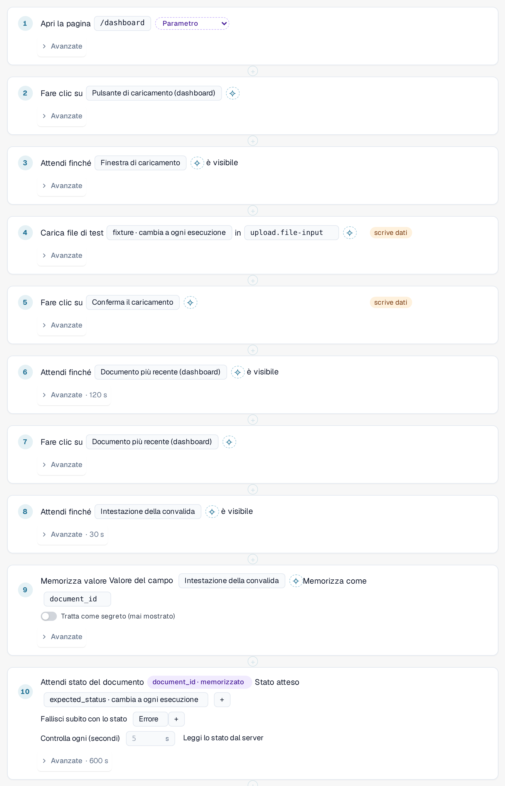
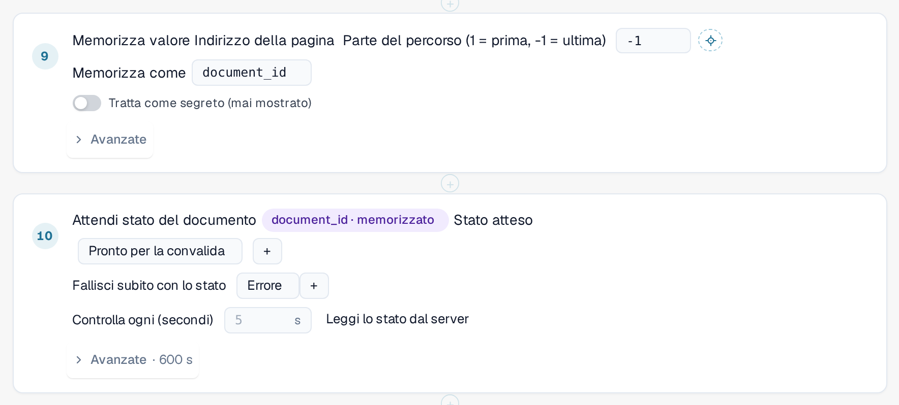
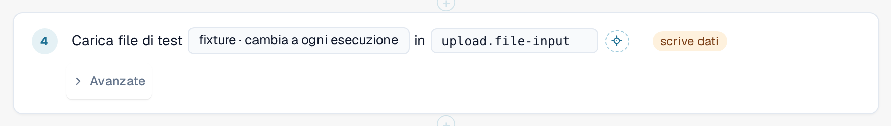

# Passaggi e blocchi predefiniti

Questa pagina spiega come costruire un modello nell'editor ([Modelli](templates.md)): i gruppi di passaggi, le impostazioni
**Avanzate** di un passaggio, i blocchi predefiniti e il modo in cui un test passa i valori da un passaggio al successivo.

## Aggiungere un passaggio

Nell'editor dei modelli, selezionare **+ Aggiungi passaggio**. Il menu **Cosa dovrebbe succedere ora?** elenca i passaggi. I cinque
passaggi di base sono **Apri pagina**, **Clic**, **Inserisci qualcosa**, **Aspetta che qualcosa sia visibile** e **Verifica**.
Quattro **gruppi** contengono i passaggi più specifici. Selezionare un gruppo per vederne i passaggi:

| Gruppo | Passaggi |
|---|---|
| **Tabella** | **Verifica riga della tabella**, **Clicca sulla riga della tabella**, **Verifica numero**. Per elenchi come l'elenco dei documenti nella dashboard. |
| **Pagina** | **Verifica indirizzo della pagina**, **Ricarica pagina** (vedere [Ricaricare e riprendere](reload-and-resume.md)), **Passa sopra l'elemento**. |
| **Documento** | **Attendi stato del documento**: attende che un documento raggiunga uno stato, ad esempio *Pronto per la validazione*. |
| **Valori** | **Memorizza valore**: conserva un testo della pagina per i passaggi successivi. |

I **Blocchi predefiniti** aggiungono più passaggi in una sola volta (vedere sotto). **Di più …** offre altri passaggi: selezionare un'opzione, caricare un file, premere un tasto,
attivare o disattivare un interruttore e acquisire una schermata (i passaggi di screenshot vengono saltati dall'esecutore nel browser).

<figure><figcaption>
Menu Aggiungi passaggio con i gruppi Tabella, Pagina, Documento e Valori; il gruppo Pagina è aperto
</figcaption></figure>

Per far puntare un passaggio a un elemento della pagina, selezionarlo nell'elenco oppure utilizzare **Seleziona nell'app**
([Selezionare un elemento nell'app](pick-in-app.md)).

## Impostazioni avanzate di un passaggio

Ogni passaggio ha una riga **Avanzate**. Selezionarla per aprire le impostazioni del passaggio. La riga compressa mostra ciò che è
stato modificato, ad esempio *Avanzate · 120 s* o *Avanzate · Pulizia*.

| Impostazione | Significato |
|---|---|
| **Limite di tempo (secondi)** | Per quanto tempo il passaggio può durare, fino a 120 secondi. Lasciare vuoto per il valore predefinito di 30 secondi. I passaggi che attendono un documento hanno un limite proprio, più lungo. |
| **Tentativi** | Quante volte DocBits ripete il passaggio se non riesce (da 0 a 3). |
| **Passaggio facoltativo (un errore non fa fallire il test)** | Se il passaggio non riesce, il log lo mostra come saltato insieme al relativo errore e il test prosegue. |
| **Sezione** | **Preparazione**, **Verifica** o **Pulizia**. **Verifica** è il valore predefinito. |

I passaggi di **Preparazione** predispongono il test. I passaggi di **Verifica** sono il test vero e proprio. I passaggi di **Pulizia** rimuovono ciò che il test ha lasciato
dietro di sé, ad esempio un documento che ha caricato. **I passaggi di pulizia vengono eseguiti anche se il test è fallito** o è scaduto, e
un passaggio di pulizia non riuscito non modifica mai il risultato del test. Devono essere gli ultimi passaggi del modello; l'editor segnala un errore se un
passaggio normale segue un passaggio di pulizia. Non vengono eseguiti se si ferma il test o si chiude la scheda.
Un modello con passaggi di pulizia viene salvato come schema 1.3 (vedere [Per sviluppatori](for-developers.md)).

<figure><figcaption>
Impostazioni avanzate di un passaggio: limite di tempo, tentativi, passaggio facoltativo e sezione, con Pulizia selezionata
</figcaption></figure>

## Blocchi predefiniti

Selezionare **+ Aggiungi passaggio**, quindi **Blocchi predefiniti**. Un blocco aggiunge i passaggi di una sequenza comune insieme ai
parametri di cui ha bisogno. Ogni passaggio può essere modificato in seguito.

| Blocco | Che cosa aggiunge |
|---|---|
| **Carica un documento** | Apre la dashboard, apre la finestra di caricamento, seleziona il file di test e conferma. |
| **Verifica un campo del documento** | Apre un documento e confronta un campo con un valore previsto. |
| **Verifica lo stato dell'esportazione** | Apre un documento e confronta il suo stato. |
| **Carica il documento e attendi l'elaborazione** | Carica il file di test, memorizza il nuovo documento e attende il suo stato. |
| **Trova riga nella tabella** | Verifica che nell'elenco della dashboard esista una riga con un determinato numero di fattura e la apre. |
| **Memorizza valore** | Memorizza un testo della pagina per i passaggi successivi. |

<figure><figcaption>
Blocchi predefiniti nel menu Aggiungi passaggio
</figcaption></figure>

### Carica il documento e attendi l'elaborazione

Utilizzare questo blocco quando un passaggio successivo ha bisogno del documento appena caricato dal test. Il blocco riconosce da solo il nuovo documento,
non in base alla prima riga dell'elenco, in modo che un documento più vecchio non venga mai scelto per errore. Legge poi l'ID
del documento dall'indirizzo della pagina e attende che il documento raggiunga lo stato previsto
(per impostazione predefinita *Pronto per la validazione*, fino a 10 minuti; si interrompe subito se il documento passa allo stato *Errore*).
Aggiunge i valori di input **fixture** (il file di test) ed **expected_status** e porta il tempo dell'intero test ad almeno 15 minuti.

<figure><figcaption>
Passaggi del blocco Carica il documento e attendi l'elaborazione
</figcaption></figure>


**Dove vanno i caricamenti:** se la propria organizzazione ha sotto-organizzazioni e la dashboard le mostra tutte, la finestra di caricamento
chiede normalmente a quale sotto-organizzazione appartiene il documento. Un test non può rispondere a questa domanda. Mentre un
test è in esecuzione nella scheda, il caricamento viene indirizzato alla **prima sotto-organizzazione proposta dalla finestra**, senza chiedere.
Al di fuori di un test non cambia nulla. Per caricare in una sotto-organizzazione specifica, avviare il test dalla vista di quella
sotto-organizzazione.


### Trova riga nella tabella

Il blocco verifica che l'elenco della dashboard contenga una riga con il numero di fattura indicato (il valore di input **row_value**)
e la apre. Per cercare in un'altra colonna, modificare la colonna e il valore nel passaggio. Entrambi i passaggi appartengono al
gruppo **Tabella**; **Verifica numero** conta righe o qualsiasi altro elemento.

## Memorizzare un valore e utilizzarlo in seguito

Un test ha spesso bisogno di un valore che esiste solo mentre è in esecuzione, ad esempio l'ID di un documento appena caricato.

1. Aggiungere **Memorizza valore** (gruppo **Valori**). Scegliere da dove proviene il valore: un testo della pagina, l'indirizzo
   della pagina (una parte del percorso o un parametro di query) oppure una cella di una riga di tabella. Inserire un nome in **Memorizza come**,
   ad esempio `document_id`. Attivare **Tratta come segreto (mai mostrato)** per i valori che non devono comparire da nessuna parte.
2. In un passaggio successivo, scegliere il valore memorizzato invece di digitarne uno. Il passaggio mostra un indicatore come
   *document_id · memorizzato*. Nel JSON del modello si scrive `{{vars.document_id}}`.

In un passaggio si possono utilizzare due tipi di valori:

| Tipo | Scritto come | Proviene da | Esempio |
|---|---|---|---|
| **Input** | `{{params.name}}` | L'[input](inputs.md) salvato: è uguale per ogni esecuzione di quell'input. Si crea con il pulsante dei parametri accanto a un valore. | *fixture · cambia a ogni esecuzione* |
| **Valore memorizzato** | `{{vars.name}}` | Un passaggio **Memorizza valore** precedente della stessa esecuzione. | *document_id · memorizzato* |

<figure><figcaption>
Memorizza valore salva l'ID del documento; il passaggio successivo attende quel documento
</figcaption></figure>

<figure><figcaption>
Un passaggio che utilizza il valore di input fixture
</figcaption></figure>

Un valore memorizzato esiste solo per l'esecuzione corrente e non viene mai salvato nel modello né nel log. I valori memorizzati
sopravvivono a un [ricaricamento della pagina](reload-and-resume.md) all'interno del test, a meno che non siano contrassegnati come segreti.
