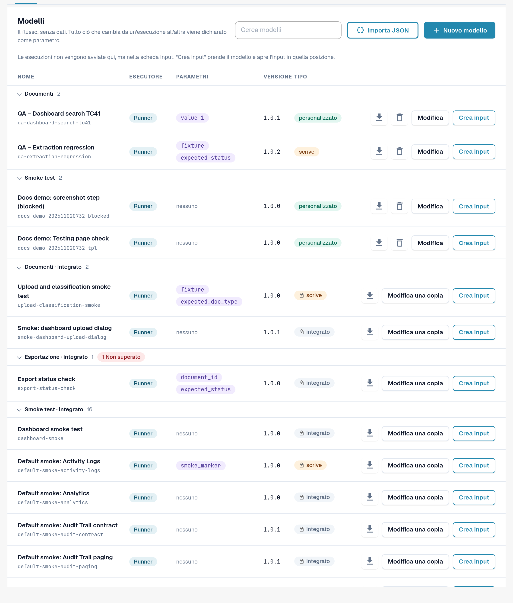
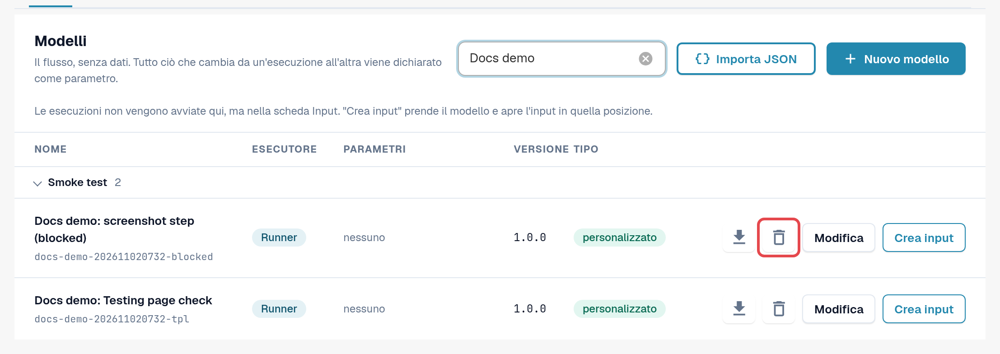
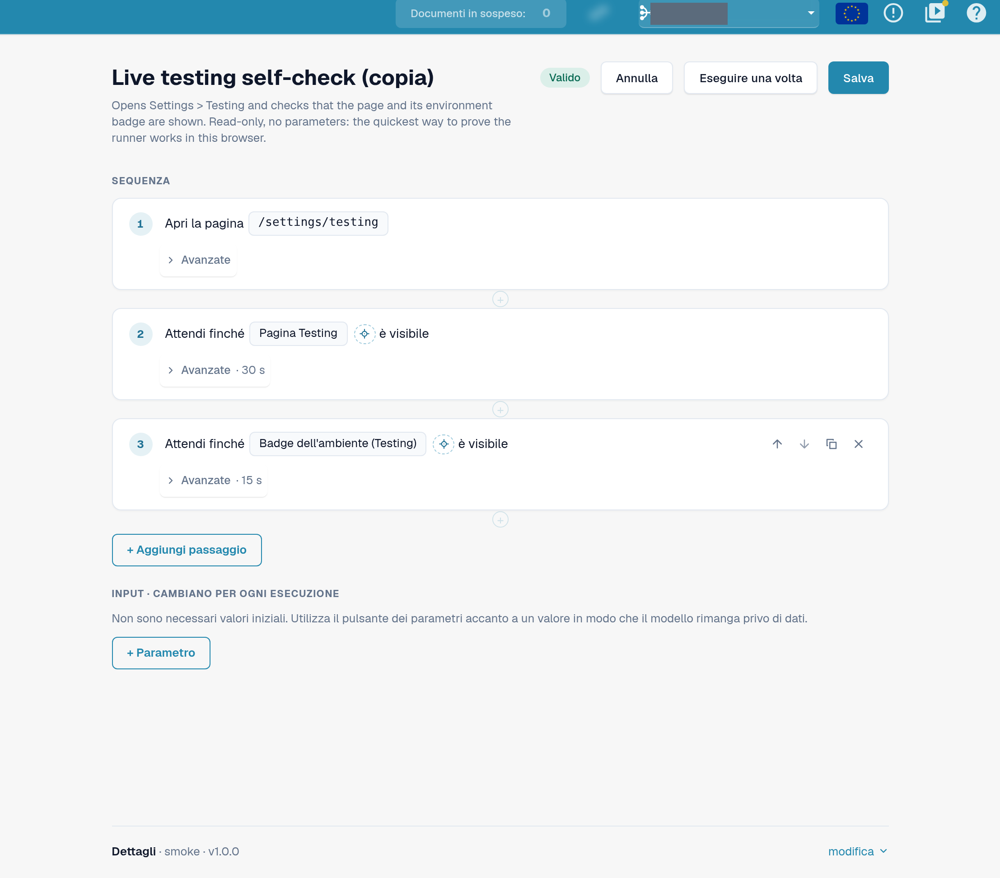
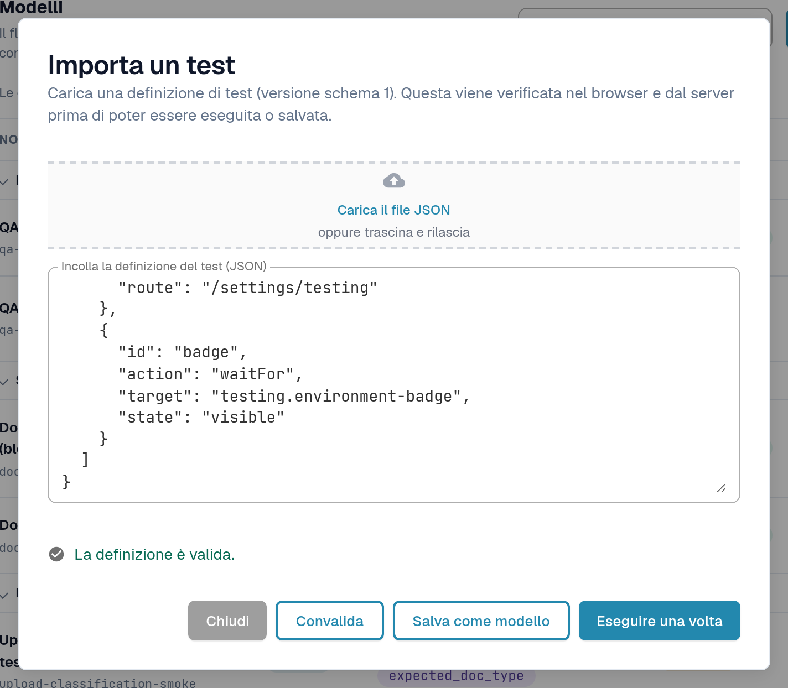
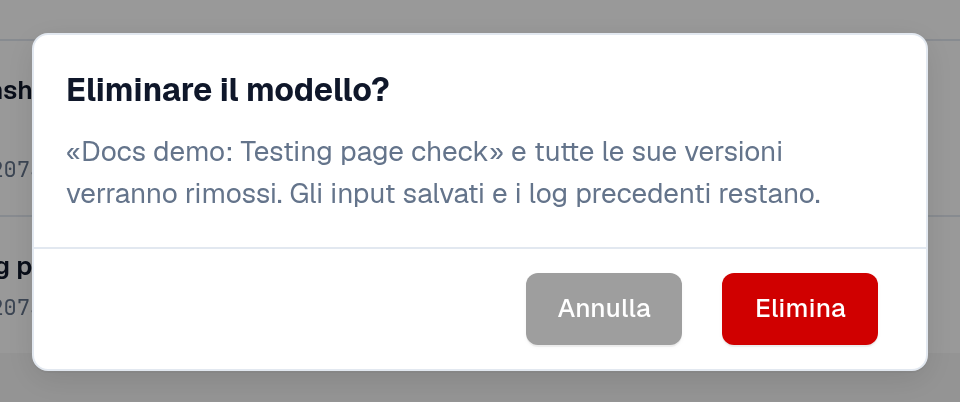

# Modelli

Un modello descrive **che cosa** viene verificato: quale pagina si apre, che cosa viene cliccato o compilato e che cosa deve
essere visibile o vero alla fine. Non contiene dati della propria organizzazione. I valori che cambiano da un'organizzazione
all'altra o da un'esecuzione all'altra, come un ID documento, vengono dichiarati come **parametri** e compilati da un [input](inputs.md).

Aprire **Impostazioni → Testing**, scheda **Modelli**.

<figure><figcaption>
Scheda Modelli: gruppi, colonne e azioni di riga.
</figcaption></figure>

## Leggere l'elenco

I modelli sono raggruppati per categoria (ad esempio **Smoke test**, **Convalida**, **Documenti**, **Esportazione**).
Selezionare il nome di un gruppo per comprimerlo; un indicatore rosso sul gruppo conta i modelli la cui ultima esecuzione non è riuscita.
**Cerca modelli** filtra per nome.

| Colonna | Significato |
|---|---|
| **Nome** | Il nome del modello e, sotto, il suo ID. |
| **Esecutore** | **Esecutore**: viene eseguito nella scheda del browser a partire da questa pagina. **Playwright**: una verifica eseguita dalla propria automazione dei test; può essere documentata qui, ma non avviata da questa pagina. |
| **Parametri** | I valori che un input deve fornire. *nessuno* significa che il modello viene eseguito così com'è. |
| **Versione** | Le versioni salvate non cambiano mai. Una modifica viene salvata come nuova versione. |
| **Tipo** | **integrato** (icona del lucchetto): fa parte del set predefinito, è uguale per tutte le organizzazioni ed è di sola lettura. **personalizzato**: il modello proprio dell'organizzazione. **scrive**: il modello modifica dati (ad esempio carica un documento) e richiede una conferma prima dell'avvio. |

Azioni di riga:

| Azione | Effetto |
|---|---|
| Icona di download (**Esporta come JSON**) | Scarica la definizione del modello come file JSON, ad esempio per conservarla o per importarla in un'altra organizzazione. |
| **Modifica una copia** (integrato) / **Modifica** (personalizzato) | Apre l'editor dei modelli con una copia che si può modificare e salvare come modello proprio. |
| **Crea input** | Apre la scheda [Input](inputs.md) con un nuovo input per questo modello. I test si avviano da lì, non da qui. |
| Icona del cestino (**Elimina modello**) | Solo sui modelli propri. Vedere *Eliminare un modello proprio* più avanti. |

<figure><figcaption>
Una riga predefinita e una riga di un modello proprio con le relative azioni.
</figcaption></figure>

## Creare un modello proprio

Un modello proprio serve quando nessun modello predefinito verifica ciò che serve oppure quando si desidera una copia modificata di un modello predefinito.

**Partire da un modello predefinito:** selezionare **Modifica una copia** sulla sua riga. **Partire da zero:** selezionare **Nuovo modello**.

Nell'editor dei modelli:

1. Inserire un **Nome del modello** e, facoltativamente, a cosa serve il modello.
2. Selezionare **+ Aggiungi passaggio** e scegliere un blocco, ad esempio **Apri pagina**, **Clic**, **Compila**, **Selezionare**,
   **Attendi**, **Verifica il testo**, **Verifica il campo** o **Verifica lo stato**. I **Blocchi predefiniti** aggiungono in un colpo solo una sequenza comune, ad esempio
   **Carica un documento** o **Carica il documento e attendi l'elaborazione**. Per i gruppi di passaggi, le impostazioni **Avanzate** e i passaggi di pulizia vedere
   [Passaggi e blocchi predefiniti](steps-and-blocks.md).
3. Per ogni valore che cambia da un'organizzazione all'altra o da un'esecuzione all'altra, utilizzare il pulsante dei parametri accanto al valore. Il valore
   diventa un parametro sotto **Input · cambiano per ogni esecuzione**, con un tipo (**Testo**, **Numero**, **Sì/No**,
   **File di test del server**), un valore predefinito e **Obbligatorio** se deve essere compilato.
4. Selezionare **Salva**. Per provare la bozza una volta senza salvarla, selezionare **Eseguire una volta**.

Per scegliere l'elemento di un passaggio indicandolo direttamente nell'applicazione, utilizzare **Seleziona nell'app**
([Selezionare un elemento nell'app](pick-in-app.md)).

I passaggi che modificano dati (ad esempio il caricamento di un documento) sono contrassegnati da **scrive dati**. Un modello con tali passaggi
richiede una conferma a ogni avvio.

<figure><figcaption>
Editor dei modelli con due passaggi e un parametro.
</figcaption></figure>

Se nel frattempo qualcun altro ha salvato la stessa versione di questo modello (ad esempio in un'altra scheda), DocBits conserva la
bozza e offre **Salva come prossima versione libera** o **Ricarica l'ultima versione**.

## Importare un modello da JSON

1. Selezionare **Importa JSON**.
2. Selezionare **Carica il file JSON** oppure incollare la definizione in **Incolla la definizione del test (JSON)**.
3. Selezionare **Convalida**. DocBits verifica la definizione nel browser e sul server ed elenca gli eventuali problemi.
4. Selezionare **Salva come modello** per aggiungerlo ai propri modelli oppure **Eseguire una volta** per provarlo senza salvarlo.

<figure><figcaption>
Finestra Importa un test con una definizione convalidata.
</figcaption></figure>

Il formato è descritto in [Per sviluppatori](for-developers.md).

## Eliminare un modello proprio

1. Sulla riga del proprio modello, selezionare l'icona del cestino (**Elimina modello**).
2. Leggere la richiesta di conferma **Eliminare il modello?** e selezionare **Elimina**.

Il modello e **tutte le sue versioni** vengono rimossi. Gli input salvati e i log precedenti restano, così la cronologia rimane leggibile.
Gli input che puntavano al modello restano nell'elenco; modificarli o eliminarli. In seguito è possibile salvare di nuovo un modello con lo
stesso ID. I modelli integrati e predefiniti non possono essere eliminati.

<figure><figcaption>
Conferma di eliminazione del modello.
</figcaption></figure>
