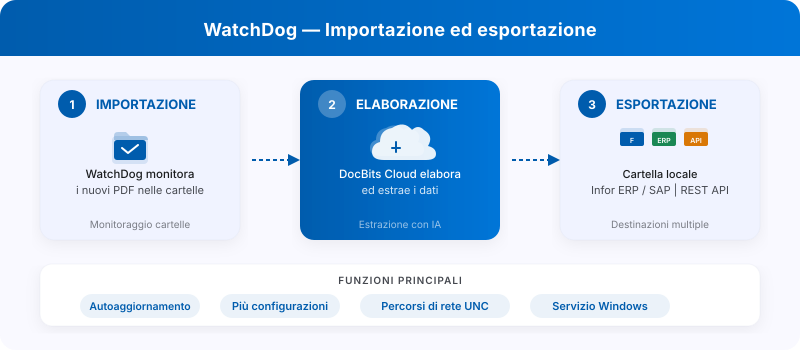
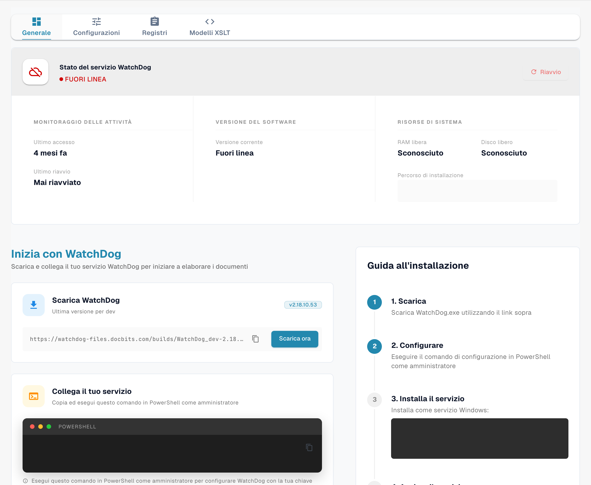

# WatchDog

<figure><figcaption><p>Schema di WatchDog: importazione, elaborazione in DocBits e destinazioni di esportazione secondo la configurazione. Diagramma esplicativo, non prova di un servizio in esecuzione.</p></figcaption></figure>

**WatchDog** è un servizio on-premise basato su Windows che monitora le cartelle locali alla ricerca di documenti in arrivo, li carica nel DocBits Cloud per l'elaborazione ed esporta i documenti completati in cartelle locali o sistemi ERP.

## Funzionalità Principali

* **Monitoraggio automatico delle cartelle** — controlla percorsi locali e percorsi di rete UNC alla ricerca di nuovi PDF
* **Supporto multi-configurazione** — più configurazioni di importazione/esportazione per istanza
* **Metodi di esportazione secondo la versione** — Local Folder, Infor IDM, Infor BOD, ION API, GLS840MI, REST API
* **Aggiornamenti** — opzioni disponibili secondo versione e pacchetto; verificare il comportamento e l’eventuale ripristino prima dell’uso
* **Gestione remota** — riavvio, aggiornamento e configurazione tramite l'interfaccia di DocBits

## Avvio Rapido

<figure><figcaption><p>Scheda Generale di WatchDog nello stato esistente FUORI LINEA. Chiave API, comandi specifici dell’account e percorso di installazione sono nascosti. La versione proposta per il download non dimostra la versione installata o in esecuzione. Nessun comando o servizio è stato avviato.</p></figcaption></figure>

### 1. Scarica WatchDog

Scarica `WatchDog.exe` da **Impostazioni → WatchDog → Generale** nell'applicazione DocBits.

### 2. Configura tramite API Key

Apri il **Prompt dei comandi come amministratore** ed esegui:

```powershell
WatchDog.exe -api YOUR_API_KEY
```

> **Nota:** L'API Key è disponibile nelle impostazioni di DocBits, nella scheda Generale di WatchDog. Collega WatchDog alla tua organizzazione DocBits.

### 3. Crea le Configurazioni in DocBits

Tutte le configurazioni di importazione ed esportazione vengono create direttamente nell'**applicazione DocBits**:

**Impostazioni → Elaborazione documenti → WatchDog → Scheda Configurazioni**

* **Configurazioni di importazione** — definiscono le cartelle da monitorare e i tipi di documento
* **Configurazioni di esportazione** — definiscono le destinazioni di esportazione, i template XSLT e i metodi di esportazione

> **Importante:** Le configurazioni di esportazione richiedono un **tipo di documento** (`doc_type`). Le configurazioni senza tipo di documento verranno rifiutate.


### 4. Installa come Servizio Windows

```powershell
WatchDog.exe install
WatchDog.exe start
```

### 5. Avvio Automatico (Facoltativo)

Per avviare WatchDog automaticamente all'avvio del sistema:

1. Apri **Servizi** (`Win + R` → `services.msc`)
2. Trova **WatchDog** nell'elenco
3. Imposta **Tipo di avvio** su **Automatico (avvio ritardato)**

## Riferimento dei Comandi

| Comando | Descrizione |
| :--- | :--- |
| `WatchDog.exe -api KEY` | Configura l'API Key e si connette a DocBits |
| `WatchDog.exe install` | Installa come servizio Windows |
| `WatchDog.exe start` | Avvia il servizio |
| `WatchDog.exe stop` | Arresta il servizio |
| `WatchDog.exe debug` | Esegue in modalità console per la risoluzione dei problemi |
| `WatchDog.exe --version` | Mostra la versione corrente |
| `WatchDog.exe --list-folders` | Elenca le cartelle monitorate configurate |
| `WatchDog.exe remove` | Disinstalla il servizio |

## Ulteriori Risorse

* [Installazione di WatchDog](watchdog-installation.md)
* [Configurazione di WatchDog](watchdog-v2-configuration.md)
* [FAQ per Amministratori di WatchDog](watchdog-admin-faq.md)

I comandi e i metodi elencati dipendono dal pacchetto installato. Verifica versione e guida del pacchetto prima dell’esecuzione. La cattura non ha installato WatchDog né modificato configurazioni o avviato un servizio.
