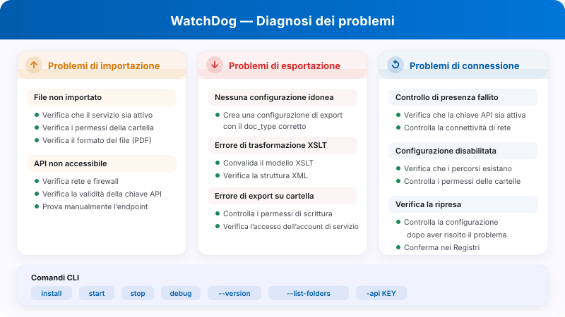

# FAQ per Amministratori di WatchDog e Risoluzione dei Problemi

<figure><figcaption><p>Diagnosi indicativa di importazione, esportazione e connessione. Dopo la correzione verifica la ripresa nei registri; il diagramma non garantisce una riattivazione automatica.</p></figcaption></figure>

Questa documentazione aiuta gli amministratori a comprendere i messaggi di errore di WatchDog e a risolvere i problemi.

**Posizione nell’interfaccia:** Impostazioni → WatchDog.

## 1. Viste per la diagnosi

Le schede effettive sono **Generale**, **Configurazioni**, **Registri** e **Modelli XSLT**. Generale contiene anche lo stato e l’ultimo contatto; Registri consente di esaminare gli eventi disponibili. Le configurazioni di importazione ed esportazione appartengono a Configurazioni.

<figure><figcaption><p>Scheda Generale di WatchDog nello stato esistente FUORI LINEA. Chiave API, comandi specifici dell’account e percorso di installazione sono nascosti. La versione proposta per il download non dimostra la versione installata o in esecuzione. Nessun comando o servizio è stato avviato.</p></figcaption></figure>

<figure><figcaption><p>Scheda Registri con il periodo selezionato Ultime 48 ore. È un filtro della vista, non una promessa sulla conservazione o sulla frequenza universale degli eventi. Nessun risultato dimostra da solo lo stato del servizio.</p></figcaption></figure>

Confronta versione installata, ora del problema, identità dell’account di servizio e configurazione interessata. Non applicare una soglia di heartbeat o un intervallo di scansione di un’altra versione come regola universale.

## 2. Messaggi di Errore di Validazione delle Cartelle

| Errore | Significato | Soluzione |
| :--- | :--- | :--- |
| `not_found` | La cartella non esiste | Crea la cartella o correggi il percorso |
| `no_read_access` | Nessun permesso di lettura | Imposta i permessi per l'account di servizio di WatchDog |
| `no_write_access` | Nessun permesso di scrittura | Concedi i diritti di scrittura all'account di servizio |
| `not_configured` | Percorso della cartella non configurato | Inserisci il percorso nella configurazione |

**Cartelle interessate:**

* **Watch Folder (Import):** dove WatchDog cerca i nuovi file
* **Success Folder:** dove vengono spostati i file importati con successo
* **Export Folder:** dove vengono scritti i file XML/PDF esportati

---

## 3. Messaggi di Errore di Importazione

| Errore | Significato | Soluzione |
| :--- | :--- | :--- |
| `file_not_found` | Il file è stato eliminato prima dell'importazione | Fornisci di nuovo il file |
| `invalid_file_type` | Formato non accettato dal percorso di importazione | Verifica i formati ammessi dal pacchetto e dalla configurazione |
| `api_not_accessible` | API di DocBits non raggiungibile | Controlla rete/firewall, verifica l'URL dell'API |
| `api_check_failed` | Controllo di integrità dell'API non riuscito | Controlla l'API Key e la connessione |
| `upload_failed` | Caricamento verso l'API non riuscito | Controlla API Key, rete, stato del server |

---

## 4. Messaggi di Errore di Esportazione

| Errore | Significato | Soluzione |
| :--- | :--- | :--- |
| `transformation_error` | Trasformazione XSLT non riuscita | Controlla il template XSLT, valida la struttura XML |
| `folder_error` | Cartella di esportazione non raggiungibile | Crea la cartella, controlla i permessi |
| `file_write_error` | Impossibile scrivere il file | Controlla lo spazio su disco, i permessi, i blocchi dei file |
| `permission_denied` | Nessun permesso di scrittura | Imposta i permessi dell'account di servizio |
| `creation_failed` | Impossibile creare la cartella | Controlla i permessi della cartella superiore |
| `no_config_match` | Nessuna configurazione di esportazione corrispondente | Crea una configurazione di esportazione con il tipo di documento corretto |

> **Nota:** Le configurazioni di esportazione richiedono un `doc_type`. Se vedi `no_config_match`, verifica che esista una configurazione di esportazione attiva per il tipo del documento.

---

## 5. Configurazione Disabilitata — Motivi

Quando una configurazione viene disabilitata, compare uno di questi motivi:

| Motivo della disabilitazione | Significato |
| :--- | :--- |
| `Watch folder: not_found` | La cartella di importazione non esiste |
| `Watch folder: no_read_access` | La cartella di importazione non è leggibile |
| `Export folder: not_found` | La cartella di esportazione non esiste |
| `Export folder: no_write_access` | La cartella di esportazione non è scrivibile |
| `Success folder: not_found` | La cartella dei successi non esiste |
| `Success folder: no_write_access` | La cartella dei successi non è scrivibile |

**Ricontrollo delle cartelle:** intervallo e riattivazione dipendono dal pacchetto e dalla configurazione. Dopo aver risolto accesso e permessi, verifica nei registri che la configurazione sia stata effettivamente riattivata e che un nuovo tentativo riesca.

---

## 6. Cartella degli Errori (`_error`)

I file non riusciti vengono spostati nella cartella `_error`:

**Posizione:** `{import_folder}/_error/{error_type}/`

**Formato del file:** `{original_name}_{YYYYMMDD_HHMMSS}.pdf`

**File sidecar:** Ogni file non riuscito ha un file associato `.error` con:

```
Error Type: transformation_error
Error Message: XSLT template not found
Timestamp: 2026-03-26 08:30:15
Original File: invoice_001.pdf
Original Path: C:\WatchDog\Import\invoice_001.pdf
```

---

## 7. Heartbeat e Stato della Connessione

WatchDog comunica il proprio stato a DocBits. Frequenza e campi dipendono dalla versione; i dati possono comprendere:

| Dati inviati | Descrizione |
| :--- | :--- |
| Timestamp | Ora corrente |
| Version | Versione di WatchDog installata |
| Last Restart | Ora dell'ultimo riavvio del servizio |
| Auto-Update Enabled | Indica se l'aggiornamento automatico è attivo |
| Latest Version | Ultima versione disponibile |
| Installation Path | Dove è installato WatchDog |
| Free RAM / Disk | Risorse di sistema disponibili |

### Stato della Connessione

| Stato | Significato |
| :--- | :--- |
| ✅ **Online** | WatchDog è connesso e attivo |
| ⚠️ **Offline** | Contatto non recente secondo la logica della versione in uso |
| ❌ **Not Installed** | WatchDog non si è mai connesso |

**Errori di heartbeat:**

* `Heartbeat failed - invalid API key` → L'API Key non è valida
* `Heartbeat failed: 401` → Autenticazione non riuscita
* `Heartbeat failed: 5xx` → Problema del server

---

## 8. Problemi Comuni e Soluzioni

### Problema: WatchDog non importa i file

1. Controlla se il servizio è in esecuzione: `services.msc` → WatchDog
2. Controlla i log: Impostazioni → WatchDog → scheda Registri
3. Controlla i permessi delle cartelle per l'account di servizio di WatchDog
4. Testa la connessione API: `WatchDog.exe debug` nel CMD
5. Verifica che il tipo di file sia PDF

### Problema: L'esportazione non funziona

1. Esiste una configurazione di esportazione con il tipo di documento corretto?
2. Il tipo di documento corrisponde tra il documento e la configurazione?
3. Il template XSLT è collegato (per l'esportazione in cartella)?
4. La cartella di esportazione è scrivibile dall'account di servizio?
5. Per le esportazioni Infor: le credenziali ION sono configurate correttamente?

### Problema: La configurazione è disabilitata

1. Il percorso della cartella esiste?
2. Permessi per `NT AUTHORITY\LOCAL SERVICE` o per l'account di servizio?
3. L'unità di rete è raggiungibile? (Controlla i percorsi UNC)
4. Dopo il ripristino verifica la riattivazione effettiva nei registri

### Problema: La trasformazione XSLT non riesce

1. Il template XSLT è valido? (usa la validazione disponibile in Modelli XSLT)
2. Il template è adatto al tipo di documento?
3. Controlla la struttura XML del documento
4. Se il percorso della tua versione usa una trasformazione lato server, controlla la connettività API

### Problema: L'esportazione REST API non riesce

1. Le credenziali ION OAuth sono configurate nella configurazione di esportazione?
2. L'endpoint API di destinazione è raggiungibile dal server di WatchDog?
3. Controlla che il formato del payload corrisponda alle aspettative dell'API di destinazione
4. Controlla la configurazione della catena di richieste per errori JSONPath

---

## 9. Comandi da Riga di Comando

```bash
# Configure API connection
WatchDog.exe -api YOUR_API_KEY

# Install Service
WatchDog.exe install

# Start Service
WatchDog.exe start

# Stop Service
WatchDog.exe stop

# Run in debug mode (console output)
WatchDog.exe debug

# Uninstall Service
WatchDog.exe remove

# Show version
WatchDog.exe --version

# List watch folders
WatchDog.exe --list-folders

# Add/remove watch folder
WatchDog.exe --add-folder "C:\Import\Invoices"
WatchDog.exe --remove-folder "C:\Import\Invoices"

# Check Windows service status
sc query WatchDog
```

---

## 10. File di Log

**Posizione:** `C:\WatchDog\logs\{module}\`

**Formato del log:**
```
INFO  - 2026-03-26 10:00:00 - module_name - Message - function=func_name - line=42
```

**Livello di log:** DEBUG, INFO, WARNING, ERROR

**Log remoti:** WatchDog invia i log anche a DocBits (visualizzabili nella scheda Registri) e, facoltativamente, al servizio di logging cloud Logtail.

I codici, i comandi e i percorsi sono riferimenti tecnici da confrontare con il pacchetto effettivo. Le immagini mostrano uno stato FUORI LINEA esistente: questa verifica non ha risolto o riprodotto un guasto del servizio, né eseguito comandi o modifiche.
