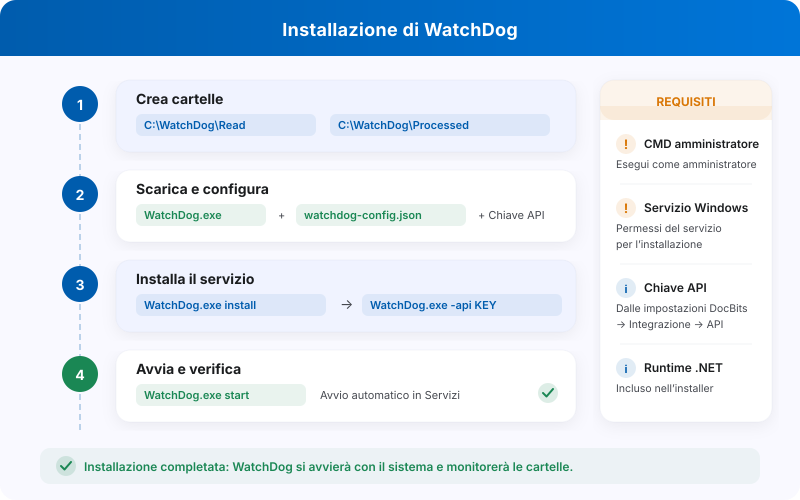

# Installazione di WatchDog

<figure><figcaption><p>Sequenza indicativa di installazione: cartelle e download, configurazione API prima dell’installazione del servizio, avvio e verifica. Requisiti e dipendenze dipendono dal pacchetto; il file JSON V1 non è un requisito del percorso moderno.</p></figcaption></figure>

> **Consigliato:** Utilizza la configurazione moderna descritta di seguito. Le configurazioni di WatchDog vengono ora create direttamente nell'applicazione DocBits — non è richiesto il download manuale del file storico `watchdog-config.json`. Il pacchetto può comunque gestire propri file locali e dipendenze.

## Prerequisiti

* Windows Server o Windows 10/11
* Accesso come amministratore
* Connettività di rete verso l'API di DocBits
* Chiave API di DocBits (disponibile in Impostazioni → WatchDog → Generale)

## Passaggi di Installazione

### 1. Crea le Cartelle Necessarie

Crea una directory principale e le sottocartelle per WatchDog:

```
C:\WatchDog\              ← WatchDog executable
C:\WatchDog\Import\       ← Watch folder for incoming documents
C:\WatchDog\Processed\    ← Success folder for processed documents
C:\WatchDog\Export\        ← Export folder for exported files
```

> **Nota:** Si consiglia di usare percorsi locali. I percorsi di rete UNC (ad es. `\\server\share`) sono supportati, ma per un rilevamento affidabile dei file potrebbe essere necessario un Polling Observer.

### 2. Scarica WatchDog

Scarica `WatchDog.exe` dall'applicazione DocBits:

**Impostazioni → Elaborazione documenti → WatchDog → Scheda Generale → Download**

Inserisci il file `WatchDog.exe` scaricato in `C:\WatchDog\`.

### 3. Configura la Connessione API

Apri il **Prompt dei comandi (CMD)** come **amministratore** ed esegui:

```powershell
cd C:\WatchDog
WatchDog.exe -api YOUR_API_KEY
```

Il comando configura il collegamento all’organizzazione. Verifica autenticazione, rete e recupero delle configurazioni nella versione installata prima di proseguire.

### 4. Crea le Configurazioni in DocBits

Vai a **Impostazioni → Elaborazione documenti → WatchDog → Scheda Configurazioni** in DocBits:

* Clicca su il comando per una nuova configurazione di importazione per impostare le cartelle da monitorare
* Clicca su il comando per una nuova configurazione di esportazione per impostare le destinazioni di esportazione

> **Importante:** Le configurazioni di esportazione richiedono un **tipo di documento**. Tutte le configurazioni sono gestite centralmente in DocBits, senza il download manuale del file di configurazione V1.


### 5. Installa come Servizio Windows

```powershell
WatchDog.exe install
```

### 6. Avvia il Servizio

```powershell
WatchDog.exe start
```

### 7. Imposta l'Avvio Automatico

1. Apri **Servizi** (`Win + R` → `services.msc`)
2. Trova **WatchDog** nell'elenco dei servizi
3. Fai doppio clic per aprirne le proprietà
4. Imposta **Tipo di avvio** su **Automatico (avvio ritardato)**
5. Clicca su **OK**

## Verifica dell'Installazione

Dopo l'installazione, controlla lo stato di WatchDog in DocBits:

**Impostazioni → WatchDog → Scheda Generale**

<figure><figcaption><p>Scheda Generale di WatchDog nello stato esistente FUORI LINEA. Chiave API, comandi specifici dell’account e percorso di installazione sono nascosti. La versione proposta per il download non dimostra la versione installata o in esecuzione. Nessun comando o servizio è stato avviato.</p></figcaption></figure>

* Controlla lo stato riportato, l’ultimo contatto e i dati effettivamente disponibili.
* Distingui la versione installata dalla versione proposta per il download.
* Verifica un import di prova autorizzato e i log: la sola apertura delle impostazioni non certifica il funzionamento.

## Riferimento dei Comandi

| Comando | Descrizione |
| :--- | :--- |
| `WatchDog.exe -api KEY` | Configura l'API Key |
| `WatchDog.exe install` | Installa come servizio Windows |
| `WatchDog.exe start` | Avvia il servizio |
| `WatchDog.exe stop` | Arresta il servizio |
| `WatchDog.exe debug` | Esegue in modalità console (per la risoluzione dei problemi) |
| `WatchDog.exe remove` | Disinstalla il servizio |
| `WatchDog.exe --version` | Mostra la versione corrente |
| `WatchDog.exe --list-folders` | Elenca le cartelle monitorate configurate |
| `WatchDog.exe --add-folder PATH` | Aggiunge una cartella monitorata |
| `WatchDog.exe --remove-folder PATH` | Rimuove una cartella monitorata |

---

## Legacy: Configurazione V1 (Obsoleta)

Il seguente metodo di configurazione V1 con file di configurazione locali è **obsoleto**. Utilizza invece la configurazione moderna basata su API descritta sopra.

<details>
<summary>Configurazione V1 (clicca per espandere)</summary>

### Configurazione di WatchDog in DocBits (V1)

1. **Accedi alle impostazioni di WatchDog**
   * Vai a **Impostazioni → Elaborazione documenti → WatchDog**
2. **Impostazioni delle cartelle**
   * Definisci i percorsi: `C:/WatchDog/Read` e `C:/WatchDog/Processed`

3. **Impostazioni generali**
   * Seleziona i tipi di documento, configura la destinazione di esportazione

4. **Configurazioni di esportazione**
   * Mostra le esportazioni configurate per l'elaborazione on-premise

5. **Scarica la configurazione**
   * Scarica `watchdog-config.json` e inseriscilo in `C:\WatchDog\`

</details>

I passaggi V1 restano soltanto un riferimento storico. Verifica i requisiti del pacchetto attuale, comprese le dipendenze runtime, invece di presumere che una dipendenza sia sempre inclusa. Durante questa verifica non sono stati eseguiti comandi, installazioni, riavvii o modifiche.
