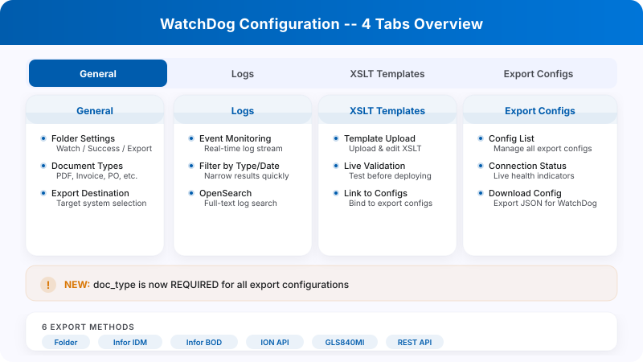
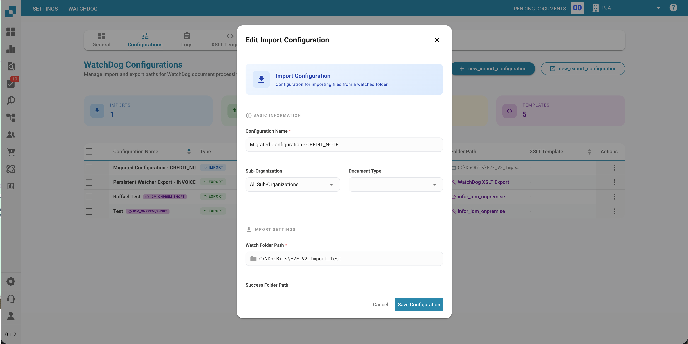

# Configurazione di WatchDog

Questa guida spiega come configurare il servizio WatchDog all'interno dell'applicazione DocBits. Tutte le configurazioni vengono gestite direttamente in **Settings → Document Processing → WatchDog**.

<figure><figcaption></figcaption></figure>

---

## 1. Scheda General

La scheda General fornisce le istruzioni di configurazione, i link di download e le impostazioni di aggiornamento.

<figure><figcaption></figcaption></figure>

### 1.1 Download e Configurazione

* Scarica l'ultima versione di `WatchDog.exe` direttamente dalla scheda General
* Copia l'API Key visualizzata
* Esegui il comando di configurazione in un Prompt dei comandi come amministratore:

```powershell
WatchDog.exe -api YOUR_API_KEY
```

### 1.2 Pianificazione degli Aggiornamenti Automatici

| Opzione | Intervallo |
| :--- | :--- |
| On Startup Only | Controlla una volta all'avvio |
| Hourly | Ogni 3600 secondi |
| Daily | Ogni 86400 secondi |
| Weekly | Ogni 604800 secondi |

---

## 2. Scheda Configurations

Crea e gestisci le configurazioni di importazione e di esportazione. Tutte le configurazioni vengono create direttamente in DocBits — non sono necessari file di configurazione locali.

<figure><figcaption></figcaption></figure>

### 2.1 Import Configurations

Definisci dove WatchDog cerca i nuovi documenti.

<figure><figcaption></figcaption></figure>

| Campo | Descrizione |
| :--- | :--- |
| **Name** | Nome visualizzato per questa configurazione |
| **Watch Folder** | Directory da monitorare per i nuovi documenti (obbligatorio) |
| **Success Folder** | Dove vengono spostati i file dopo un'importazione riuscita |
| **Document Type** | INVOICE, CREDIT\_NOTE, PURCHASE\_ORDER, ecc. |
| **Sub-Organisation** | Facoltativo — instrada i documenti a una sub-organizzazione specifica |

### 2.2 Export Configurations

Definisci come e dove vengono esportati i documenti elaborati.

> **Importante:** Le configurazioni di esportazione ora **richiedono un tipo di documento** (`doc_type`). Le configurazioni senza tipo di documento verranno rifiutate dal sistema.

| Campo | Descrizione |
| :--- | :--- |
| **Name** | Nome visualizzato per questa configurazione |
| **Document Type** | Obbligatorio — INVOICE, CREDIT\_NOTE, ecc. |
| **Export Method** | Come vengono esportati i documenti (vedi sotto) |
| **Export Folder** | Directory di destinazione per le esportazioni in cartella |
| **Execution Order** | Priorità quando più configurazioni corrispondono (predefinito: 1) |
| **XSLT Template** | Facoltativo — template di trasformazione XML |

### 2.3 Metodi di Esportazione

| Metodo | Descrizione |
| :--- | :--- |
| **Folder (watcher)** | Esporta PDF + XML in una cartella locale |
| **Infor IDM** | Carica in Infor Document Management |
| **Infor BOD** | Invia il BOD XML a Infor ERP / SAP / M3 |
| **ION API** | Chiama gli endpoint dell'API Infor ION |
| **GLS840MI** | Elaborazione batch M3 (tramite REST API) |
| **REST API** | Invia a un'API esterna con autenticazione ION OAuth |

<figure><figcaption></figcaption></figure>

### 2.4 Opzioni di Elaborazione

* **Barcode Divider:** Divide automaticamente i documenti multipagina in base ai codici a barre
* **DocBits Operator:** Abilita le attività di automazione del browser

---

## 3. Scheda Status

Monitora lo stato di salute e l'attività del servizio WatchDog.

<figure><figcaption></figcaption></figure>

### Informazioni di Stato

| Campo | Descrizione |
| :--- | :--- |
| **Online/Offline** | Stato di connessione corrente (soglia heartbeat di 30 s) |
| **Version** | Versione di WatchDog installata |
| **Version First Seen** | Quando questa versione è stata segnalata per la prima volta |
| **Last Restart** | Timestamp dell'ultimo riavvio del servizio |
| **Auto-Update Enabled** | Indica se gli aggiornamenti automatici sono attivi |
| **Latest Version** | Ultima versione disponibile |
| **Latest Version Checked At** | Quando è stata controllata l'ultima versione |
| **System Info** | Percorso di installazione, RAM libera, spazio libero su disco |

### Indicatore di Stato

| Stato | Significato |
| :--- | :--- |
| ✅ **Online** | WatchDog è connesso e attivo |
| ⚠️ **Offline** | Nessun heartbeat ricevuto da oltre 30 secondi |
| ❌ **Not Installed** | WatchDog non si è mai connesso a questa organizzazione |

---

## 4. Scheda Logs

Visualizza tutti gli eventi di WatchDog memorizzati in OpenSearch.

<figure><figcaption></figcaption></figure>

* Filtra per data, tipo di evento o parole chiave
* Tipi di evento: `FILE_IMPORT_STARTED`, `FILE_IMPORT_COMPLETED`, `FILE_IMPORT_FAILED`, `EXPORT_STARTED`, `EXPORT_COMPLETED`, `EXPORT_FAILED`, `FOLDER_VALIDATION_FAILED`, `CONFIG_LOADED`, `SERVICE_RESTART_INITIATED`, `SERVICE_RESTART_COMPLETED`

---

## 5. Scheda XSLT Templates

Gestisci i template di trasformazione XSLT utilizzati per le esportazioni XML.

<figure><figcaption></figcaption></figure>

* Carica e modifica i template XSLT
* **Validazione in tempo reale** — testa i template su un XML di esempio con analisi dei campi
* Collega i template alle configurazioni di esportazione
* Visualizza il conteggio di utilizzo (quali configurazioni usano ciascun template)

<figure><figcaption></figcaption></figure>

---

## 6. Scheda Export Configurations

Panoramica di tutte le configurazioni di esportazione attive con lo stato della connessione.

* Monitora il timestamp dell'ultima connessione riuscita
* Gestisci le configurazioni direttamente nell'elenco (modifica, copia, elimina)
* Copia in blocco le configurazioni tra le sub-organizzazioni
