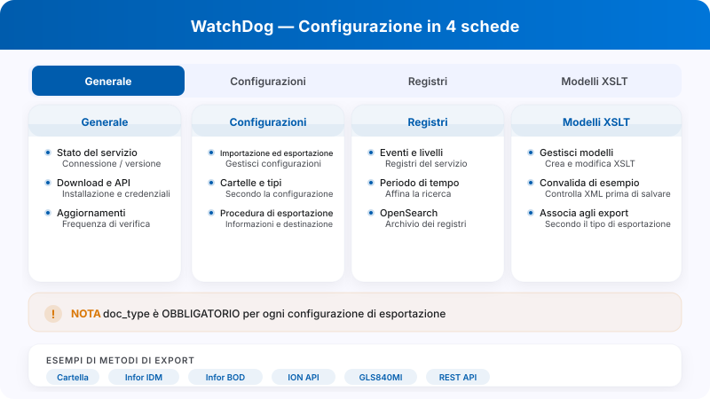
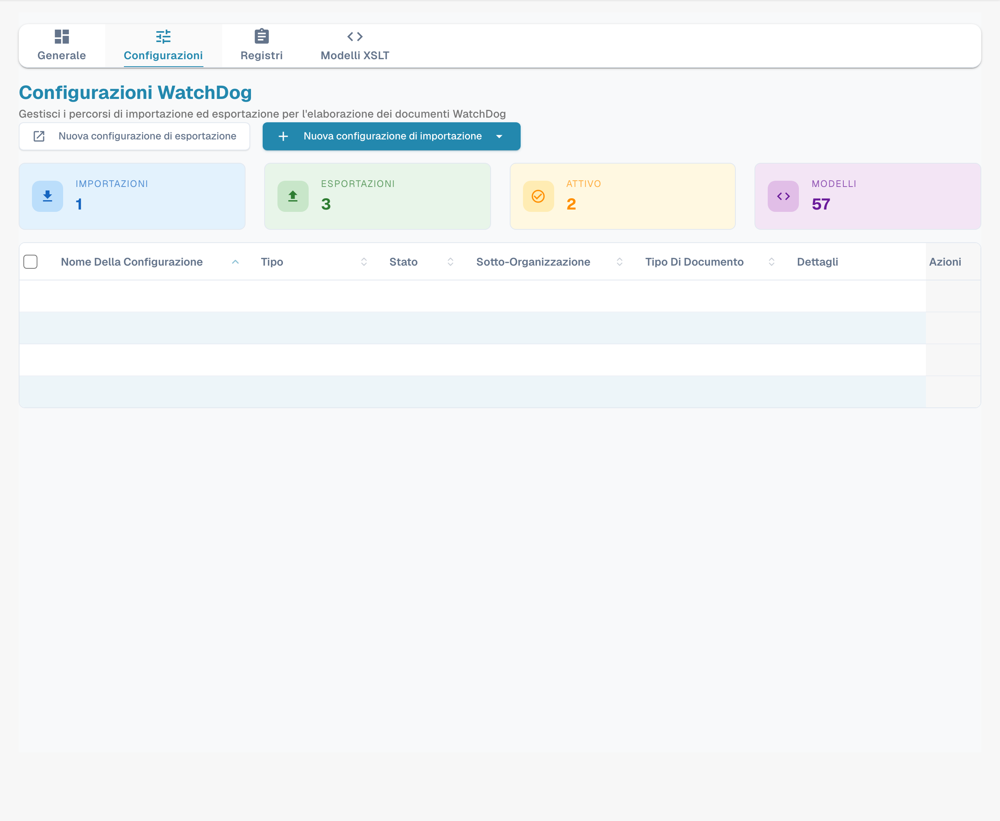
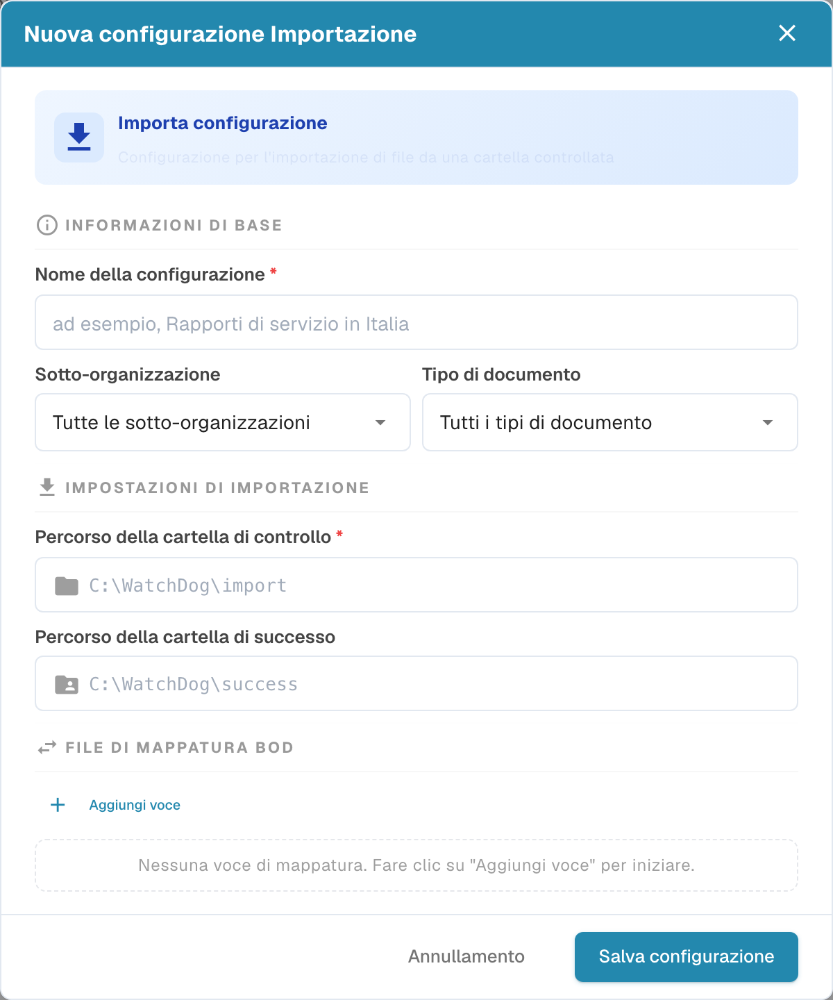
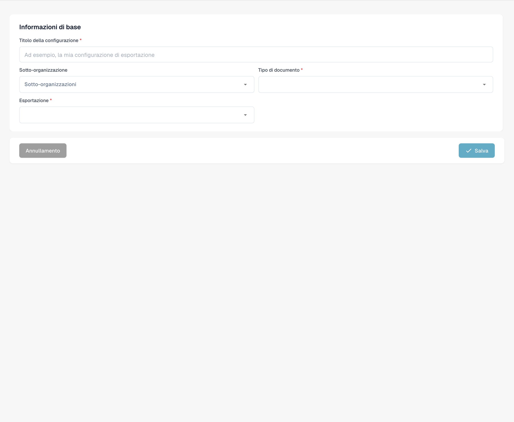
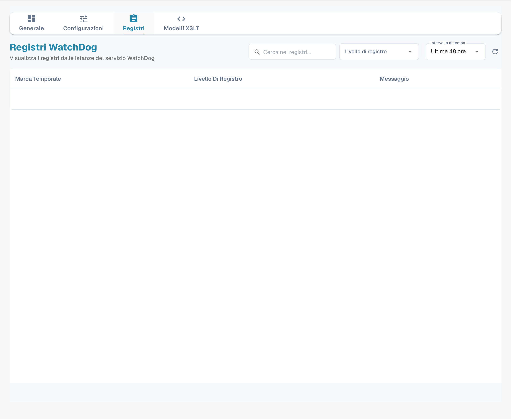
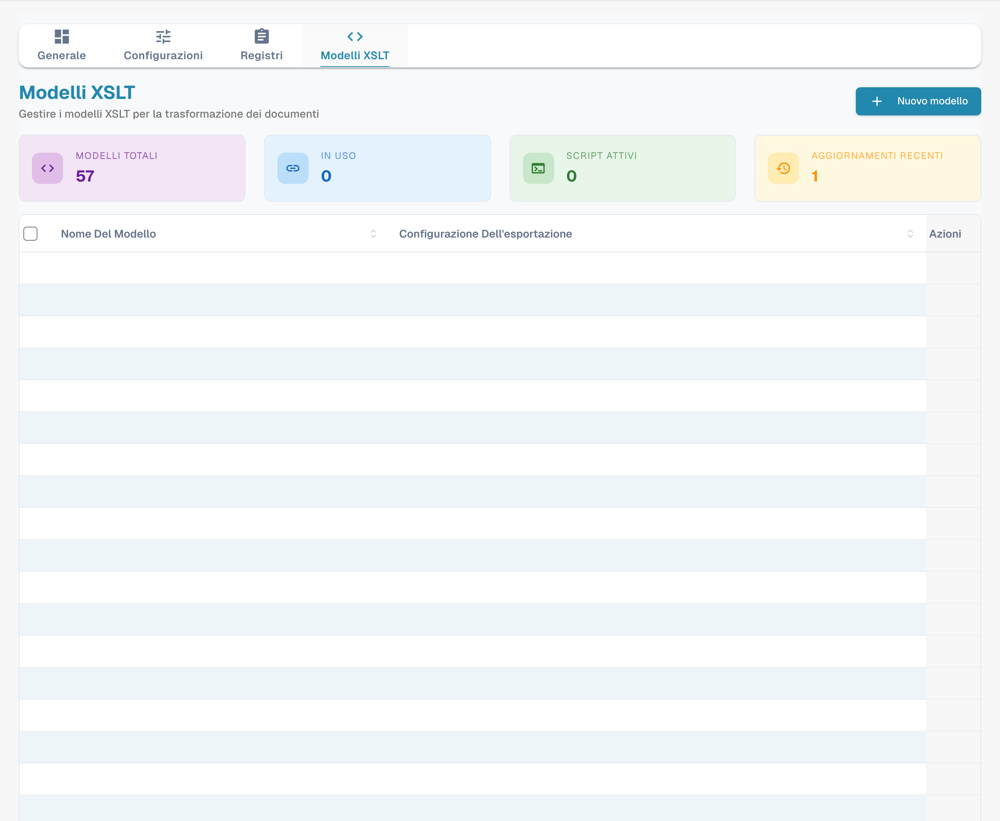
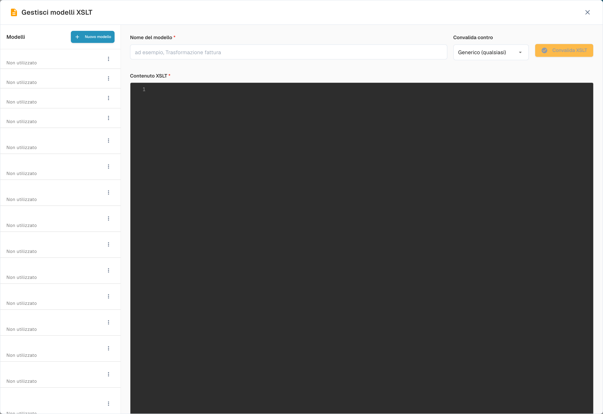

# Configurazione di WatchDog

Apri **Impostazioni → WatchDog**. Nella versione illustrata le schede effettive sono **Generale**, **Configurazioni**, **Registri** e **Modelli XSLT**. Lo stato è mostrato in Generale; non è una quinta scheda autonoma.

<figure><figcaption><p>Ruoli delle quattro schede attuali: Generale, Configurazioni, Registri e Modelli XSLT. OpenSearch riguarda i registri; la procedura di esportazione riguarda Configurazioni. Diagramma esplicativo, non schermata del prodotto.</p></figcaption></figure>

## 1. Generale

Esamina istruzioni, download, stato del servizio e opzioni di aggiornamento disponibili. La versione di download e la versione installata sono informazioni diverse. Non dedurre che il servizio sia attivo dalla presenza del pulsante di download.

<figure><figcaption><p>Scheda Generale di WatchDog nello stato esistente FUORI LINEA. Chiave API, comandi specifici dell’account e percorso di installazione sono nascosti. La versione proposta per il download non dimostra la versione installata o in esecuzione. Nessun comando o servizio è stato avviato.</p></figcaption></figure>

Per collegare il pacchetto all’organizzazione, segui le istruzioni della tua versione. Il comando documentato è:

```powershell
WatchDog.exe -api YOUR_API_KEY
```

Proteggi la chiave API e verifica la configurazione prima dell’esecuzione. Le opzioni di pianificazione degli aggiornamenti dipendono dalla versione; l’immagine non dimostra intervalli universali o un aggiornamento riuscito.

## 2. Configurazioni

Le configurazioni di importazione definiscono cartella monitorata, cartella di successo, tipo di documento ed eventuale sub-organizzazione. Quelle di esportazione definiscono tipo di documento (`doc_type`), metodo, destinazione, ordine di esecuzione e trasformazioni pertinenti. Verifica i campi obbligatori nella versione installata.

<figure><figcaption><p>Scheda Configurazioni con sezioni e contatori esistenti. I valori delle righe sono mascherati mantenendo la struttura; gli elenchi non sono vuoti. Nessuna configurazione è stata creata, copiata o modificata.</p></figcaption></figure>

### Importazione

Apri la creazione di una configurazione di importazione e identifica cartelle, tipo e ambito. Non confondere l’invio di una configurazione con l’importazione di un documento.

<figure><figcaption><p>Modulo di importazione vuoto. Nuova configurazione Importazione e Importa configurazione sono etichette poco chiare della versione illustrata; l’acronimo BOD è corretto. Nessun campo è stato compilato e nessuna configurazione è stata salvata.</p></figcaption></figure>

### Esportazione

Seleziona il tipo di documento e il metodo previsto dalla tua integrazione. Secondo il pacchetto possono essere disponibili cartella locale, Infor IDM, Infor BOD, ION API, GLS840MI e REST API. La disponibilità di un metodo non garantisce connettività o accettazione nel sistema destinatario. Per l’esportazione XML associa il modello XSLT pertinente e verifica il risultato su un campione autorizzato.

<figure><figcaption><p>Primo passaggio della creazione di una configurazione di esportazione, senza dati salvati. È una bozza vuota, non una configurazione funzionante né una prova di esportazione.</p></figcaption></figure>

Il percorso moderno usa le configurazioni gestite in DocBits; il download manuale di `watchdog-config.json` appartiene al percorso storico V1, non è un prerequisito universale. Eventuali opzioni di divisione tramite codici a barre o automazione dell’Operatore richiedono una verifica specifica del pacchetto e del processo.

## 3. Registri

Consulta gli eventi disponibili e il periodo selezionato. OpenSearch è il contesto di ricerca dei registri; non è una configurazione di esportazione. Un filtro temporale non certifica la conservazione completa degli eventi.

<figure><figcaption><p>Scheda Registri con il periodo selezionato Ultime 48 ore. È un filtro della vista, non una promessa sulla conservazione o sulla frequenza universale degli eventi. Nessun risultato dimostra da solo lo stato del servizio.</p></figcaption></figure>

Gli identificatori tecnici comprendono `FILE_IMPORT_STARTED`, `FILE_IMPORT_COMPLETED`, `FILE_IMPORT_FAILED`, `EXPORT_STARTED`, `EXPORT_COMPLETED`, `EXPORT_FAILED`, `FOLDER_VALIDATION_FAILED`, `CONFIG_LOADED`, `SERVICE_RESTART_INITIATED` e `SERVICE_RESTART_COMPLETED`. Verifica presenza, timestamp ed esito nel processo reale; l’elenco non dimostra che tutti gli eventi siano stati prodotti durante questa verifica.

## 4. Modelli XSLT

Gestisci i modelli di trasformazione usati dalle esportazioni. Identifica modello, XML in ingresso e configurazione associata. Se la versione offre una validazione, esamina anche il risultato con un campione rappresentativo; la sola presenza dell’editor non dimostra una trasformazione valida.

<figure><figcaption><p>Scheda Modelli XSLT con l’elenco esistente e valori privati mascherati. Nessun modello è stato creato, modificato o eliminato.</p></figcaption></figure>

<figure><figcaption><p>Editor XSLT vuoto con Nome del modello e Contenuto XSLT. I nomi configurati visibili sullo sfondo sono mascherati. Nessun contenuto, modello o risultato di validazione è stato salvato.</p></figcaption></figure>

La verifica ha aperto viste e moduli vuoti e li ha chiusi senza salvataggi. Non ha eseguito importazioni, esportazioni, aggiornamenti o riavvii del servizio.
