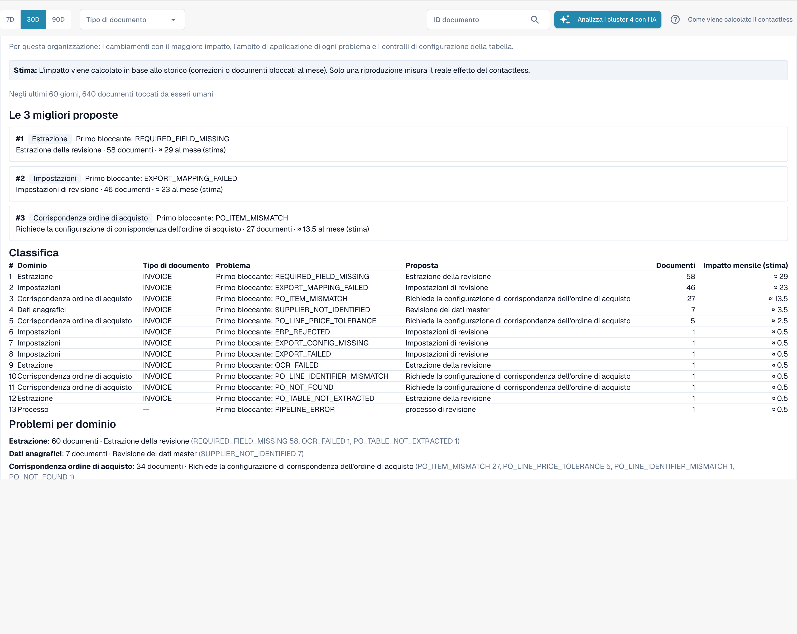

# Touchless Intelligence: Proposte di modifica e report

Una raccomandazione può essere accompagnata da una **proposta di modifica**, cioè un singolo cambiamento di impostazione che dovrebbe aiutare. Gli amministratori lavorano con essa in quattro passi:

1. **Anteprima** (Preview): mostra la modifica (valore attuale → valore proposto) e ciò che DocBits si aspetta. Non viene salvato nulla. **Applica** (Apply) è possibile solo dopo aver visto un'anteprima.
2. **Applica**: salva esattamente la modifica vista in anteprima. Viene registrata nel log.
3. **Misura**: DocBits confronta il tasso touchless dello stesso tipo di documento **prima e dopo**, su periodi di uguale durata. Servono almeno **20 documenti** in ciascun periodo, altrimenti indica *not measurable*.
4. **Annulla** (Undo): ripristina la modifica.


Una differenza prima/dopo è un'**osservazione**, non la prova di una causa. Nello stesso periodo possono cambiare altre cose (un nuovo fornitore, un picco stagionale).


**Esempio.** Applichi *Switch on automatic PO match and export* per le fatture. Due settimane dopo la **Cronologia delle modifiche** (Change history) indica: tasso puro prima 52 % (210 documenti), dopo 61 % (198 documenti). Sono +9 pp, con documenti sufficienti per la misurazione.

Gli amministratori vedono anche due sezioni tra gli indicatori chiave e i grafici:

* **Richieste di miglioramento** (Improvement requests): suggerimenti inviati dagli utenti dall'assistente di convalida, in due schede **Open** (Aperte) e **History** (Cronologia).
* **Proposte di regole apprese** (Learned rule proposals): regole che DocBits ha imparato dalle correzioni del tuo team, ad esempio "per il fornitore X, sostituisci il valore nel campo Y". Prima di crearne una, controlla i documenti in cui sostituirebbe un valore che il tuo team aveva accettato. La sezione **After activation** (Dopo l'attivazione) mostra le correzioni manuali del campo di destinazione prima e dopo l'attivazione di una regola.

<figure><figcaption>
Il Report di consulenza: le proposte principali, una classifica di tutti i blocchi con documenti e impatto stimato al mese, e i problemi per ambito. Organizzazione di esempio con dati demo; i nomi dei fornitori sono fittizi.
</figcaption></figure>

Gli amministratori trovano il **Report di consulenza** (Consulting report) in fondo alla scheda. Fai clic su **Crea report** (Create report) per caricarlo. Combina, per la tua organizzazione:

* le **modifiche con il maggiore effetto**, in ordine di classifica, ciascuna con l'ambito, il problema, l'azione consigliata, il numero di documenti e l'effetto **stimato** al mese,
* **l'ambito di ogni problema** (estrazione, dati anagrafici, abbinamento ordini, contabilizzazione automatica, impostazioni, processo),
* **controlli della configurazione delle tabelle**, ad esempio *structured table output not used* o *table column type mismatch* per tipo di documento e colonna.

I valori dell'effetto sono **stime**. Se il report risponde *forbidden*, il tuo ruolo non lo consente.

## Pagine correlate

* [Touchless Intelligence](touchless-intelligence.md)
* [Diagnosi del fornitore e cluster di problemi](touchless-supplier-diagnosis.md)
* [Diagnosi dell'abbinamento ordini](touchless-po-matching-diagnosis.md)
