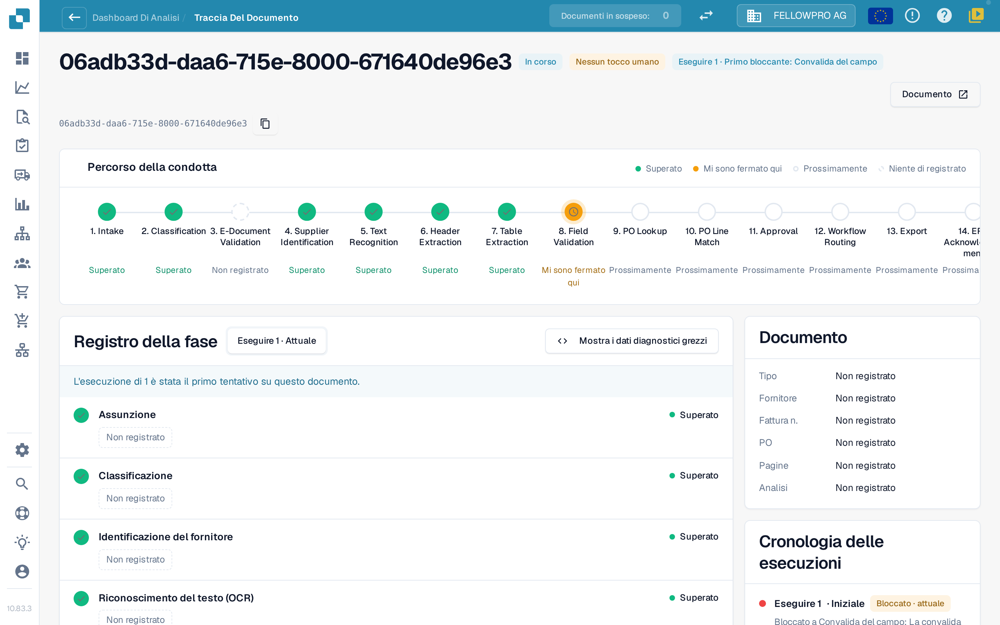
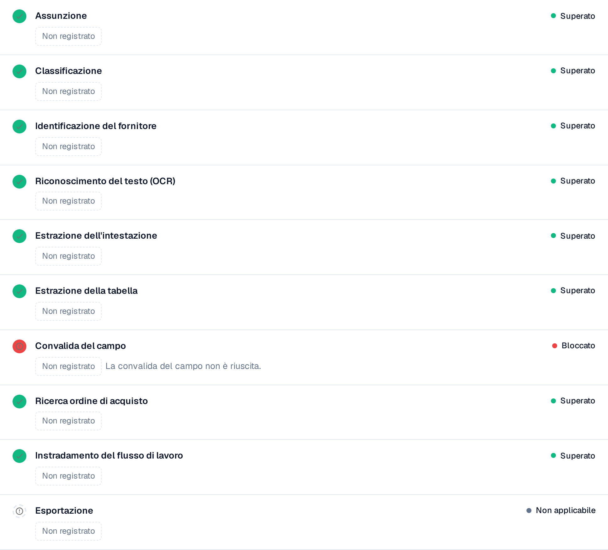

# Touchless Intelligence: Tracciamento del documento

Inserite un ID documento in **Document ID**, oppure aprite un documento di esempio da un cluster, per vedere **che cosa è successo a questo documento**.

L'intestazione mostra il file, il suo stato (ad esempio **In corso**), l'esecuzione che state consultando e il suo primo bloccante, oltre a un pulsante **Documento** con l'ID del documento.

<figure><figcaption>
Il tracciamento del documento: il percorso della condotta con tutti i passaggi e il registro dei passaggi con ciò che ognuno ha registrato.
</figcaption></figure>

Il **Percorso della condotta** mostra 14 passaggi: Intake, Classification, E-Document Validation, Supplier Identification, Text Recognition, Header Extraction, Table Extraction, Field Validation, PO Lookup, PO Line Match, Approval, Workflow Routing, Export, ERP Acknowledgement. Ogni passaggio porta un solo stato:

| Stato | Significato |
| --- | --- |
| **Superato** (verde) | Il passaggio è andato a buon fine |
| **Mi sono fermato qui** (arancione) | Il passaggio ha bloccato il documento |
| **Prossimamente** | Il documento non è mai arrivato fin qui |
| **Niente di registrato** (tratteggiato) | Per questo passaggio non è stato registrato alcun dato |
| **Non applicabile** | Il passaggio non si applica a questo documento |

### Registro dei passaggi

Il **registro dei passaggi** sotto il percorso elenca gli stessi passaggi con ciò che ciascuno ha registrato. Un punto di stato e la parola di stato si trovano a sinistra e a destra di ogni riga.

* Ogni valore è un **chip di valore**: un numero con la sua unità, ad esempio **Affidabilità 100 %**, **Soglia 60 %**, **Regole fallite 0**, **8 campi mancanti** o **0 lacune di abbinamento**. Le percentuali sono mostrate come `97 %`, mai come `0.97`.
* **Dettagli** apre l'elenco completo dei valori registrati da un passaggio, comprese le alternative che ha considerato.
* Il passaggio che ha bloccato il documento ne indica il motivo, ad esempio **Convalida del campo non riuscita**.
* Un valore che nessun passaggio ha registrato compare come **Non registrato**, mai come valore inventato. I valori sono numeri e termini fissi, mai testo del documento.
* **Mostra diagnostica grezza** attiva i dati grezzi quando l'assistenza li richiede.

<figure><figcaption>
Ogni passaggio mostra ciò che ha registrato; il passaggio bloccato indica la sua causa.
</figcaption></figure>

### Esecuzioni e modifiche

Il selettore di esecuzione in cima al registro dei passaggi (**Eseguire 1 · Attuale**) passa da un'esecuzione all'altra del documento. La **cronologia delle esecuzioni** a destra elenca ogni esecuzione con il suo esito e il punto in cui si è fermata. Quando un documento è stato eseguito più di una volta, scegliete un'esecuzione nel selettore per confrontarla con quella attuale: i valori modificati portano allora un contrassegno con la differenza e la sua unità, ad esempio **−2 campi** o **+3 %**.

La scheda **Documento** accanto al registro dei passaggi indica il tipo di documento, il fornitore, il numero di fattura, l'ordine d'acquisto, il numero di pagine e se l'analisi è basata su **regole** o scritta da un'IA.

**Esempio.** I documenti di un fornitore si fermano tutti al passaggio 8. Nel tracciamento vedete ogni volta gli stessi campi mancanti. Non è un problema di estrazione dei singoli documenti, ma un valore predefinito mancante nella configurazione dei campi: correggetelo una volta e l'intero cluster è recuperabile.

## Pagine correlate

* [Touchless Intelligence](touchless-intelligence.md)
* [Diagnosi del fornitore e cluster di problemi](touchless-supplier-diagnosis.md)
* [Diagnosi dell'abbinamento ordini](touchless-po-matching-diagnosis.md)

Le schermate di questa pagina mostrano l'interfaccia in italiano.
