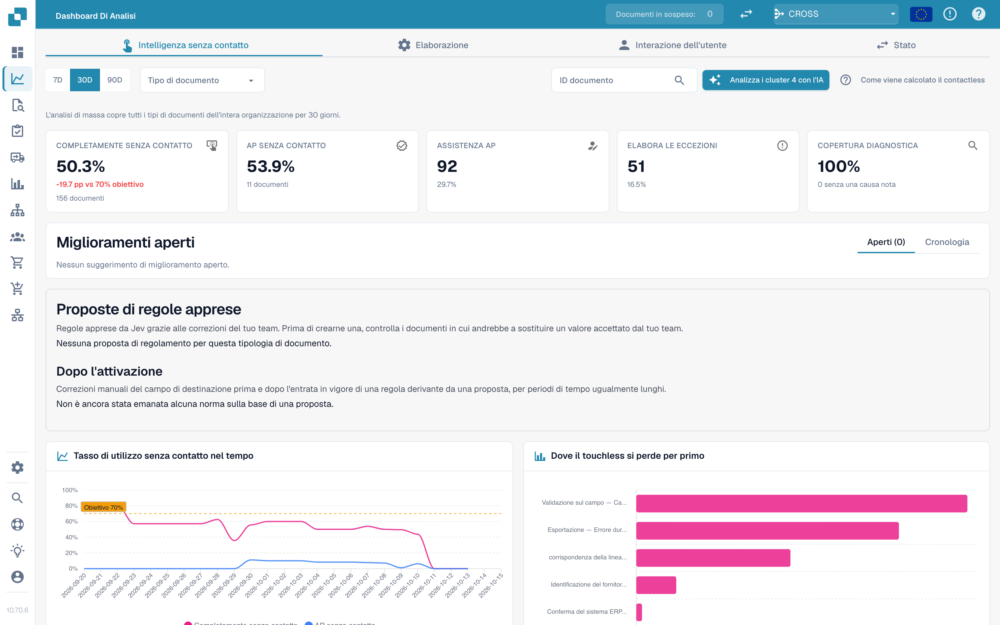
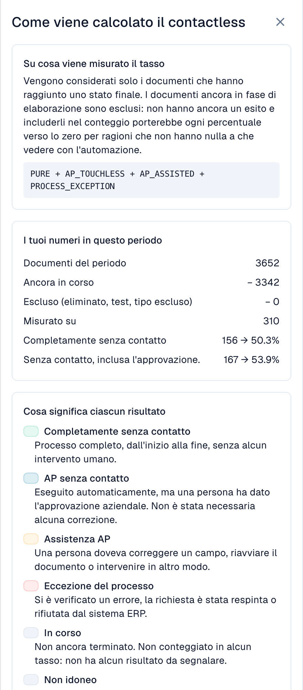
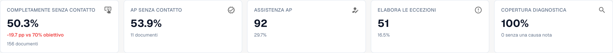
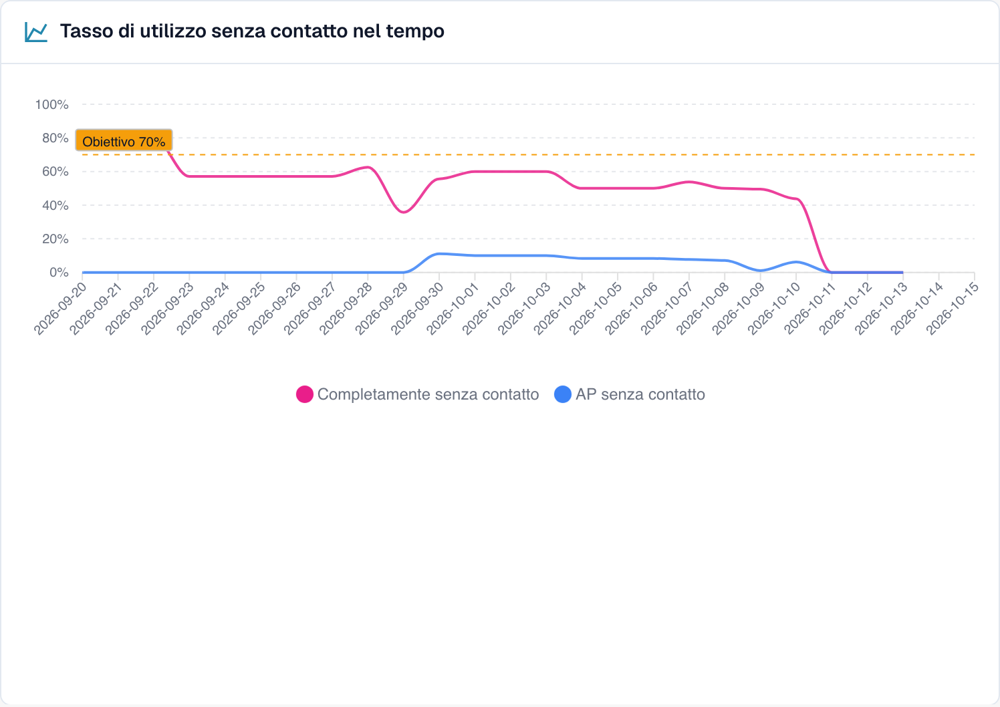
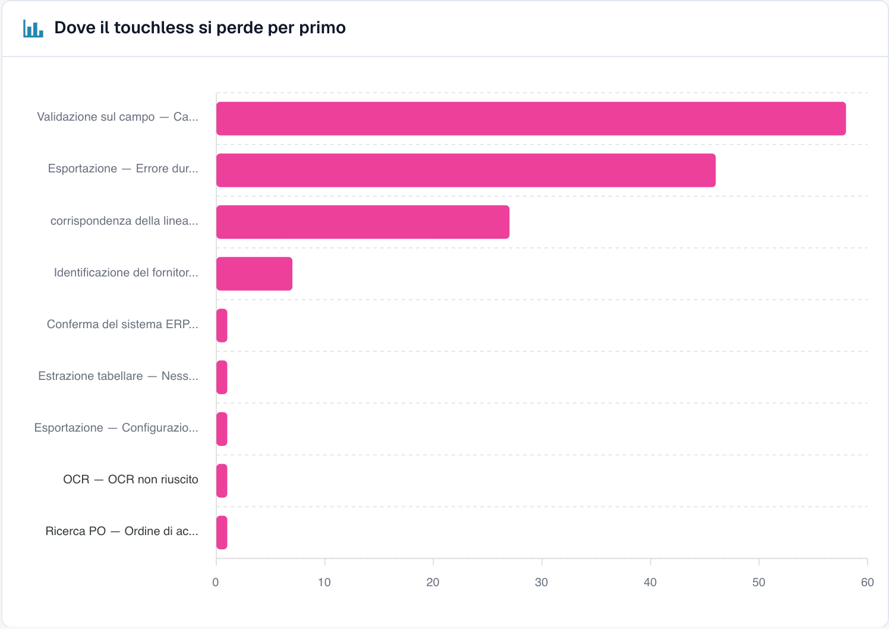
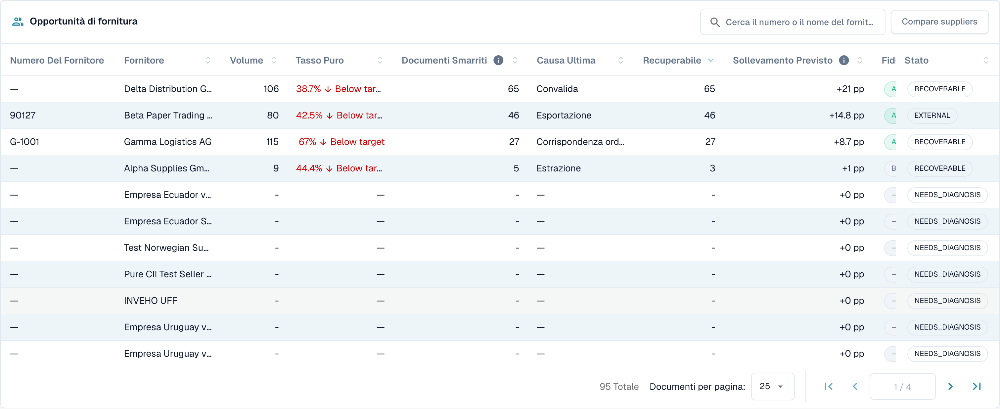
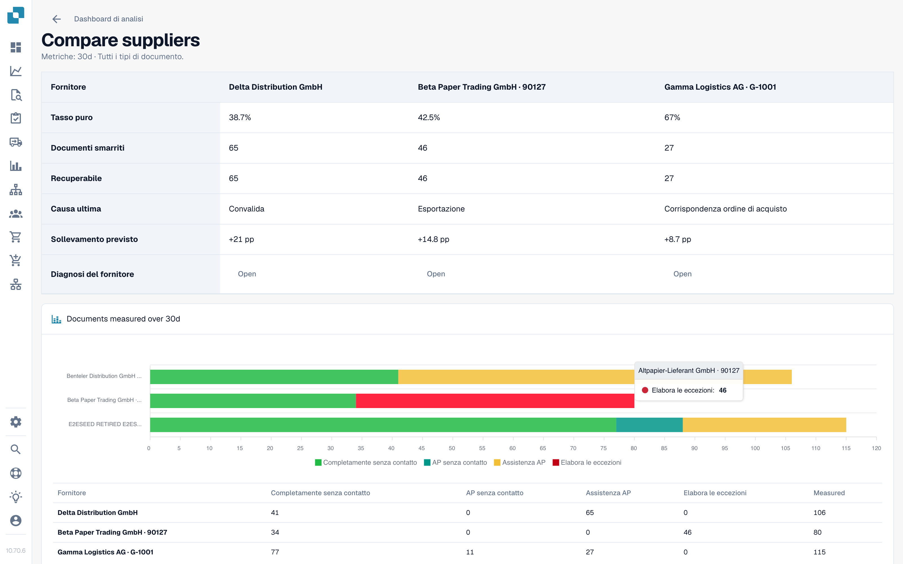

# Touchless Intelligence

## Panoramica

**Touchless Intelligence** risponde a due domande sull'elaborazione dei tuoi documenti:

1. **Quanti documenti passano attraverso DocBits senza che nessuno li tocchi?** Questo è il tuo *tasso touchless*.
2. **Perché gli altri si fermano e cosa dovremmo cambiare perché se ne fermino meno?** Questa è la *diagnosi*.

È una scheda della [Dashboard di analisi](analytics-dashboard.md). Non aggiunge alcun lavoro al tuo team: DocBits registra cosa succede a ogni documento nella pipeline di elaborazione e valuta il risultato ogni 15 minuti.

<figure><figcaption><p>La scheda Touchless Intelligence: indicatori chiave, miglioramenti, il tasso nel tempo e il grafico del primo punto di perdita. Organizzazione di esempio con dati demo; i nomi dei fornitori sono fittizi.</p></figcaption></figure>

### Cosa puoi fare

| Vuoi… | Usa | Esempio |
| --- | --- | --- |
| Vedere quanto sei automatizzato | I cinque **indicatori chiave** in alto | "Il 63,2 % dei nostri documenti è stato elaborato senza intervento umano il mese scorso" |
| Vedere l'andamento | **Tasso touchless nel tempo** (Touchless rate over time) | "Il tasso è salito dal 55 % al 68 % da quando abbiamo corretto i dati anagrafici dei fornitori" |
| Scoprire dove si bloccano i documenti | **Dove si perde il touchless per primo** (Where touchless is lost first) | "La maggior parte dei documenti si ferma alla Convalida dei campi" |
| Decidere quale fornitore correggere per primo | **Opportunità fornitori** (Supplier opportunities) | "Il fornitore A ci darebbe +4,0 punti percentuali" |
| Capire un fornitore | Pagina **Diagnosi del fornitore** (Supplier Diagnosis) | "Le sue fatture non hanno un numero d'ordine, quindi l'abbinamento ordini fallisce" |
| Capire un documento | **Tracciamento del documento** (Document Trace) | "Questa fattura si è fermata alla fase 8, Convalida dei campi" |
| Confrontare i fornitori | **Confronta fornitori** (Compare suppliers) | "I fornitori A e B usano lo stesso modello, ma solo B fallisce" |
| Cambiare un'impostazione che aiuta | **Proposte di modifica** (Change proposals) | "Attiva l'abbinamento ordini automatico: anteprima, applica, misura, annulla" |

## Chi può vederla

* La scheda fa parte della Dashboard di analisi. Il tuo amministratore la abilita per l'organizzazione. Se la scheda manca, chiedi al tuo amministratore.
* Gli **amministratori dell'organizzazione** la vedono sempre.
* Gli altri utenti la vedono quando un amministratore ha concesso al loro ruolo la scheda **Dashboard di analisi** (**Impostazioni → Ruoli**). Senza questa autorizzazione, solo gli amministratori hanno accesso.
* Alcune azioni sono riservate agli amministratori: **Analisi con l'IA** (AI analysis), **applicare e annullare una modifica**, **proposte di regole apprese** e il **Report di consulenza** (Consulting report).

Se non hai l'autorizzazione, la pagina mostra *Action not allowed, please contact the administrator*.

## Cosa significa "touchless"

Ogni documento termina con esattamente **un** esito:

| Esito | Significato | Conta nel tasso |
| --- | --- | --- |
| **Touchless puro** (Pure touchless) | Elaborato dall'importazione all'esportazione **senza alcun intervento umano** | Sì, come successo |
| **AP touchless** | Elaborato automaticamente; una persona ha dato solo l'**approvazione commerciale**. Non è stata necessaria alcuna correzione | Sì, come successo |
| **AP assistito** (AP assisted) | Una persona ha dovuto **correggere un campo, riavviare il documento** o intervenire in altro modo | Sì, come mancato successo. Non è un fallimento, solo un'automazione che non ha portato a termine da sola il documento |
| **Eccezione di processo** (Process exception) | Terminato con un **errore**, **rifiutato**, **respinto dall'ERP** o **fermo** nella pipeline | Sì, come mancato successo |
| **In corso** (In progress) | Non ancora terminato | **No**. Non ha ancora un esito |
| **Non idoneo** (Not eligible) | Eliminato, archiviato, un documento di test o un tipo di documento escluso | **No** |

Il **tasso touchless** è:

```
rate = (Pure touchless + AP touchless)
       ÷ (Pure touchless + AP touchless + AP assisted + Process exception)
```

I documenti ancora **in corso** o **non idonei** non rientrano mai nel calcolo. Questo protegge il tasso: un documento arrivato cinque minuti fa non può abbassarlo.


**Un intervento conta per sempre.** Quando una persona ha toccato un documento, questo resta contato come toccato, anche se una successiva elaborazione automatica non avrebbe richiesto nessuno. **Riavviare un documento non lo rende di nuovo touchless.** Il tasso riflette il lavoro che è stato svolto.


### Esempio di calcolo (numeri illustrativi)

In 30 giorni sono arrivati 200 documenti:

| Esito | Documenti |
| --- | --- |
| Touchless puro | 120 |
| AP touchless | 30 |
| AP assistito | 30 |
| Eccezione di processo | 10 |
| In corso | 8 |
| Non idonei (documenti di test) | 2 |

* Denominatore: 120 + 30 + 30 + 10 = **190**. Gli 8 documenti in corso e i 2 non idonei restano esclusi.
* **Touchless puro**: 120 ÷ 190 = **63,2 %**
* **AP touchless**: 30 ÷ 190 = **15,8 %**
* **Tasso touchless**: (120 + 30) ÷ 190 = **78,9 %**

La scheda mostra un **obiettivo** (70 %, salvo che la tua organizzazione ne usi uno diverso). In questo esempio il tasso è sopra l'obiettivo.

Fai clic su **Come viene calcolato il touchless** (How touchless is calculated) in alto a destra per aprire questa spiegazione dentro DocBits, con i numeri del tuo periodo (documenti nel periodo, ancora in corso, esclusi, misurati).

<figure><figcaption><p>Il pannello <strong>Come viene calcolato il touchless</strong> (How touchless is calculated): la formula, <strong>I tuoi numeri in questo periodo</strong> (Your numbers in this period; qui 2.425 documenti, 2.115 ancora in corso, 310 misurati) e il significato di ogni esito. Organizzazione di esempio con dati demo; i nomi dei fornitori sono fittizi.</p></figcaption></figure>

### Quanto sono aggiornati i numeri

Gli esiti vengono **ricalcolati ogni 15 minuti**. L'esito di un documento può ancora cambiare dopo la prima comparsa: l'ERP può confermare un'esportazione dopo ore. La riga **Data as of …** in fondo alla scheda mostra quando i numeri sono stati calcolati l'ultima volta.

## La scheda panoramica

### Filtri

| Filtro | Cosa fa |
| --- | --- |
| **7D / 30D / 90D** | Il periodo per gli indicatori chiave e la coda. Il valore predefinito è 30 giorni |
| **Tipo di documento** (Document Type) | Limita ogni numero a un solo tipo, ad esempio INVOICE |
| **Campo di segmento / Valore di segmento** (Segment field / Segment value) | Solo se la tua organizzazione gestisce più processi con un unico tipo di documento (ad esempio ordini diretti, indiretti e EAM nel campo `order_type`). Scegli un campo per vedere la suddivisione, scegli un valore per restringere tutto a quel valore |
| **ID documento** (Document ID) | Apre il **Tracciamento del documento** per un documento |

La **sotto-organizzazione** selezionata in alto in DocBits restringe gli indicatori chiave e la coda dei fornitori. I cluster di problemi e l'analisi con l'IA riguardano sempre l'intera organizzazione.

### I cinque indicatori chiave

<figure><figcaption><p>I cinque indicatori chiave. Qui il tasso puro è 50,3 % (156 documenti), cioè 19,7 punti sotto l'obiettivo del 70 %, e la copertura della diagnosi è 100 %. Organizzazione di esempio con dati demo; i nomi dei fornitori sono fittizi.</p></figcaption></figure>

| Scheda | Mostra | Esempio (illustrativo) |
| --- | --- | --- |
| **Touchless puro** (Pure touchless) | La percentuale e la differenza rispetto all'obiettivo | **63,2 %** · "120 documents" · "−6,8 pp vs 70 % target" (rosso, sotto l'obiettivo) |
| **AP touchless** | La percentuale | **15,8 %** · "30 documents" |
| **AP assistito** (AP assisted) | Il numero di documenti e la loro quota | **30** · 15,8 % |
| **Eccezioni di processo** (Process exceptions) | Il numero di documenti e la loro quota | **10** · 5,3 % |
| **Copertura della diagnosi** (Diagnosis coverage) | Per quanti documenti bloccati la causa è **nota** | **80 %** · "10 without a known cause" |

* Una scheda mostra un trattino (—) invece di **0 %** quando non c'è nulla da misurare. Un trattino significa "nessun dato", non "zero".
* **Copertura della diagnosi** = documenti con un motivo di blocco noto ÷ tutti i documenti bloccati. Esempio: 50 documenti bloccati, 10 con causa sconosciuta → 40 ÷ 50 = **80 %**. Un valore basso significa "non capiamo ancora perché i documenti si fermano". Miglioralo prima di provare a correggere le singole cause.
* **Fai clic su una scheda** per aprire in una nuova scheda del browser l'elenco dei documenti dietro il numero ("View the documents behind this number"). Le schede con 0 documenti non sono cliccabili.

### Tasso touchless nel tempo

<figure><figcaption><p>Il tasso al giorno con la linea dell'obiettivo. Qui il tasso resta tra il 40 e il 60 % e scende bruscamente dal 10 ottobre. Organizzazione di esempio con dati demo; i nomi dei fornitori sono fittizi.</p></figcaption></figure>

Un grafico con una linea per il **Touchless puro**, una per l'**AP touchless** e la **linea dell'obiettivo**. I periodi brevi mostrano punti giornalieri, quelli lunghi punti settimanali.

**Esempio.** Dopo aver attivato l'abbinamento ordini automatico il 1° ottobre, il tasso puro sale dal 55 % al 68 % in due settimane. Il grafico mostra il giorno in cui la curva cambia, così puoi collegarlo alla tua modifica.

### Dove si perde il touchless per primo

<figure><figcaption><p>Documenti bloccati per fase e motivo in cui si sono fermati per primi. Qui <strong>Field validation: Required field missing</strong> costa più documenti (58), poi <strong>Export mapping failed</strong> (46) e <strong>PO item mismatch</strong> (27). Organizzazione di esempio con dati demo; i nomi dei fornitori sono fittizi.</p></figcaption></figure>

Un grafico a barre dei **Documenti bloccati** per fase della pipeline: la **prima** fase che ha fermato un documento.

**Esempio.** Barre: Identificazione fornitore 12, Convalida dei campi 41, Abbinamento righe ordine 7. La barra più grande ti dice di guardare prima la **Convalida dei campi**, di solito perché un campo obbligatorio non viene estratto.

### Opportunità fornitori

<figure><figcaption><p>La coda dei fornitori (ridotta alle prime quattro righe). Il primo fornitore ha 106 documenti, un tasso puro del 38,7 % e 65 documenti recuperabili, quindi correggerlo vale <strong>+21 pp</strong>. Organizzazione di esempio con dati demo; i nomi dei fornitori sono fittizi.</p></figcaption></figure>

La coda risponde a **"Quale fornitore dovremmo correggere per primo?"** È ordinata per documenti **Recuperabili**, dal più alto, con 25 righe per pagina.

| Colonna | Significato |
| --- | --- |
| **Numero fornitore / Fornitore** (Supplier Number / Supplier) | Il fornitore. I documenti senza fornitore riconosciuto compaiono come **No supplier identified (n documents)** |
| **Volume** | Documenti idonei del fornitore nel periodo |
| **Tasso puro** (Pure Rate) | Quota di documenti touchless puri. Verde se pari o sopra l'obiettivo, rosso se sotto |
| **Documenti persi** (Lost Documents) | Documenti terminati come AP assistito o come eccezione di processo. Non sempre una persona: contano anche un rifiuto dell'ERP o un documento fermo per sette giorni |
| **Causa radice** (Root Cause) | Chi è responsabile della correzione: Configurazione, Integrazione ERP, Esportazione, Estrazione, Dati anagrafici, Misurazione, Abbinamento ordini, Processo utente, Convalida o Sconosciuta |
| **Recuperabili** (Recoverable) | Documenti persi la cui causa DocBits può correggere: configurazione, dati anagrafici o modello del fornitore |
| **Incremento atteso** (Expected Lift) | Di quanti **punti percentuali** salirebbe il tasso della tua organizzazione se ogni documento recuperabile di questo fornitore fosse elaborato in modalità touchless (**+x pp**) |
| **Affidabilità** (Confidence) | **Alta**, **Media** o **Bassa**: quanto è sicura la diagnosi |
| **Stato** (Status) | Nuovo, Aperto, In analisi, In corso, Confermato, Risolto, Respinto. Un fornitore con troppi pochi documenti mostra **NEEDS_DIAGNOSIS** |

**Esempio.** La tua organizzazione ha 1.000 documenti idonei nel periodo. Il fornitore A ha 40 documenti recuperabili, il fornitore B ha 90 documenti persi ma solo 10 recuperabili (il loro problema è dalla loro parte).

* Fornitore A: 40 ÷ 1.000 = **+4,0 pp di incremento atteso**
* Fornitore B: 10 ÷ 1.000 = **+1,0 pp**, anche se B ha più documenti persi

La coda mette A sopra B perché l'**incremento atteso** è misurato rispetto a tutta la tua organizzazione, non rispetto al fornitore. Un fornitore con quattro documenti problematici non può superarne uno con quattrocento.

Usa la casella di ricerca ("Search supplier number or name") per trovare un fornitore. Fai clic su una riga per aprire la **Diagnosi del fornitore**.

### Confronta fornitori

<figure><figcaption><p>Tre fornitori affiancati: tasso puro, documenti persi e recuperabili, causa radice, incremento atteso e un grafico a barre degli esiti. Ogni <strong>Open</strong> porta alla Diagnosi del fornitore. Organizzazione di esempio con dati demo; i nomi dei fornitori sono fittizi.</p></figcaption></figure>

Fai clic su **Confronta fornitori** (Compare suppliers), seleziona **da due a cinque** fornitori (ognuno è elencato con il suo numero di documenti bloccati) e fai clic su **Confronta** (Compare).

Il confronto mostra i fornitori affiancati: **Tasso puro**, **Documenti persi**, **Recuperabili**, **Causa radice**, **Incremento atteso**, un grafico a barre degli esiti e un link alla **Diagnosi del fornitore** di ciascuno.

**Esempio.** I fornitori A e B inviano lo stesso layout di fattura. B ha un tasso puro dell'80 %, A solo il 35 %. Entrambi hanno come causa radice "Dati anagrafici". Il confronto mostra che il layout va bene e che l'anagrafica di A è incompleta. Correggi i dati anagrafici di A invece di cambiare il modello.

### Analizza con l'IA

Il pulsante **Analyse n clusters with AI** (Analizza n cluster con l'IA) analizza i cluster di problemi con il maggior potenziale touchless (ciascuno con almeno un numero minimo di documenti). Richiede circa 13 secondi per cluster e riguarda l'**intera organizzazione**. Solo gli amministratori possono avviarlo.

Mentre è in corso vedi **Queued**, **Running**, **Done**, **Already analysed** o **Error** per ogni cluster, con un link **Open cluster**. Se l'IA è disattivata o non è configurata nell'ambiente, il pulsante è disabilitato con il motivo, e **tutto il resto della pagina continua a funzionare**.

## Approfondisci

| Pagina | Cosa tratta |
| --- | --- |
| [Diagnosi del fornitore e cluster di problemi](touchless-supplier-diagnosis.md) | Un fornitore in dettaglio: riquadri degli esiti, andamento, cluster di problemi, da dove nasce una raccomandazione |
| [Diagnosi dell'abbinamento ordini](touchless-po-matching-diagnosis.md) | Perché i documenti si fermano alla ricerca dell'ordine o all'abbinamento delle righe, e il flusso decisionale che mostra come DocBits abbina le righe fattura alle righe ordine |
| [Tracciamento del documento](touchless-document-trace.md) | Cosa è successo a un documento, fase per fase |
| [Proposte di modifica e report](touchless-change-proposals.md) | Anteprima, applicazione, misurazione e annullamento di una modifica; proposte di regole apprese; il Report di consulenza |

## Lavorare con Touchless Intelligence: una routine

1. **Ogni settimana**: apri la scheda e controlla il **tasso** e l'**andamento** rispetto all'obiettivo.
2. Guarda la **Copertura della diagnosi**. Sotto circa l'80 %, scopri prima perché i documenti si fermano.
3. Leggi **Dove si perde il touchless per primo** e scegli la fase più grande.
4. Apri **Opportunità fornitori**. Ordina per **Incremento atteso** e prendi il primo fornitore con lo stato **RECOVERABLE**.
5. Leggi i **cluster di problemi**, controlla le **Prove mancanti** (Missing evidence), poi segui **Cosa cambiare** (What to change).
6. Applica una modifica alla volta con una **anteprima**, così la **Cronologia delle modifiche** (Change history) può misurarla.
7. Dopo due settimane controlla il risultato **prima/dopo**.

## Chiedi in linguaggio naturale: DocBits MCP

Tutto questo è disponibile anche per il tuo assistente IA tramite il [DocBits MCP](../advanced-functions-and-tools/docbits-mcp/README.md). Esempi di domande:

* "Qual è il nostro tasso touchless degli ultimi 30 giorni?"
* "Quali tre fornitori ci costano più documenti touchless?"
* "Perché i documenti di questo fornitore si fermano e richiedono una persona?"
* "Perché l'abbinamento ordini è fallito per questo documento?"

## FAQ

**I tassi mostrano un trattino (—).**
Nessun documento ha raggiunto un esito finale nel periodo, oppure sono stati misurati meno documenti del minimo. I documenti ancora in corso non vengono contati.

**La scheda manca.**
Chiedi al tuo amministratore di abilitare il modulo e di concedere al tuo ruolo la scheda **Dashboard di analisi**.

**Un documento è contato come toccato, ma questa volta è passato senza nessuno.**
È stato toccato in un'elaborazione precedente (una correzione o un riavvio). Il tasso conta il lavoro che è stato svolto.

**Perché il numero cambia dopo qualche ora?**
L'ERP può confermare un'esportazione ore dopo il suo invio. L'esito viene ricalcolato ogni 15 minuti.

**L'IA cambia qualcosa da sola?**
No. L'IA scrive solo spiegazioni. Un'impostazione cambia solo dopo che un amministratore ne ha visto l'anteprima e l'ha applicata.

## Pagine correlate

* [Diagnosi del fornitore e cluster di problemi](touchless-supplier-diagnosis.md)
* [Diagnosi dell'abbinamento ordini](touchless-po-matching-diagnosis.md)
* [Tracciamento del documento](touchless-document-trace.md)
* [Proposte di modifica e report](touchless-change-proposals.md)
* [Dashboard di analisi](analytics-dashboard.md)
* [Assistente impostazioni](settings/global-settings/company-information/settings-assistant.md)
* [DocBits MCP](../advanced-functions-and-tools/docbits-mcp/README.md)

<!-- Source notes (not shown): screenshots come from the dev test organisation with synthetic demo data (seed script) and fictional supplier names; the PO matching decision flow has no screenshot yet. facts read from the doc2app code (TouchlessIntelligence pages and components) and the dev UI on 14 Oct 2026; NOVA gates the tab with its own organisation flag, VESTA with the Analytics module. Consulting report export format not verified, so no export is described. -->
