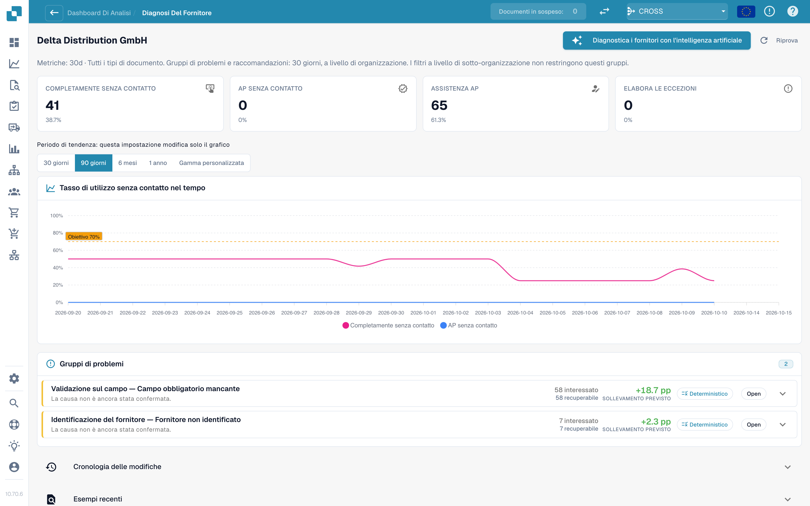
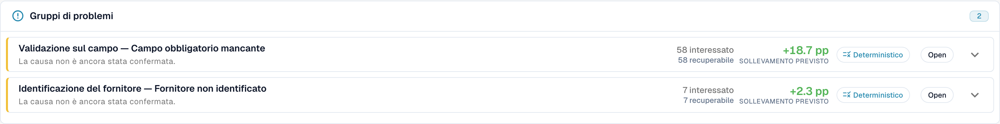

# Touchless Intelligence: Diagnosi del fornitore e cluster di problemi

Fai clic su un fornitore nella coda per aprire la sua pagina di diagnosi.

<figure><figcaption>
La pagina Diagnosi del fornitore: riquadri degli esiti, andamento con selettore del periodo e due cluster di problemi ordinati per incremento atteso. Organizzazione di esempio con dati demo; i nomi dei fornitori sono fittizi.
</figcaption></figure>

La pagina mostra:

* **Sei riquadri degli esiti** (Touchless puro, AP touchless, AP assistito, Eccezione di processo, In corso, Non idoneo), ciascuno collegato ai documenti.
* **L'andamento** con un proprio selettore del periodo: 30 giorni, 90 giorni, 6 mesi, 1 anno o un intervallo personalizzato (fino a due anni). Questo modifica solo il grafico.
* **Cluster di problemi** (vedi sotto).
* **Cronologia delle modifiche** (Change history): le modifiche che hai applicato per questo fornitore e cosa hanno ottenuto.
* **Esempi recenti** (Recent examples): documenti di esempio, in due schede: **Needed attention** (hanno richiesto attenzione) e **Went touchless** (sono passati in modalità touchless).
* **Diagnosi del fornitore con l'IA** (Diagnose supplier with AI): analizza tutti i cluster del fornitore (amministratori).

Una breve nota spiega una pagina vuota, ad esempio: *5 documents from this supplier are still being processed and have no analysis result yet.* oppure *All 40 completed documents from this supplier ran touchless: there is nothing to diagnose.*

### Cluster di problemi

Un **cluster** raggruppa i documenti di un fornitore che si sono fermati per lo **stesso primo motivo**. Invece di 40 problemi singoli vedi "3 problemi".

<figure><figcaption>
La scheda di un cluster aperto: il primo blocco, <strong>What to change</strong> (cosa cambiare) e una <strong>Change proposal</strong> (proposta di modifica) con rischio, ambito e domande aperte. Qui il cluster riguarda 58 documenti e vale +18,7 pp. Organizzazione di esempio con dati demo; i nomi dei fornitori sono fittizi.
</figcaption></figure>

**Esempio di cluster (illustrativo).**

* **Titolo**: *Required field missing* alla fase *Field Validation*
* **Interessati**: 28 documenti. **Recuperabili**: 28 documenti. **Incremento atteso**: +2,8 pp
* **Causa sospetta**: il fornitore stampa il numero d'ordine sotto la tabella, dove l'estrazione non cerca
* **Cosa cambiare**: *Master data change*: aggiungi il layout di questo fornitore. **Apri** (Open) ti porta alla pagina di impostazioni giusta
* **Responsabile**: Consulente. **Affidabilità**: Media. **Fonte**: Ipotesi

Cosa mostra la scheda di un cluster:

| Parte | Significato |
| --- | --- |
| **Primo blocco** (First blocker) e **fase** (stage) | Il motivo e la fase della pipeline in cui i documenti si fermano. I motivi sono più di 30, ad esempio *Supplier not identified*, *Purchase order not found*, *Unit price outside PO tolerance*, *Rejected by the ERP*, *E-invoice validation failed* |
| **Interessati / Recuperabili / Incremento atteso** (Affected / Recoverable / Expected lift) | Quanti documenti, quanti si possono recuperare, quanti punti percentuali si otterrebbero |
| **Causa sospetta / Causa confermata** (Suspected cause / Confirmed cause) | Cosa ritiene DocBits (o cosa ha confermato una persona) essere il motivo |
| **Prove** e **Prove mancanti** (Evidence, Missing evidence) | Su cosa si basa il risultato e cosa DocBits **non** ha potuto stabilire. Leggi le **Prove mancanti** prima di fidarti del resto |
| **Cosa cambiare** (What to change) | Passi concreti con link **Apri** (Open) alle impostazioni. Un'etichetta indica il tipo: *Configuration change*, *Master data change*, *Supplier template change*, *Process change*, *Supplier action needed*, *Not fixable* |
| **Responsabile** (Owner) | DocBits, Cliente, Consulente, Fornitore o Non assegnato |
| **Documenti di esempio** (Sample documents) | Documenti reali del cluster da guardare |

**Fixable in DocBits** (correggibile in DocBits) e **Supplier action only** (solo azione del fornitore) sono mostrati in due gruppi. Per *Supplier action only* nulla in DocBits cambia il risultato: il fornitore deve correggere il documento e inviarlo di nuovo.

### Da dove nasce una raccomandazione

Ogni causa mostra la sua **fonte**, così puoi distinguere un risultato derivato da un'ipotesi:

| Fonte | Significato |
| --- | --- |
| **Deterministic** / **Rule-based** (Deterministica / Basata su regole) | Una regola l'ha derivata dalle prove registrate nella pipeline. Non è stato coinvolto alcun modello linguistico |
| **Hypothesis** (Ipotesi) | Un modello linguistico l'ha proposta a partire dalle prove del cluster. Consideralo uno spunto e verificalo prima di agire |
| **Confirmed** (Confermata) | Una persona ha esaminato le prove e ha confermato la causa |

I testi dell'IA sono scritti nella lingua della tua organizzazione. Se un cluster è stato analizzato in un'altra lingua, usa **Analyse in this language** (Analizza in questa lingua).

## Cluster di abbinamento ordini

Se il primo blocco di un cluster è un motivo di abbinamento ordini (ad esempio *PO item mismatch* o *Purchase order not found*), la scheda del cluster mostra come DocBits cerca di abbinare la fattura all'ordine d'acquisto. Vedi [Diagnosi dell'abbinamento ordini](touchless-po-matching-diagnosis.md).

## Pagine correlate

* [Touchless Intelligence](touchless-intelligence.md)
* [Diagnosi dell'abbinamento ordini](touchless-po-matching-diagnosis.md)
* [Tracciamento del documento](touchless-document-trace.md)
* [Proposte di modifica e report](touchless-change-proposals.md)
