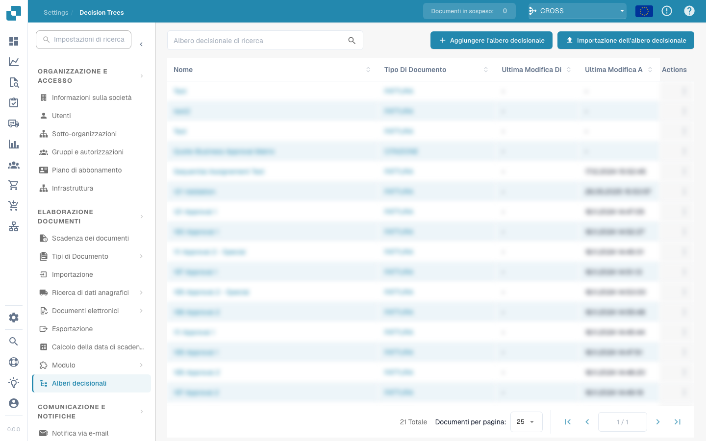

# Flusso di lavoro

<figure><figcaption></figcaption></figure>

## Motore di Workflow DocBits: Semplificazione dell'Automazione dei Processi

### Comprendere e preparare il flusso di lavoro 

Scopra il vero account di test DocBits: otto esecuzioni nella dashboard, due workflow salvati con ordine di esecuzione 100/200 e tre scenari di test superati. Il tutorial spiega anche i workflow Standard e Advanced, le licenze, i modelli e il Card SDK.



[Guarda con i sottotitoli](https://docbits-videos.fra1.cdn.digitaloceanspaces.com/settings-assistant/workflow-orientation-admin/v1/it.html) · [Apri il video](https://docbits-videos.fra1.cdn.digitaloceanspaces.com/settings-assistant/workflow-orientation-admin/v1/it.mp4) · [Sottotitoli (WebVTT)](https://docbits-videos.fra1.cdn.digitaloceanspaces.com/settings-assistant/workflow-orientation-admin/v1/it.vtt) · [Trascrizione](https://docbits-videos.fra1.cdn.digitaloceanspaces.com/settings-assistant/workflow-orientation-admin/v1/it.txt) · 3:23

Capitoli e trascrizione

| Capitolo | Inizio |
| --- | --- |
| Conoscere l’amministratore | [0:00](https://docbits-videos.fra1.cdn.digitaloceanspaces.com/settings-assistant/workflow-orientation-admin/v1/it.mp4#t=0.000) |
| Organizzazione e accesso | [0:01](https://docbits-videos.fra1.cdn.digitaloceanspaces.com/settings-assistant/workflow-orientation-admin/v1/it.mp4#t=1.875) |
| Dashboard e filtri | [0:17](https://docbits-videos.fra1.cdn.digitaloceanspaces.com/settings-assistant/workflow-orientation-admin/v1/it.mp4#t=17.000) |
| Elenco dei workflow | [0:58](https://docbits-videos.fra1.cdn.digitaloceanspaces.com/settings-assistant/workflow-orientation-admin/v1/it.mp4#t=58.958) |
| Ordine di esecuzione | [1:14](https://docbits-videos.fra1.cdn.digitaloceanspaces.com/settings-assistant/workflow-orientation-admin/v1/it.mp4#t=74.542) |
| Standard Workflow | [1:33](https://docbits-videos.fra1.cdn.digitaloceanspaces.com/settings-assistant/workflow-orientation-admin/v1/it.mp4#t=93.958) |
| Advanced Workflow | [1:47](https://docbits-videos.fra1.cdn.digitaloceanspaces.com/settings-assistant/workflow-orientation-admin/v1/it.mp4#t=107.667) |
| Licenze | [2:05](https://docbits-videos.fra1.cdn.digitaloceanspaces.com/settings-assistant/workflow-orientation-admin/v1/it.mp4#t=125.208) |
| Modelli | [2:22](https://docbits-videos.fra1.cdn.digitaloceanspaces.com/settings-assistant/workflow-orientation-admin/v1/it.mp4#t=142.417) |
| Test Manager | [2:35](https://docbits-videos.fra1.cdn.digitaloceanspaces.com/settings-assistant/workflow-orientation-admin/v1/it.mp4#t=155.417) |
| Card SDK | [2:50](https://docbits-videos.fra1.cdn.digitaloceanspaces.com/settings-assistant/workflow-orientation-admin/v1/it.mp4#t=170.292) |
| Verificare la preparazione | [3:05](https://docbits-videos.fra1.cdn.digitaloceanspaces.com/settings-assistant/workflow-orientation-admin/v1/it.mp4#t=185.792) |

**Conoscere l’amministratore**

Gestisco DocBits.

**Organizzazione e accesso**

Allora, controllo prima l’organizzazione indicata in alto. Queste impostazioni del workflow riguardano l’organizzazione selezionata. Per questa dimostrazione uso il nostro account di test della documentazione.

**Dashboard e filtri**

La dashboard dei workflow offre una visione d’insieme. Per questa panoramica ho eseguito manualmente due workflow di formazione otto volte su una fattura di esempio. Qui vedo otto esecuzioni totali e sei esecuzioni riuscite. In due esecuzioni la condizione sull’importo non era soddisfatta. Il tasso di successo comprende anche questi controlli conclusi correttamente. Filtro per nome del workflow e verifico il periodo. I contatori e il grafico seguono la selezione. A destra passo dai workflow salvati agli scenari di test. Le esecuzioni del Test Manager vengono contate separatamente.

**Elenco dei workflow**

Nell’elenco gestisco i singoli workflow. Controllo nome, tipo Standard o Advanced, ordine di esecuzione, evento iniziale e azioni disponibili. Cerco un workflow esistente prima di crearne un altro.

**Ordine di esecuzione**

L’ordine di esecuzione conta quando più workflow elaborano lo stesso documento. Controllo quale deve partire prima e quali dati servono al successivo. Qui il controllo della fattura ha ordine cento e il controllo successivo duecento. I valori più bassi vengono eseguiti prima.

**Standard Workflow**

Per una regola lineare scelgo Standard Workflow. Quando definisce l’evento iniziale, E aggiunge condizioni, quindi Allora esegue le azioni. La libreria contiene le schede disponibili.

**Advanced Workflow**

Per percorsi alternativi uso Advanced Workflow. Questa anteprima mostra Start e collegamenti espliciti. Successo, condizione non soddisfatta ed errore possono seguire percorsi diversi. La posizione delle schede non definisce l’ordine.

**Licenze**

In Licenza controllo separatamente Workflow e Advanced Workflow. Qui entrambi sono inattivi. La finestra mostra gli abbonamenti disponibili. Chiudo questa consultazione senza modifiche. Aprire il designer non attiva il motore.

**Modelli**

I modelli permettono di riutilizzare un punto di partenza. Apro la libreria e l’opzione dei modelli predefiniti. Controllo comunque campi, destinatari e azioni per il mio processo.

**Test Manager**

Test Manager conserva scenari di prova per workflow Standard e Advanced. Dopo la configurazione aggiungo dati rappresentativi e risultati attesi. Esegui tutti i test permette di verificare le modifiche.

**Card SDK**

Card SDK serve per estensioni personalizzate. Gli sviluppatori possono usare un modello, caricare un pacchetto o importare da GitHub. Per l’amministrazione ordinaria inizio dalla libreria di schede esistente.

**Verificare la preparazione**

Prima di costruire confermo organizzazione, accesso, licenza necessaria, campi del documento e risultato desiderato. Decido se basta una regola lineare. Nel prossimo video creiamo uno Standard Workflow passo dopo passo.

### Introduzione

Nel campo dell'automazione dei processi, il Motore di Workflow DocBits si distingue per il suo approccio semplice e intuitivo. Questo motore semplifica la creazione e la gestione dei flussi di lavoro attraverso una struttura chiara e semplice basata su regole. Il principio fondamentale alla base del suo design è la regola "Easy When-And-Then" (Facile Quando-E-Allora), che scompone il processo di automazione in tre componenti fondamentali: Trigger, Condizione e Azione. Questa guida spiega come funziona ciascun componente all'interno del sistema e come lavorano insieme per facilitare un'automazione senza soluzione di continuità.

### La Regola "Easy When-And-Then" Spiegata

Il Motore di Workflow DocBits opera su un principio di base ma potente che rende l'automazione dei flussi di lavoro accessibile agli utenti di tutti i livelli di competenza. Questo principio è racchiuso nella regola "Easy When-And-Then", che può essere suddivisa come segue:

#### [When](./#when-trigger) (Trigger)

* **Definizione**: Il componente "When" (Quando) rappresenta il _Trigger_ del flusso di lavoro. Questo è l'evento o la condizione che avvia l'esecuzione del flusso di lavoro. I trigger possono essere una varietà di occorrenze come l'arrivo di una nuova email, una data e un'ora specifiche o la creazione di un nuovo documento.
* **Esempio**: "Quando viene inviato un nuovo modulo cliente..."

#### [And](./#and-condizione) (Condizione)

* **Definizione**: Il componente "And" (E) introduce la _Condizione_ che deve essere soddisfatta affinché l'azione proceda. Le condizioni servono come filtri o criteri che affinano il trigger, garantendo che il flusso di lavoro venga eseguito solo in determinate circostanze.
* **Esempio**: "...e il cliente proviene dal segmento 'Enterprise'..."

#### [Then](./#then-azione) (Azione)

* **Definizione**: Infine, la parte "Then" (Allora) specifica l'_Azione_ da intraprendere una volta che si verifica il trigger e la condizione è soddisfatta. Le azioni sono i compiti o le operazioni eseguiti dal flusso di lavoro, come l'invio di un'email, l'aggiornamento di un database o la creazione di un'attività in uno strumento di gestione dei progetti.
* **Esempio**: "...allora assegna il lead al team di vendita enterprise e invia un'email di benvenuto."

### Combinazione di Componenti per Automazioni Potenti

Assemblando questi tre componenti—Trigger, Condizione e Azione—il Motore di Workflow DocBits consente agli utenti di creare flussi di lavoro altamente personalizzati ed efficienti. Questo approccio modulare non solo semplifica il processo di configurazione delle automazioni, ma offre anche la flessibilità di creare flussi di lavoro complessi in grado di gestire un'ampia gamma di attività e processi.

### Conclusione

La regola "Easy When-And-Then" del Motore di Workflow DocBits esemplifica l'impegno del motore nel fornire una piattaforma user-friendly per l'automazione dei processi. Questa regola semplice, scomponendo l'automazione negli elementi essenziali di Trigger, Condizione e Azione, rende più facile per gli utenti concettualizzare, creare e gestire i flussi di lavoro. Che tu sia nuovo nell'automazione dei flussi di lavoro o un professionista esperto, il Motore di Workflow DocBits offre uno strumento efficiente e accessibile per migliorare la produttività e semplificare le operazioni.

## Percorso dal principiante all’esperto

[Percorso dal principiante all’esperto](workflow-learning-path.md). Seguire i livelli nell’ordine. Leggere non basta: ogni livello termina con una configurazione propria, un’aspettativa verificabile e una prova. P0 evita errori fondamentali di esecuzione; P1 approfondisce dati, decisioni aziendali e integrazioni.
