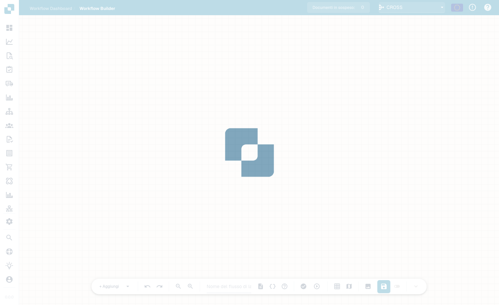

# Advanced Workflow

Il builder **Advanced Workflow** è un editor a grafo di nodi per i workflow che necessitano di ramificazioni, percorsi paralleli e controllo del flusso — oltre il modello lineare When/And/Then del builder Standard. Disponi i nodi su un canvas e li colleghi per definire il flusso di esecuzione.

## Video: percorsi delle fatture in DocBits

Conosci Roberto e segui la sua spiegazione nell’interfaccia reale di DocBits in italiano. Controlla la dashboard, l’elenco dei workflow e la licenza, poi apre una bozza non salvata nel designer. Passo dopo passo assegna un nome al workflow, configura il controllo dell’importo e due azioni, dispone le schede e collega entrambi i percorsi. Mostra poi come preparare i test con un documento o dati personalizzati. L’account dimostrativo non dispone di un abbonamento Advanced Workflow e blocca la validazione; la bozza rimane non salvata e inattiva.



[Apri video](https://docbits-videos.fra1.cdn.digitaloceanspaces.com/settings-assistant/advanced_workflows_canvas-admin/v8/it.mp4) · [Sottotitoli (WebVTT)](https://docbits-videos.fra1.cdn.digitaloceanspaces.com/settings-assistant/advanced_workflows_canvas-admin/v8/it.vtt) · [Trascrizione (testo)](https://docbits-videos.fra1.cdn.digitaloceanspaces.com/settings-assistant/advanced_workflows_canvas-admin/v8/it.txt) · 3:35

| In questo video | Inizio |
| --- | --- |
| Presentazione dell’amministratore | [0:00](https://docbits-videos.fra1.cdn.digitaloceanspaces.com/settings-assistant/advanced_workflows_canvas-admin/v8/it.mp4#t=0) |
| Controllare l’accesso | [0:04](https://docbits-videos.fra1.cdn.digitaloceanspaces.com/settings-assistant/advanced_workflows_canvas-admin/v8/it.mp4#t=4) |
| Dare un nome al workflow | [0:30](https://docbits-videos.fra1.cdn.digitaloceanspaces.com/settings-assistant/advanced_workflows_canvas-admin/v8/it.mp4#t=30) |
| Configurare il controllo importo | [0:46](https://docbits-videos.fra1.cdn.digitaloceanspaces.com/settings-assistant/advanced_workflows_canvas-admin/v8/it.mp4#t=46) |
| Aggiungere l’azione Approval | [1:13](https://docbits-videos.fra1.cdn.digitaloceanspaces.com/settings-assistant/advanced_workflows_canvas-admin/v8/it.mp4#t=73) |
| Aggiungere l’azione Standard | [1:34](https://docbits-videos.fra1.cdn.digitaloceanspaces.com/settings-assistant/advanced_workflows_canvas-admin/v8/it.mp4#t=94) |
| Disporre le schede | [1:56](https://docbits-videos.fra1.cdn.digitaloceanspaces.com/settings-assistant/advanced_workflows_canvas-admin/v8/it.mp4#t=116) |
| Collegare i percorsi | [2:12](https://docbits-videos.fra1.cdn.digitaloceanspaces.com/settings-assistant/advanced_workflows_canvas-admin/v8/it.mp4#t=132) |
| Preparare i test | [2:38](https://docbits-videos.fra1.cdn.digitaloceanspaces.com/settings-assistant/advanced_workflows_canvas-admin/v8/it.mp4#t=158) |
| Validare, salvare e attivare | [3:05](https://docbits-videos.fra1.cdn.digitaloceanspaces.com/settings-assistant/advanced_workflows_canvas-admin/v8/it.mp4#t=185) |

Trascrizione

**Presentazione dell’amministratore**

Gestisco DocBits. Creiamo un controllo delle fatture.

**Controllare l’accesso**

Parto dalla dashboard dei workflow e apro l’elenco. Poi controllo la licenza. Workflow e Advanced Workflow richiedono entrambi un accesso attivo. Con entrambi abilitati, Nuovo workflow offre Advanced Workflow. Questo account di documentazione non ha una licenza workflow attiva. Proseguo quindi con un’anteprima non salvata nel designer.

**Dare un nome al workflow**

Lavoro nel vero designer di DocBits. Per prima cosa assegno un nome chiaro alla bozza. Controlleremo l’importo di una fattura e useremo due semplici azioni per mostrare i percorsi possibili. Questa dimostrazione resta non salvata.

**Configurare il controllo importo**

Apro il menu per aggiungere e scelgo una scheda di condizione. Nella categoria Campo documento seleziono la condizione Docfield. Inserisco il campo total_amount. Poi scelgo il confronto maggiore di. E inserisco mille. Usate la chiave del vostro campo documento. Un importo esattamente uguale a mille non soddisfa questo confronto.

**Aggiungere l’azione Approval**

Ora aggiungo una scheda azione dalla categoria Campo documento. L’azione imposta un campo del documento. Uso la chiave dimostrativa approval_route. E inserisco il valore Approval. Questo identifica il percorso. Un processo di approvazione reale richiede le proprie azioni aziendali.

**Aggiungere l’azione Standard**

Aggiungo una seconda scheda con la stessa azione. L’azione imposta un campo del documento. Uso la chiave dimostrativa approval_route. Questa volta il campo dimostrativo riceve il valore Standard. Entrambe le schede sono configurate. Servono ancora le connessioni per stabilire quale azione verrà eseguita.

**Disporre le schede**

Trascino le schede per ottenere una disposizione leggibile. Le due azioni vanno a destra. La condizione sta al centro e Start a sinistra. Spostare una scheda cambia la posizione. Non crea una connessione.

**Collegare i percorsi**

Trascino dall’uscita di Start all’ingresso della condizione. Il percorso di successo arriva ad Approval con una connessione blu. Il percorso arancione per la condizione non soddisfatta arriva a Standard. L’uscita rossa di errore è distinta e serve per gli errori di valutazione. Qui resta scollegata. In un workflow di produzione, decidete come gestire questi errori.

**Preparare i test**

Il pulsante di test nella barra apre la selezione del documento di prova. Posso scegliere un documento dimostrativo oppure preparare dati personalizzati completi. Provate importi superiori, inferiori e uguali a mille. Verificate anche un importo mancante. Questo account non ha una licenza Advanced Workflow. Mostro la preparazione del test, non un risultato eseguito.

**Validare, salvare e attivare**

La validazione controlla connessioni e impostazioni delle schede. Qui la licenza mancante impedisce la validazione. Con un account abilitato salverei esplicitamente sul server. Poi controllerei separatamente l’attivazione. Prima del primo salvataggio l’interruttore è disabilitato. L’indicatore della bozza automatica riguarda una copia locale nel browser. Non significa che il workflow sia salvato o attivato.

## Come accedere

Apri il designer Advanced Workflow dall'area dei workflow (il canvas del builder avanzato). Parti da un nodo **Start** e costruisci il flusso aggiungendo nodi.

<figure><figcaption>
Il canvas Advanced Workflow — un grafo di nodi con controlli di zoom, esecuzione, griglia e salvataggio. Assegna un nome al workflow nella barra degli strumenti.
</figcaption></figure>

## Aggiungere nodi

Clicca su **+ Add** per aprire il menu dei nodi. Oltre alle familiari schede **When**, **And** e **Then**, il builder avanzato aggiunge nodi di controllo del flusso:

<figure><figcaption>
Il menu dei nodi <strong>+ Add</strong>: When / And / Then più Wait ALL, Wait ANY, OR e Note.
</figcaption></figure>

- **When / And / Then** — le stesse schede di condizione e azione del builder Standard.
- **Wait ALL** — attende che *tutte* le ramificazioni in ingresso siano completate prima di continuare.
- **Wait ANY** — continua non appena *una qualsiasi* ramificazione in ingresso è completata.
- **OR** — dirama il flusso lungo percorsi alternativi.
- **Note** — un'annotazione di testo libero sul canvas (non influisce sull'esecuzione).

Esegui il flusso con il controllo di riproduzione, validalo e salvalo con il pulsante di salvataggio nella barra degli strumenti.

## Prossimi passi

- Scopri cosa fa ogni scheda nella sezione **Cards**.
- Per automazioni lineari semplici, il builder **Standard Workflow** è più rapido da configurare.

[Guarda i cinque capitoli](advanced-workflow-videos.md)
