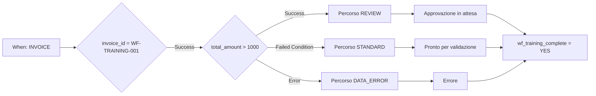

# Caso Advanced: instradamento delle fatture

Una fattura di formazione superiore a 1000 EUR richiede revisione. Fino a 1000 EUR inclusi segue il percorso standard. Un importo assente o numericamente non valido segue la correzione dei dati. Tutti e tre i percorsi raggiungono un’azione finale comune.

## Prerequisiti e struttura

Usare un’organizzazione di test con Advanced attivo e il [pacchetto di formazione](workflow-training-kit.md). Importare `advanced-workflow.json` tramite **Import Workflow**, lasciarlo disattivato e aprire il grafico. When controlla Fattura; la prima scheda And limita l’esercizio a `invoice_id = WF-TRAINING-001`. Non sono configurati destinatari o esportazioni.

Il controllo iniziale usa `invoice_id`, `eq` e `WF-TRAINING-001`; un numero diverso salta tutte le azioni successive. Il controllo dell’importo usa **Docfield is**, versione 2, con `total_amount`, `gt`, `1000`. Le azioni di testo scrivono `wf_training_route`. Le schede di stato usano la versione 3 e **Trigger Workflows = false**.

**v2:** La scheda di stato del percorso scelto si collega direttamente alla Then comune `complete`, che scrive `wf_training_complete = YES`. Qui non attende un nodo OR. V1 provava solo il test: con predecessori non raggiunti lo scheduler può saltare un’unione che il test valuta comunque. La [guida P0](masterclass/control-nodes.md) spiega la differenza. Una Then comune diretta non è una barriera per più azioni obbligatorie simultanee.

## Costruire e verificare

1. Validare l’intero grafico.
2. Preparare i file per la propria organizzazione seguendo il pacchetto.
3. Aprire **Test → Custom Data** e usare il file completo per ogni caso. Un oggetto con il solo `total_amount` non è sufficiente.
4. Eseguire dall’ingresso completo. Controllare uscita di `amount`, percorso raggiunto, messaggio di stato e `complete`.
5. Confrontare con le aspettative indipendenti. Le risposte salvate mostrano i risultati realmente osservati.

| Caso | Importo | Uscita di amount | Percorso / stato | Risultato globale |
| --- | --- | --- | --- | --- |
| above | 1785,00 | Success | REVIEW / validated_pending_approval | success |
| below | 999,00 | Failed Condition | STANDARD / ready_for_validation | success |
| boundary | 1000,00 | Failed Condition | STANDARD / ready_for_validation | success |
| just-above | 1000,01 | Success | REVIEW / validated_pending_approval | success |
| missing | assente | Error | DATA_ERROR / error | error |
| invalid-number | invalid | Error | DATA_ERROR / error | error |
| other-invoice | 1785,00 | non eseguito | numero diverso; nessuna azione | failed_condition |

Nel caso di errore, `data_error` e `complete` possono riuscire mentre il risultato globale rimane **error**. La gestione dell’errore non elimina la valutazione originariamente fallita.

## Estendere il processo aziendale

I test sono stati eseguiti il 21 ottobre 2026 sul servizio Dev distribuito DocFlow **2.10.38**. Il pacchetto contiene risposte reali di test; modifiche a campi e stati erano simulate. Non contiene Workflow Logs documentali persistiti e non dimostra approvazione personale o consegna reale dell’esportazione.

Sostituire i marcatori con assegnazioni e azioni di approvazione configurate. Collegare l’esportazione solo a una condizione di approvazione esplicitamente controllata. Confermare un’esecuzione reale sul documento e la ricezione presso il destinatario, usando un documento proprio di formazione e una destinazione di test prevista. Consultare la [diagnosi](workflow-troubleshooting.md).

## WF-02: Esercizio e collaudo

Eseguire i sette casi e registrare uscita amount, percorso, stato, complete e risultato totale. Collaudare test ed esecuzione reale separatamente. Un errore gestito non diventa un’esecuzione senza errori perché complete riesce.

[Percorso](workflow-learning-path.md)
