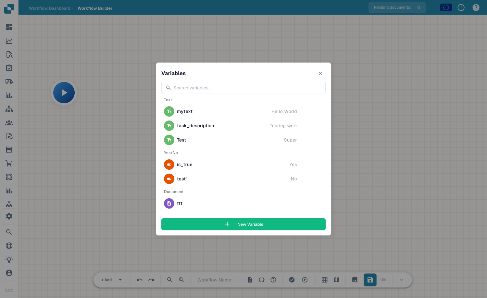

# Variabili

## Video: Variabili, test e attivazione



[Apri video](https://docbits-videos.fra1.cdn.digitaloceanspaces.com/settings-assistant/advanced_workflows_testing/v3/it.mp4) · [Sottotitoli (WebVTT)](https://docbits-videos.fra1.cdn.digitaloceanspaces.com/settings-assistant/advanced_workflows_testing/v3/it.vtt) · 1:56

Trascrizione

**Scegli il tipo**

Apri Variabili con le parentesi graffe. Scegli testo, numero, sì o no, oppure documento. Cerca i nomi. Document contiene un riferimento impostato da un’azione dedicata; il modulo non accetta valori di documento.

**Variabili dell’organizzazione**

Scegli nome univoco, tipo e valore iniziale. Creazione, modifica ed eliminazione vengono salvate immediatamente nell’organizzazione. Altri workflow condividono questi valori. Salvare o scartare il canvas non annulla le modifiche alle variabili.

**Convalida la struttura**

Premi Convalida. Esamina errori e avvisi sopra il canvas. Un messaggio individua il nodo. Verifica azioni, ingressi, uscite, cicli e giunzioni. Una struttura valida non garantisce dati corretti.

**Scegli il contesto**

La riproduzione nella barra apre la scelta del documento. Scegli documento, dati personalizzati o test senza documento per schede indipendenti. Start avvia direttamente. I test includono modifiche non salvate e simulano azioni distruttive.

**Preparare e verificare gli scenari di test**

Prepara test separati sopra, sotto ed esattamente a mille, oltre ai dati mancanti. Dopo l’esecuzione, controlla messaggi e durate: verde indica successo, arancione falso, rosso errore e grigio saltato. Ripeti i test dopo le correzioni. Usa il gestore test per scenari ripetibili.

**Salva prima di attivare**

Il salvataggio automatico conserva una bozza locale circa ogni trenta secondi dopo modifiche. Salva esplicitamente sul server. Attiva dopo il primo salvataggio. Verifica lo stato nell’elenco prima di attendere esecuzioni automatiche.

[Guarda i cinque capitoli](../advanced-workflow-videos.md)

Le **Variables** ti permettono di memorizzare i valori una sola volta e di riutilizzarli tra i nodi di un Advanced Workflow — per esempio una soglia, un destinatario fisso o un valore letto dal documento e passato a un nodo successivo. Apri il pannello delle variabili dal pulsante **variables** (l'icona `{ }`) nella barra degli strumenti.

<figure><figcaption>
Il pannello Variables — variabili raggruppate per tipo, con ricerca e <strong>New Variable</strong>.
</figcaption></figure>

## Tipi di variabile

Le variabili sono raggruppate per tipo:

- **Text** — un valore stringa (es. una descrizione o un'etichetta fissa).
- **Yes/No** — un flag booleano (Yes / No).
- **Document** — un riferimento a un documento o a un campo del documento.

Usa la casella di ricerca per trovare rapidamente una variabile quando l'elenco si allunga.

## Creare una variabile

Fai clic su **New Variable**, assegnale un nome e un tipo e imposta il suo valore. La variabile diventa quindi disponibile per essere referenziata dalle schede sui tuoi nodi, così puoi mantenere la configurazione in un unico posto e modificarla senza dover modificare ogni nodo.

## Passi successivi

- Scopri come i nodi usano questi valori in [Nodi](nodes.md).
- Valida ed esegui il workflow in [Validazione e test](validation-and-testing.md).
