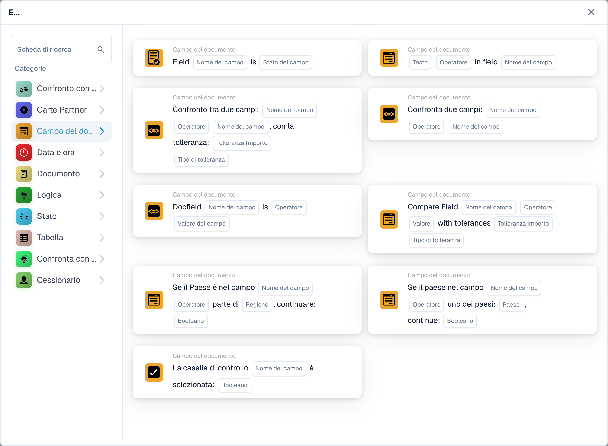
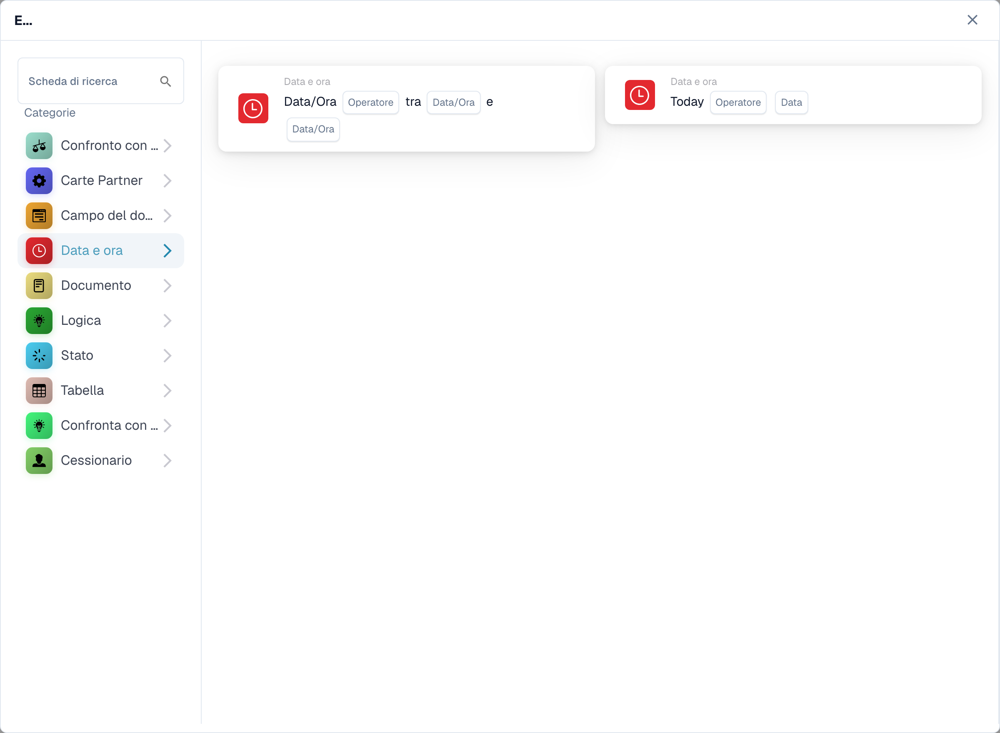
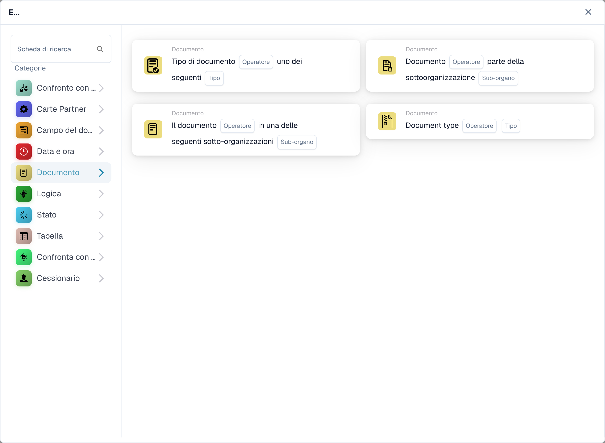
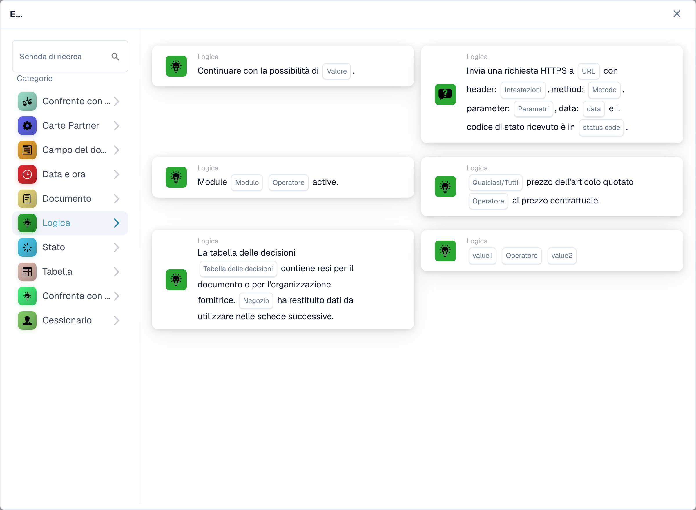
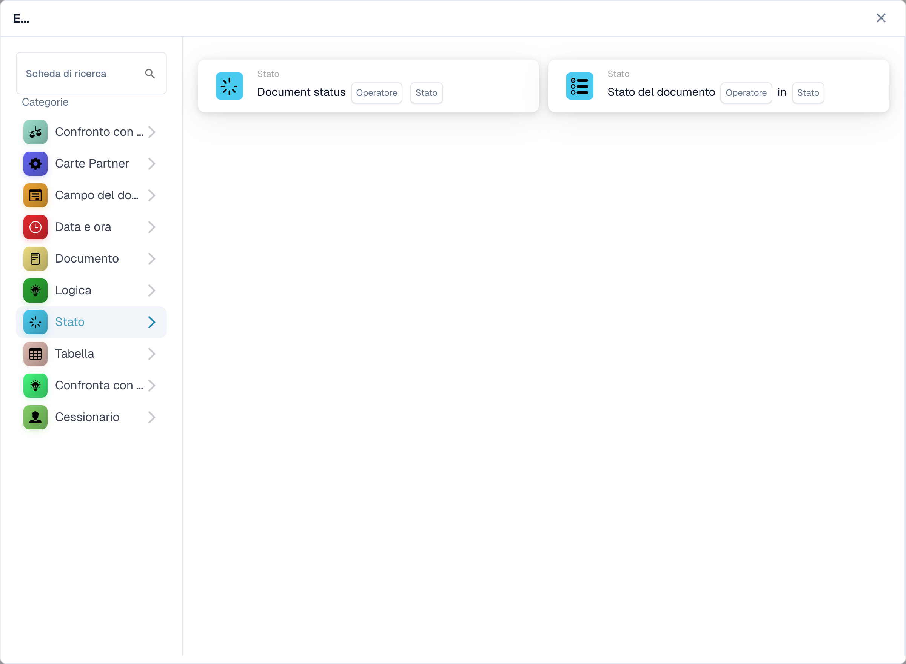
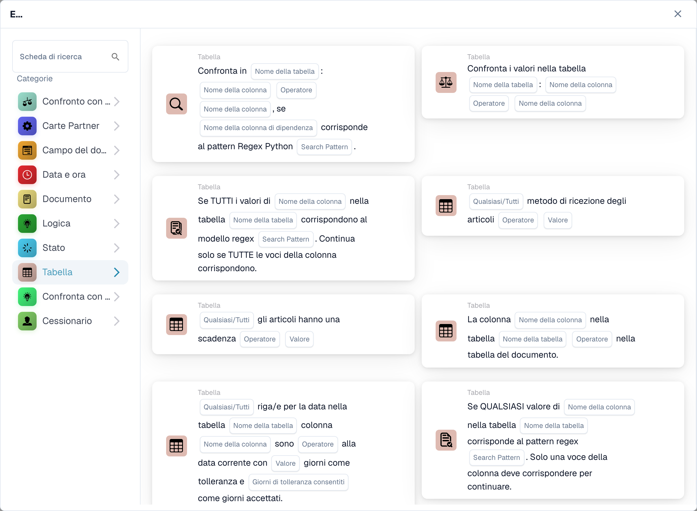
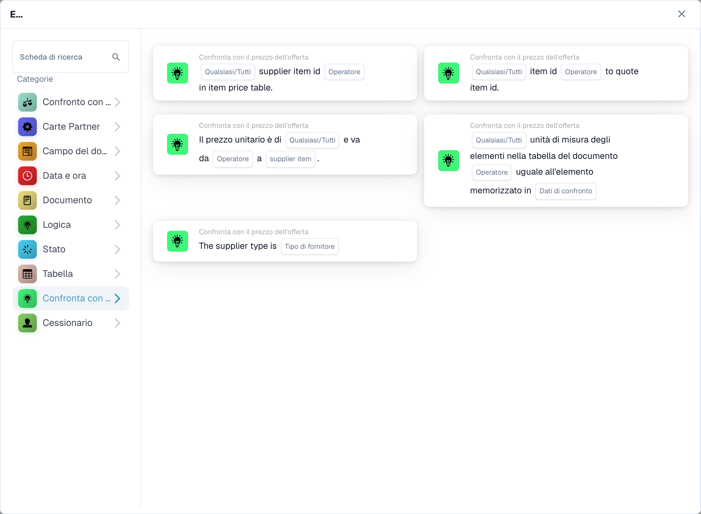
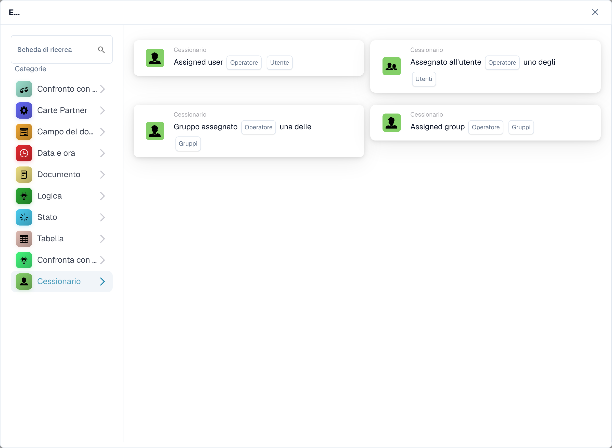

# E

Utilizza una carta **E** per decidere se un flusso di lavoro deve continuare dopo l'attivazione **Quando**. Aggiungi i controlli necessari prima dell'azione **Allora**. Ogni scheda mostra i campi da compilare, come **Operatore**, **Nome campo** o **Valore**; gli screenshot mostrano i modelli di carte disponibili, non le regole completate.

Nel **Costruttore di flussi di lavoro**, seleziona **Aggiungi carta** sotto **E...**. Scegli una categoria a sinistra o digita il nome di una carta in **Cerca carta**. Seleziona l'anteprima di una carta per aggiungerla al flusso di lavoro. Puoi scorrere l'elenco di anteprima per vedere più carte. Usa **×** per chiudere il selettore senza scegliere un'altra carta. Dopo aver configurato le carte, salva il flusso di lavoro. Vedi [Flusso di lavoro](..) per i passaggi circostanti **Quando**, **E** e **Allora**.

## Confronta con Ordine d'Acquisto

Utilizzare queste schede per confrontare i dati dell'ordine o della fattura con un ordine di acquisto, ad esempio il prezzo unitario, la data di consegna promessa, le spese o la quantità. Scegli i campi, l'operatore e l'eventuale tolleranza richiesta dalla carta selezionata. Vedi [Confronta con ordine d'acquisto](compare-with-purchase-order) per le singole carte.

<figure><figcaption>
Condizioni di confronto con gli ordini di acquisto. Alcuni testi delle schede restano in inglese o presentano traduzioni inesatte nel prodotto.
</figcaption></figure>

## Campo documento

Scegli questa categoria per selezionare una casella di controllo o lo stato di un campo, confrontare un campo con un valore o confrontare due campi. Compila i segnaposto **Nome del campo** e **Operatore** sulla scheda scelta. Alcuni confronti richiedono anche una tolleranza. Vedi [Campo documento](document-field).

<figure><figcaption>
Condizioni sui campi del documento. Alcuni testi delle schede restano in inglese o presentano traduzioni inesatte nel prodotto.
</figcaption></figure>

## Data e ora

Utilizza **Data e ora** per confrontare una data o un'ora con un intervallo o confronta **Oggi** con una data scelta. Seleziona **Operatore** e i valori della data nella scheda. Vedi [Data e ora](date-and-time).

<figure><figcaption>
Condizioni di data e ora. Alcuni testi delle schede restano in inglese o presentano traduzioni inesatte nel prodotto.
</figcaption></figure>

## Documento

Utilizza queste schede quando un flusso di lavoro deve dipendere dal **tipo di documento** o **sub-organizzazione**. Scegli il tipo o l'organizzazione nominata nella carta. Vedi [Documento](document).

<figure><figcaption>
Condizioni sui documenti. Alcuni testi delle schede restano in inglese o presentano traduzioni inesatte nel prodotto.
</figcaption></figure>

## Logica

Questa categoria include i controlli utilizzando una tabella decisionale, una risposta HTTPS, la disponibilità del modulo, il prezzo di un articolo quotato, un valore casuale o due valori. Apri la scheda specifica e inserisci i segnaposto nominati; ad esempio, la scheda HTTPS richiede un URL, un metodo e un codice di stato accettato. Vedi [Logica](logic).

<figure><figcaption>
Condizioni logiche. Alcuni testi delle schede restano in inglese o presentano traduzioni inesatte nel prodotto.
</figcaption></figure>

## Stato

Usa **Stato** per verificare se un documento ha uno stato scelto o se il suo stato è in un set selezionato. Scegli **Operatore** e **Stato** nella scheda. Vedi [Stato](status).

<figure><figcaption>
Condizioni sullo stato. Alcuni testi delle schede restano in inglese o presentano traduzioni inesatte nel prodotto.
</figcaption></figure>

## Tabella

Queste schede esaminano le righe della tabella dei documenti. Le opzioni visibili includono controlli della data, modelli di testo, durata di conservazione e confronti tra colonne. Seleziona **Nome tabella** e **Nome colonna** prima di scegliere un operatore o un modello. Vedi [Tabella](table).

<figure><figcaption>
Condizioni sulle tabelle di dati. Alcuni testi delle schede restano in inglese o presentano traduzioni inesatte nel prodotto.
</figcaption></figure>

## Confronta con il prezzo preventivo

Utilizza queste schede per confrontare un articolo con i dati del prezzo quotato. Le scelte visibili riguardano ID articolo, tipo fornitore, ID articolo fornitore, prezzo unitario e unità di misura. Il **Operatore** e i segnaposto dei dati dipendono dalla carta selezionata.

<figure><figcaption>
Condizioni sui prezzi dei preventivi. Alcuni testi delle schede restano in inglese o presentano traduzioni inesatte nel prodotto.
</figcaption></figure>

## Assegnatario

Utilizzare **Assegnatario** quando la condizione dipende dall'utente o dal gruppo assegnato. Scegli se confrontare con un utente o un gruppo o un set selezionato. Vedi [Assegnatario](assignee).

<figure><figcaption>
Condizioni sulle assegnazioni. La categoria Cessionario riguarda l’assegnazione a utenti e gruppi; alcune schede restano in inglese. Alcuni testi delle schede restano in inglese o presentano traduzioni inesatte nel prodotto.
</figcaption></figure>

[Schede di confronto dettagliate delle citazioni e comportamento Qualsiasi/Tutto](../cards-overview/quote-comparison-guide.md).

Alcune etichette del prodotto restano in inglese o presentano traduzioni inesatte. Le tabelle sono tabelle di dati; i valori restituiti non sono rendimenti finanziari. Gli identificatori tecnici restano invariati.
