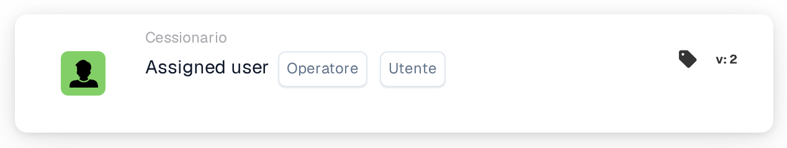

# Condizione utente singolo assegnato

<figure><figcaption>
Versione 2
</figcaption></figure>

**Scopo**

Questa scheda di workflow facilita le operazioni basate sull'assegnazione di un'attività o di un documento a un singolo utente specifico. Utilizzando un approccio di logica condizionale diretta, gestisce i workflow che richiedono un coinvolgimento mirato dell'utente, garantendo precisione nella gestione delle attività basata sull'utente.

**Componenti della scheda**

1. **Operatore**
   * **Descrizione**: Specifica la logica da applicare all'assegnazione dell'utente.
   * **Opzioni**:
     * **IS**: Attiva l'operazione se l'utente assegnato del documento o dell'attività corrisponde all'utente specificato.
     * **NON LO È**: Attiva l'operazione se l'utente assegnato non corrisponde all'utente specificato.
2. **Utente**
   * **Descrizione**: Consente la selezione di un singolo utente con cui confrontare l'utente assegnato.
   * **Dettaglio**: Si tratta di un semplice menu a discesa o campo con completamento automatico in cui è possibile selezionare un utente alla volta.

**Funzionalità**

* **Identificazione dell'assegnazione dell'utente**: Identifica l'utente attualmente assegnato a una determinata attività o documento.
* **Valutazione della condizione**:
  * Per l'operatore **IS**, la scheda verifica se l'utente assegnato è lo stesso utente selezionato.
  * Per l'operatore **NON LO È**, verifica che l'utente assegnato sia diverso dall'utente selezionato.
* **Esecuzione dell'azione**:
  * **Condizione vera**: Se l'assegnazione soddisfa la condizione impostata (IS o IS NOT), attiva azioni predefinite, che potrebbero includere il proseguimento con approvazioni, l'avvio di ulteriori attività, l'invio di notifiche o altri workflow correlati.
  * **Condizione falsa**: Se la condizione non è soddisfatta, il workflow non proseguirà.

**Interazioni dell'utente**

* **Configurazione e impostazione**: Gli utenti configurano la scheda scegliendo un operatore e selezionando un utente dal campo utente. Questa configurazione dovrebbe essere semplice, garantendo una selezione e configurazione facili dell'utente.
* **Monitoraggio e reporting**: Offre strumenti per monitorare le prestazioni della scheda, come il tracciamento di quali attività vengono attivate da specifiche assegnazioni di utenti e gli esiti di tali attivazioni.
* **Gestione degli errori e notifiche**: Fornisce meccanismi per avvisare gli utenti se le attività vengono assegnate in modo errato o se si verificano errori operativi dovuti a problemi di assegnazione.

#### Conclusione

La scheda di workflow "Single Assigned User Condition" è essenziale per una gestione precisa di documenti e attività specifica per utente all'interno di un sistema ERP. Semplifica i workflow concentrandosi sulle assegnazioni dei singoli utenti, garantendo così che le azioni vengano eseguite solo quando appropriato, in base al ruolo e alle responsabilità dell'utente. Documentare chiaramente questa scheda aiuterà gli utenti a comprenderne l'applicazione, consentendo loro di implementarla e gestirla efficacemente nelle operazioni quotidiane. Questa documentazione garantisce che tutti i potenziali utenti possano cogliere facilmente lo scopo della scheda e integrarla senza problemi nei loro workflow.

<!-- workflow-card-practical-example-20261021 -->

## Esempio pratico

**Quando utilizzarlo:** Gestisci la coda di un particolare revisore.

**Configurazione:** Seleziona l'operatore uguale e `Demo Reviewer A`.

**Risultato atteso e controesempio:** Passa un documento assegnato a quell'utente; un altro utente assegnato fallisce.

Questa è una configurazione illustrativa e il risultato atteso. Utilizza campi, utenti e gruppi configurati nella tua organizzazione di test; non si afferma che questo esempio sia stato eseguito.
